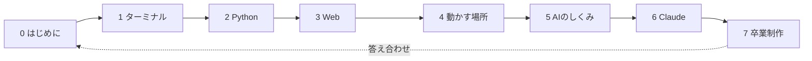

# カリキュラム / Curriculum

ゴール：**AIに任せるが、何を任せたかは分かっている人になる。**
構文を覚えるコースではありません。AIを使うときに裏で何が起きているかが分かれば合格です。

レッスンの種類：
- **作る** … 手を動かして、自分の書いたものが動く
- **覗く** … すでに動いている本物を観察する

1レッスン 15〜45分。全レッスンの最後に「AIとの関係」があります。
コマンドや略語の元の英語は [COMMANDS.md](COMMANDS.md)。

## 第0部 はじめに

| # | レッスン | 種類 | 所要 |
|---|---|---|---|
| 0-1 | [Claude が5分でアプリを作る：裏で何が起きた？](lessons/00-intro/01-wow/) | 覗く | 30分 |
| 0-2 | [画面の見方と権限ダイアログ](lessons/00-intro/02-the-app/) | 覗く | 15分 |
| 0-3 | [名前と番号：IPアドレスと DNS](lessons/00-intro/03-names-and-numbers/) | 覗く | 25分 |

## 第1部 ターミナルとファイル

| # | レッスン | 種類 | 所要 |
|---|---|---|---|
| 1-1 | [いまどこ？ pwd・ls・cd](lessons/01-terminal/01-where-am-i/) | 作る | 20分 |
| 1-2 | [ファイルはただの文字 mkdir・echo・cat](lessons/01-terminal/02-files-are-text/) | 作る | 20分 |
| 1-3 | [vi は5つだけ](lessons/01-terminal/03-vi/) | 作る | 20分 |
| 1-4 | [シェルスクリプトと実行権限 chmod](lessons/01-terminal/04-shell-script/) | 作る | 25分 |
| 1-5 | [Python で Hello World](lessons/01-terminal/05-python-hello/) | 作る | 20分 |
| 1-6 | [エラーとログ tail -f・grep](lessons/01-terminal/06-errors-and-logs/) | 作る | 25分 |
| 1-7 | [git と GitHub](lessons/01-terminal/07-git/) | 作る | 30分 |

## 第2部 Python を実験台に

| # | レッスン | 種類 | 所要 |
|---|---|---|---|
| 2-1 | [uv で Python の環境を作る](lessons/02-python/01-uv/) | 作る | 20分 |
| 2-2 | [変数・if・ループ](lessons/02-python/02-variables-if-loop/) | 作る | 25分 |
| 2-3 | [リストと辞書 ＝ JSON の形](lessons/02-python/03-list-dict-json/) | 作る | 25分 |
| 2-4 | [関数](lessons/02-python/04-functions/) | 作る | 20分 |
| 2-5 | [ファイルを読み書き](lessons/02-python/05-files/) | 作る | 25分 |
| 2-6 | [100万件で探す：線形探索 vs 二分探索](lessons/02-python/06-binary-search/) | 作る | 30分 |
| 2-7 | [Claude に書かせたコードを読んで説明する](lessons/02-python/07-read-claude-code/) | 覗く | 25分 |

## 第3部 Web

| # | レッスン | 種類 | 所要 |
|---|---|---|---|
| 3-1 | [DevTools で天気サイトの裏側を覗く](lessons/03-web/01-devtools-weather/) | 覗く | 25分 |
| 3-2 | [DevTools でショッピングサイトの裏側を覗く](lessons/03-web/02-devtools-shopping/) | 覗く | 25分 |
| 3-3 | [curl で API を直接叩く](lessons/03-web/03-curl/) | 作る | 20分 |
| 3-4 | [HTML と CSS：ページの骨と服](lessons/03-web/04-html-css/) | 作る | 25分 |
| 3-5 | [JavaScript：ページを動かす](lessons/03-web/05-javascript/) | 作る | 25分 |
| 3-6 | [Webサーバーを立てる](lessons/03-web/06-web-server/) | 作る | 20分 |
| 3-7 | [Python で API を叩く](lessons/03-web/07-python-api-client/) | 作る | 25分 |
| 3-8 | [FastAPI で自分の API を作る](lessons/03-web/08-fastapi/) | 作る | 30分 |

## 第4部 動かす場所

| # | レッスン | 種類 | 所要 |
|---|---|---|---|
| 4-1 | [プロセス ps・lsof・kill](lessons/04-infra/01-processes/) | 作る | 20分 |
| 4-2 | [環境変数と API キー](lessons/04-infra/02-env-vars/) | 作る | 25分 |
| 4-3 | [IPアドレス・DNS・ポート・localhost](lessons/04-infra/03-network/) | 作る | 30分 |
| 4-4 | [データベース SQLite と SQL 10文](lessons/04-infra/04-database/) | 作る | 30分 |
| 4-5 | [VM とコンテナ（Docker）](lessons/04-infra/05-containers/) | 作る | 30分 |
| 4-6 | [デプロイ：世界に公開する](lessons/04-infra/06-deploy/) | 作る | 30分 |
| 4-7 | [PWA：Webサイトをスマホアプリにする](lessons/04-infra/07-pwa/) | 作る | 30分 |
| 4-8 | [セキュリティ最低限](lessons/04-infra/08-security/) | 作る | 30分 |

## 第5部 AIのしくみ

5-3・5-4 の一部・5-4b の一部・5-5 は Claude API キーが必要で、少額ですが有料です（任意。キーが無くても進められます）。

| # | レッスン | 種類 | 所要 |
|---|---|---|---|
| 5-1 | [モデルとは](lessons/05-ai/01-what-is-a-model/) | 作る | 25分 |
| 5-2 | [小さなニューラルネット](lessons/05-ai/02-tiny-neural-net/) | 作る | 25分 |
| 5-3 | [Claude API を Python から呼ぶ](lessons/05-ai/03-claude-api/) | 作る | 30分 |
| 5-4 | [プロンプトとコンテキスト：AIは覚えていない](lessons/05-ai/04-prompt-and-context/) | 作る | 30分 |
| 5-4b | [コンテキストを溢れさせる](lessons/05-ai/04b-context-overflow/) | 作る | 35分 |
| 5-5 | [ハーネスとは](lessons/05-ai/05-harness/) | 作る | 30分 |
| 5-6 | [MCP は AI 向けの API](lessons/05-ai/06-mcp/) | 覗く ＋ 作る | 30分 |
| 5-7 | [AIの限界と確かめ方](lessons/05-ai/07-limits/) | 作る | 25分 |

## 第6部 Claude を使いこなす

| # | レッスン | 種類 | 所要 |
|---|---|---|---|
| 6-1 | [Claude の製品たち](lessons/06-claude/01-products/) | 覗く | 20分 |
| 6-2 | [モデルの使い分けと料金](lessons/06-claude/02-models-and-cost/) | 作る | 25分 |
| 6-3 | [上手な頼み方](lessons/06-claude/03-asking-well/) | 作る | 25分 |
| 6-4 | [CLAUDE.md とスキル](lessons/06-claude/04-claude-md-and-skills/) | 作る | 30分 |
| 6-5 | [コネクタと MCP](lessons/06-claude/05-connectors-mcp/) | 覗く | 20分 |
| 6-6 | [プランモードとサブエージェント](lessons/06-claude/06-plan-mode-and-subagents/) | 作る | 25分 |
| 6-7 | [作ってみる](lessons/06-claude/07-make-things/) | 作る | 30分 |
| 6-8 | [コンテキストと使用量](lessons/06-claude/08-context-and-usage/) | 覗く | 20分 |
| 6-9 | [安全に使う](lessons/06-claude/09-safety/) | 覗く | 25分 |

## 第7部 卒業制作

Round 1（7-1〜7-4）は手で作り、Round 2（7-5）で同じものを Claude に作らせて見比べます。

| # | レッスン | 種類 | 所要 |
|---|---|---|---|
| 7-1 | [メモAPIを作る FastAPI＋SQLite](lessons/07-capstone/01-api/) | 作る | 40分 |
| 7-2 | [画面をつなぐ HTML＋JS](lessons/07-capstone/02-frontend/) | 作る | 30分 |
| 7-3 | [Docker に入れる](lessons/07-capstone/03-docker/) | 作る | 40分 |
| 7-4 | [スマホで開く PWA](lessons/07-capstone/04-pwa/) | 作る | 30分 |
| 7-5 | [Round 2：同じものを Claude に作らせる](lessons/07-capstone/05-ai-rebuild/) | 覗く | 45分 |
| 7-6 | [インターネットに出す（任意）](lessons/07-capstone/06-publish/) | 作る | 30分 |
