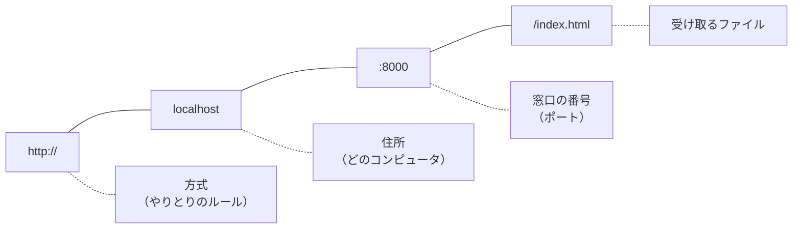
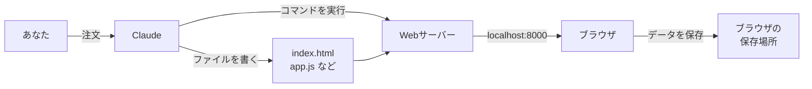

# 0-1 Claude が5分でアプリを作る：裏で何が起きた？

所要 30分 ／ 種類：覗く

## 今日のゴール
- あなたの好きなものをテーマに、Claude に**本物っぽく動くアプリ**を作ってもらう
- 使ってみて、機能を1つ足してもらう
- そのとき Claude が**裏で何をしたか**を振り返り、このコースで何が分かるようになるのかをつかむ

## ステップ

### 1. 好きなものでアプリを頼む
このレッスンだけは、**Claude が作ります**。あなたは注文して、使って、眺める係です。

**やってみよう**：次の文をコピーして、〇〇を書きかえ、チャットに送ってください。

```
playground/wow に、〇〇がテーマの〇〇を作って。
1枚のページで動くアプリ（SPA）にして、本物のサービスっぽいデザインにして。
ボタンを押したり、投稿したり、カートに入れたりが実際にできるようにして。
データはブラウザに保存して、リロードしても消えないようにして。
作ったらブラウザで見られるようにして。
```

書きかえの例：
- 「**ラーメン**がテーマの **SNS**」（写真の代わりに絵文字で投稿、いいね、コメント）
- 「**猫グッズ**がテーマの **ショッピングサイト**」（商品一覧、カート、合計金額）
- 「**富士山**がテーマの **お絵描きアプリ**」（色とペンの太さ、保存）
- 「**サッカー**がテーマの **クイズゲーム**」（点数とランキング）

途中で「許可しますか？」と聞かれたら、押す前に「これ何するの？」と聞いてかまいません。くわしくは 0-2 でやります。
<!-- 先生用：この文と例をメッセージにそのまま載せる。受講者の注文を受けたら、Claude としてアプリを作る。条件：playground/wow に index.html（必要なら style.css と app.js）だけ、ビルド不要・外部ライブラリなしで動く、データは localStorage、最初からサンプルデータが数件入っていて画面が寂しくない、スマホ幅でも崩れない、見た目は今どきのサービス風（余白・角丸・配色）。できたら別タブで `python3 -m http.server 8000` を playground/wow で起動し、ブラウザで開く。作業中は何をしているかを一言ずつ添える（あとで振り返るため） -->

### 2. 使ってみる
**やってみよう**：できたアプリを、本当に使ってみてください。
- 投稿する／カートに入れる／絵を描く／クイズに答える
- そのあと**ページをリロード**（`⌘` + `R`）。さっきのデータは残っていますか？

いま触っているのは、**ページを移動せずに中身だけが切り替わるアプリ**です。これを **SPA**（**S**ingle **P**age **A**pplication）と呼びます。Gmail や X（旧Twitter）も同じ作りです。

### 3. 機能を1つ足してもらう
**やってみよう**：使ってみて「こうだったらいいのに」と思ったことを、1つだけ Claude に頼んでください。

例：「ダークモードを付けて」「投稿を新しい順に並べて」「合計金額に送料を足して」「消しゴムを付けて」

**頼めば、すぐ直る。** これが AI と一緒に作る感覚です。

### 4. アドレス欄を読む
ブラウザのアドレス欄には `http://localhost:8000/` のような文字が出ています。これを **URL**（**U**niform **R**esource **L**ocator：ネット上の住所）と呼びます。



| 部品 | 名前 | たとえると |
|---|---|---|
| `http://` | 方式。**H**yper**T**ext **T**ransfer **P**rotocol | 手紙の出し方のルール。`https` の s は secure（暗号化） |
| `localhost` | ドメイン（住所） | どの建物か。`localhost` は「この建物＝いま使っている Mac」 |
| `:8000` | ポート（窓口の番号） | 建物の何番窓口か。Claude が起動したサーバーが 8000 番で待っている |
| `/index.html` | パス | 窓口で受け取る書類（省略すると `index.html` が出る） |

いつもの `https://www.google.com` も同じ形です。ポートが見えないのは「`https` なら 443 番」と決まっていて、省略されているからです。

### 5. スマホで開いてみる
**やってみよう**：Claude に「これ、スマホで見られる？」と聞いてみてください。

すんなりいくかもしれないし、いかないかもしれません。**いかなかったら、それが今日いちばんの収穫です。** 理由は 0-3 で分かります。

### 6. 振り返り：Claude は何をした？
チャットを上にスクロールすると、Claude がやったことが全部残っています。



| Claude がやったこと | それが分かるようになるレッスン |
|---|---|
| フォルダとファイルを作った | 1-1, 1-2 |
| HTML と CSS で画面を作った | 3-4 |
| JavaScript でボタンを動くようにした | 3-5 |
| `python3 -m http.server` を実行した | 3-6 |
| 「localhost:8000 で見られます」と言った | 0-3、4-3 |
| データをブラウザに保存した | 2-3（データの形）、4-4（本物のデータベース） |
| 許可を求めてきた | 0-2 |
| スマホで見られなかった（かも） | 0-3、4-3 |

**この数分間に Claude がやったことが、全部分かるようになる。それがこのコースです。** 最後の卒業制作では、同じようなアプリを**自分の手で**作り、もう一度 Claude に作らせて見比べます。

**確かめ**：`localhost` は、どのコンピュータのこと？ ボタン：`この Mac` / `インターネットのどこか`
<!-- 先生用：この Mac（自分自身）。間違えたら「建物＝この Mac」のたとえで1行言い直して次へ -->

## チェック
`/check`：`playground/wow/index.html` があり、ブラウザで開いて使えたら合格。

## AIとの関係
Claude は魔法ではなく、ファイルを書き、コマンドを打つ「とても速い人」です。何をしたかは全部チャットに残っていて、あなたもそれを読めるようになります。
