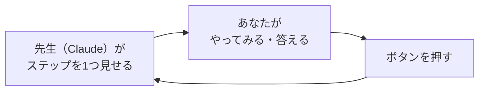
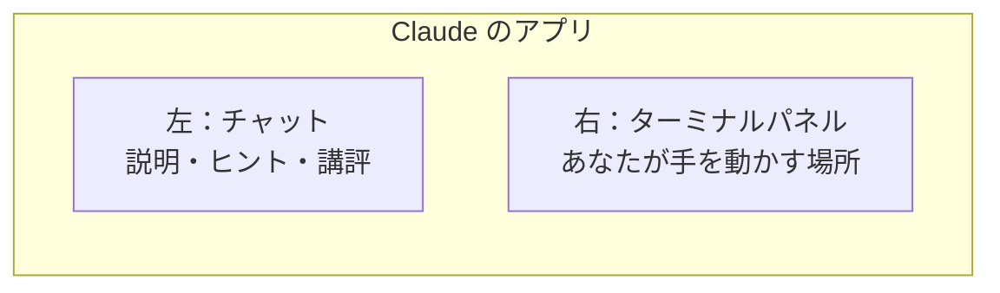
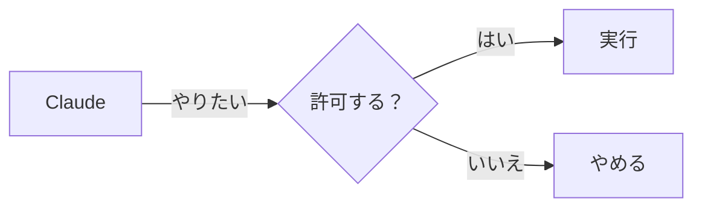

# 0-2 画面の見方と権限ダイアログ

所要 15分 ／ 種類：覗く

## 今日のゴール
- このコースの進め方（1ステップずつ、ボタンで進む）が分かる
- チャットとターミナルパネルの「画面2枚」を使える
- 権限ダイアログで、何を聞かれているのか読める

## ステップ

### 1. このコースの進め方

- 先生は、1回のメッセージで**1つのステップ**だけ見せます
- メッセージの最後には、いつも「次にやること」の欄とボタンが出ます
  - `わかった` / `もう少し詳しく`：説明を読んだとき
  - `やった` / `うまくいかない`：操作をしたとき
- ボタンを押すまで、先生は先に進みません。自分のペースで大丈夫です
- **分からないことは、いつでもチャットに書いてください。** 答えたら、元のステップに戻ります

**やってみよう**：読めたら、下の `わかった` を押してください。

### 2. 画面2枚：チャットとターミナル

- **前提**：パソコンへの頼み方は2つあります。マウスでボタンを押すか、**文字で命令する**か
- **困りごと**：ボタンは、アプリを作った人が用意したことしかできません。Claude にもマウスはありません
- **解決**：文字の命令（**コマンド**）なら、何でも組み合わせて頼めます。それを打つ画面が**ターミナル**です
- 0-1 で Claude がページを作ったときも、裏ではこのコマンドを使っていました

**やってみよう**：先生がチャットの横にターミナルパネルを開きます（「練習」というタブ）。
1. ターミナルの中をクリックする
2. `echo こんにちは` と打って Enter（`echo`＝こだま：言ったことをそのまま返す）
3. `やった` を押す

先生はパネルの中身を読めるので、**結果を貼る必要はありません**。ターミナル.app や iTerm で打ったものは先生から見えないので、このコースではパネルを使います。

**確かめ**：いま打った `echo こんにちは` のうち、「命令に渡した材料」はどっち？ ボタン：`こんにちは` / `echo`
<!-- 先生用：材料は「こんにちは」、命令は echo。間違えたら「echo さようなら と打つと変わるのは後ろだけ。変わるほうが材料」と1行で言い直す。この見方は 1-5 の python3 hello.py でも使う -->

### 3. なぜ「許可しますか？」と聞かれるのか

- **前提**：Claude は、あなたの Mac の中でファイルを作ったり、消したり、コマンドを実行したりできます
- **困りごと**：Claude も間違えます。読んだWebページや文章に、悪い命令がまぎれていることもあります。勝手に動かれたら、大事なファイルが消えるかもしれません
- **解決**：やる前に「許可しますか？」と聞く仕組み（**権限ダイアログ**）。最後に決めるのは人間です
- ボタンは、アプリの版によって言葉が少し違いますが、だいたい次の3種類です

| ボタン | 意味 |
|---|---|
| 許可（今回だけ） | この1回だけやってよい |
| 今後も許可 | 同じ種類のことは、次から聞かずにやってよい |
| 拒否 | やらないで |

**確かめ**：「ファイルを消すコマンド」に `今後も許可` を押したあと、Claude が間違えて大事なファイルを消そうとしたら？ ボタン：`止める前に消される` / `またダイアログで止められる`
<!-- 先生用：止める前に消される（次からは聞かれない）。間違えたら「合鍵を渡したら、もう玄関で止められない」と1行で言い直す -->

### 4. 本物のダイアログを読んでみる
押す前に、2つだけ読みます。
- **何を** するのか（ファイルを作る？ 消す？ インターネットに送る？）
- **どこに** するのか（このフォルダの中？ 外？）

**やってみよう**：チャットに、次の文を送ってください。

> playground/hello.txt に「はじめまして」と書いたファイルを作って

ここは **Claude がやります**。ダイアログが出たら、すぐ押さずに「何を・どこに」を読んでから許可してください。分からなければ、押さずに「これ何するの？」と聞くのが正しい使い方です。
<!-- 先生用：ダイアログが出なかったら、設定でファイル作成が許可済みになっていると説明し、「コマンドを実行するときは出る」と伝える -->

### 5. モデルを選ぶ
- **前提**：アプリでは、Claude の「**モデル**」（頭脳の種類）を選べます
- **困りごと**：大きいモデルほど賢いけれど、返事が遅く、使える量（使用量の上限）を早く使います
- **解決**：頼みごとに合わせて選ぶ。このコースは、ほとんど **Sonnet** で足ります（くわしくは第6部）

**やってみよう**：先生が、モデルを選ぶ場所を教えます。いま何が選ばれているか、見てください。

## チェック
`/check`：ターミナルパネルで `echo` を打てていて、`playground/hello.txt` ができていれば合格。

## AIとの関係
許可ボタンは、AIに渡す「鍵」です。何の鍵か分かって渡す人と、全部「はい」を押す人では、事故の起き方がまったく違います。分からないときは押さずに聞く。それがいちばん安全な使い方です。
