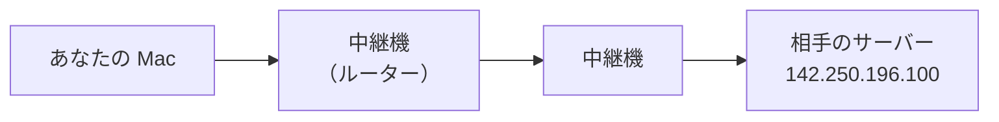
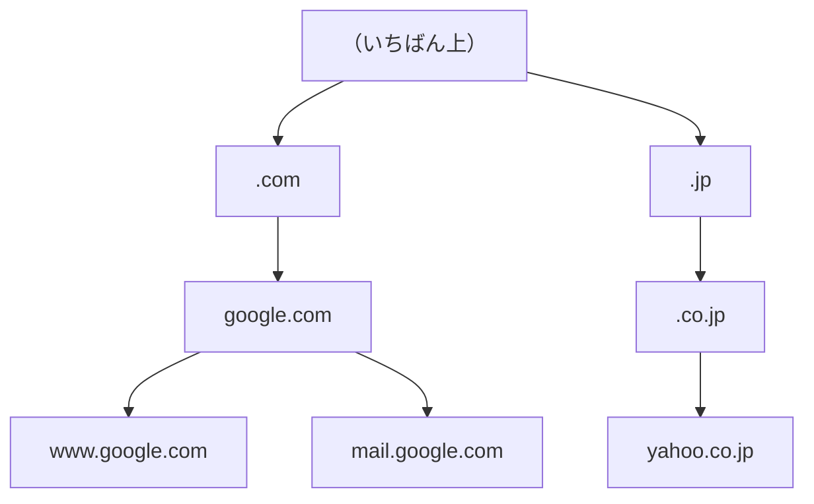
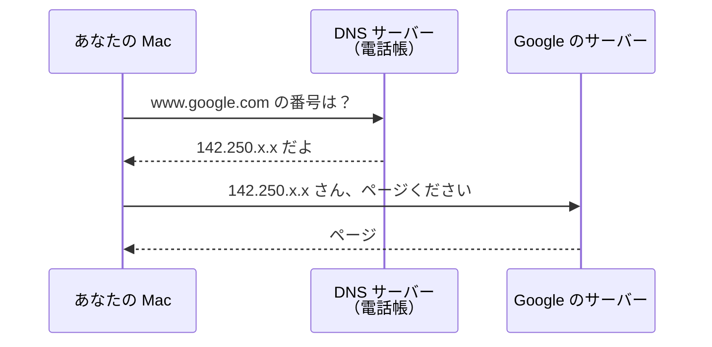
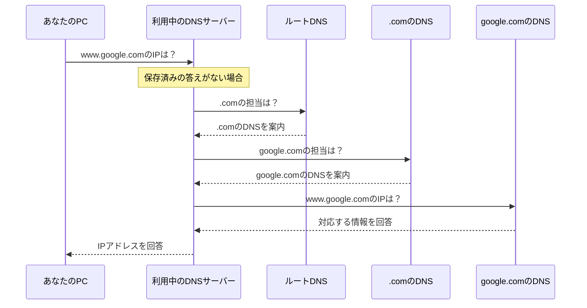
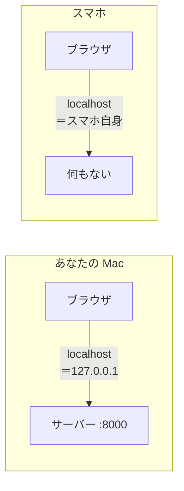

# 0-3 名前と番号：IPアドレスと DNS

所要 25分 ／ 種類：覗く

## 今日のゴール
- コンピュータどうしが、どうやって相手を見つけているか分かる
- `www.google.com` という名前が、番号に変わるまでの流れを図で説明できる
- 0-1 でスマホから見られなかった理由が分かる

## ステップ

### 1. 前提：コンピュータは番号で相手を見つける

- **前提**：インターネットにつながる機械には、1台ずつ番号が付いています。これが **IPアドレス**（**I**nternet **P**rotocol address）。例：`142.250.196.100`
- 途中の中継機（ルーター）は、郵便局が郵便番号で仕分けるように、**この番号だけを見て**行き先を決めます
- 名前のままでは、中継機はどこに送ればいいか分かりません

### 2. 困りごと：人間は番号を覚えられない
- **困りごと**：見たいサイトごとに `142.250.196.100` のような番号を覚えて打つのは、無理です
- しかも番号は、サーバーの引っ越しや増設で変わります
- **解決**：名前を付けて、その名前を番号に変える**電話帳**を作った。それが **DNS**（**D**omain **N**ame **S**ystem）。`www.google.com` のような名前を**ドメイン**と呼びます
- 番号が変わっても、電話帳を書き換えるだけ。みんなは同じ名前のまま使えます

### 3. 名前は「住所」のように整理されている

- 世界中の名前を1つの表で管理するのは無理なので、**区分けして**管理しています
- 住所の「日本 → 東京都 → 千代田区」と同じで、名前は**右に行くほど大きな区分**です
- それぞれの持ち主が、自分の下の名前を自由に決められます（google.com の持ち主が `www` や `mail` を決める）。だから世界中で名前がぶつかりません

**確かめ**：`news.yahoo.co.jp` の `news` を決めたのは？ ボタン：`yahoo.co.jp の持ち主` / `.jp の管理人`
<!-- 先生用：yahoo.co.jp の持ち主。間違えたら「住所の番地を決めるのは、国ではなくその家の人」と1行で言い直す -->

### 4. 名前を引いて、ページを頼む
ブラウザに `www.google.com` と打つと、裏ではこうなっています。

**やってみよう**：先生がターミナル（0-2 で使ったもの）を開きます。そこで次を打ってください。

`nslookup www.google.com`
（`nslookup`＝**n**ame **s**erver **look up**：ネームサーバー＝電話帳を引く）

出てきた行の読み方：

| 行 | 意味 | 図では |
|---|---|---|
| `Server:` と一番上の `Address:` | あなたの Mac が使っている電話帳（DNS サーバー）の番号 | DNS サーバー |
| `Non-authoritative answer:` | 「本家ではなく、控えから答えたよ」（次のステップで説明） | |
| その下の `Name:` と `Address:` | Google の番号。複数出ることもある | 142.250.x.x |

番号は場所や時間で変わることがあります。大きなサービスは、世界中にたくさんのサーバーを置いているからです。

### 5. 電話帳は、どうやって答えを見つける？
電話帳（DNS サーバー）も、全部の答えを知っているわけではありません。ステップ3の区分けを、**上から順に担当者に聞いていきます**。

- **ルート → .com → google.com** と、区分けを上から下へたどっています
- 毎回これをやると遅いので、DNS サーバーは一度聞いた答えを**しばらく覚えておきます**（キャッシュ）
- ステップ4の `Non-authoritative answer` は、この**覚えておいた答え**から返ってきた、という意味です

**確かめ**：さっき引いた `www.google.com` を、すぐもう一度引くと？ ボタン：`覚えた答えがすぐ返る` / `またルートから聞きに行く`
<!-- 先生用：覚えた答えがすぐ返る（キャッシュ）。間違えたら「毎回この6往復をするのは遅いので、一度聞いた答えはしばらくメモしておく」と図を指して1行で言い直す -->

### 6. localhost と、スマホで見られなかった理由

- `localhost` だけは電話帳を引きません。最初から「`127.0.0.1`＝自分自身」と決まっています
- だから Mac で開くと、Mac の中のサーバーに届きます
- でもスマホで `localhost` を開くと、**スマホ自身**を見に行ってしまう。だから 0-1 で見られなかったのです（Mac の本当の番号で開く方法は第4部で）

**やってみよう**：ブラウザで `http://127.0.0.1:8000` を開いてください。0-1 と同じページが出たら、名前（`localhost`）と番号（`127.0.0.1`）が同じ場所を指している証拠です。
<!-- 先生用：0-1 のサーバーが止まっていたら、先生が別タブで playground/wow を python3 -m http.server 8000 で起動してから案内する -->

## チェック
`/check`：ターミナルで `nslookup www.google.com` を実行し、ブラウザで `http://127.0.0.1:8000` が開けたら合格。

## AIとの関係
Claude が「`localhost:8000` で見られます」と言ったら、それは**あなたの Mac の中だけ**で見られる、という意味です。人に見せたいなら、公開（第4部のデプロイ）が要る。それが分かっていれば、Claude に正しく頼めます。
