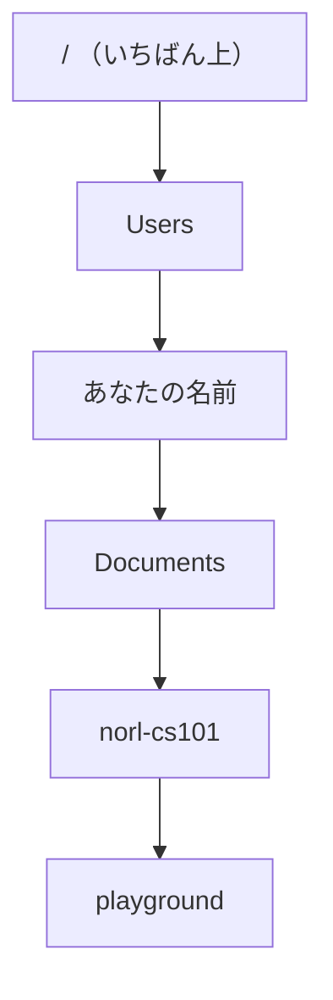
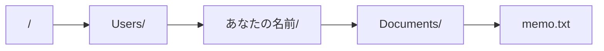
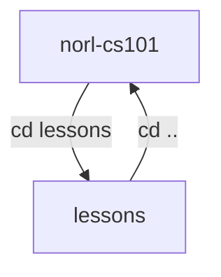

# 1-1 いまどこ？ pwd・ls・cd

所要 20分 ／ 種類：作る

## 今日のゴール
- コンピュータの中のファイルが「フォルダの木」に並んでいることが分かる
- ターミナルで、いまいる場所を確かめ（`pwd`）、中を見て（`ls`）、移れる（`cd`）
- 迷子になっても、自分で帰ってこられる

## ステップ

### 1. コンピュータの中は「フォルダの木」

- **前提**：Mac の中には、何万個ものファイルがあります
- **困りごと**：全部が1か所に並んでいたら探せません。同じ名前のファイルもぶつかります
- **解決**：フォルダの中にフォルダを入れて、**木**の形で整理する
- Finder で見ているフォルダも、まったく同じ木です。ターミナルは、それを文字で見ているだけです
- フォルダのことを、ターミナルでは **ディレクトリ**（directory：住所録・案内板）とも呼びます

### 2. パス：木の中の住所

- 木の中の1か所は、いちばん上から順に枝をたどった道で書きます。これを **パス**（path：道）と呼びます
- 例：`/Users/hanako/Documents/memo.txt`
- `/` は「その中の」という区切りです。**左ほど大きなフォルダ**で、右に行くほど奥に入ります
- 0-1 の URL の最後の `/index.html` も、このパスです
- 0-3 のドメイン（`www.google.com`）は**右ほど大きい区分**でした。パスは逆向きです

**確かめ**：`/Users/hanako/Documents/memo.txt` で、`memo.txt` がすぐ入っているフォルダは？ ボタン：`Documents` / `Users`
<!-- 先生用：Documents。逆に答えたら、図の矢印を指して「左から右へ、奥に入っていく。memo.txt のすぐ左が入れ物」と言い直す -->

### 3. いまどこ？ `pwd` と `ls`
- **前提**：ターミナルは、いつも木のどこか1か所に「立って」います
- **困りごと**：「memo.txt を見せて」と言っても、どこの memo.txt か分かりません
- **解決**：コマンドは、**いま立っている場所**を基準に動きます。だから、まず場所を確かめます

**やってみよう**：先生がターミナルパネルを開きます。そこで、1つずつ打って Enter を押してください。

| 打つもの | 元の英語 | 意味 |
|---|---|---|
| `pwd` | **p**rint **w**orking **d**irectory | いま立っている場所（作業ディレクトリ）を表示 |
| `ls` | **l**i**s**t | ここにあるものを一覧 |

コマンドは英語の略です。**元の英語で覚える**と忘れません。一覧は [COMMANDS.md](../../../COMMANDS.md)。

### 4. `cd` で移る、`..` で戻る

- **困りごと**：別のフォルダの中を見たいとき、毎回長いパスを打つのは大変です
- **解決**：立つ場所そのものを移る。`cd`＝**c**hange **d**irectory（ディレクトリを変える）
- `..` は「1つ上のフォルダ」という意味の記号です

**やってみよう**：ターミナルで、順に打ってください。
1. `cd lessons`
2. `pwd`
3. `ls`
4. `cd ..`
5. `pwd`

**確かめ**：`cd lessons` のあとの `ls` は、ステップ3の `ls` と違うものを出しました。なぜ？ ボタン：`立っている場所が変わったから` / `ls が lessons 用の命令になったから`
<!-- 先生用：立っている場所が変わったから。ls は「いま立っている場所の中」を見せる。間違えたら「ls の後ろには何も書いていない。変わったのは立ち位置だけ」と1行で言い直す -->

### 5. Tab キーで、残りを打ってもらう
- **困りごと**：フォルダの名前は長いし、1文字間違えると動きません
- **解決**：途中まで打って **Tab キー**を押すと、残りをターミナルが埋めてくれます（補完）

**やってみよう**：`cd les` まで打って Tab。`lessons/` まで埋まったら Enter。そのあと `cd ..` で戻ってください。

### 6. 家に帰って、また戻ってくる
- `~`（チルダ）は、あなたの**ホーム**（`/Users/あなたの名前`）を表す記号です
- `cd ~` で、どこにいても家に帰れます

**やってみよう**：
1. `cd ~` で家に帰る
2. `pwd` で、本当に家にいるか確かめる
3. そこから、自分の力で **norl-cs101 に戻ってください**。最後に `pwd` で確かめます

ヒント：ステップ3で最初に打った `pwd` の答えを思い出してください。Tab も使えます。
<!-- 先生用：最初の pwd の出力から /Users/名前 を除いた残り（例 cd Documents/repo/norl-cs101）を打てばよい。1つずつ cd して ls で確かめながら進んでもよい。迷ったら、まず ls で「家の中に何がある？」を見てもらう -->

## チェック
`/check`：ターミナルパネルで `pwd`・`ls`・`cd` を使い、最後に norl-cs101 に戻ってこられたら合格。

## AIとの関係
Claude が「`/Users/.../playground/index.html` を作りました」と言ったら、それが木のどこか分かるようになりました。Claude もいつも、どこかのフォルダに立って作業しています。頼むときは「playground の中に」と場所で言うと、間違いが減ります。
