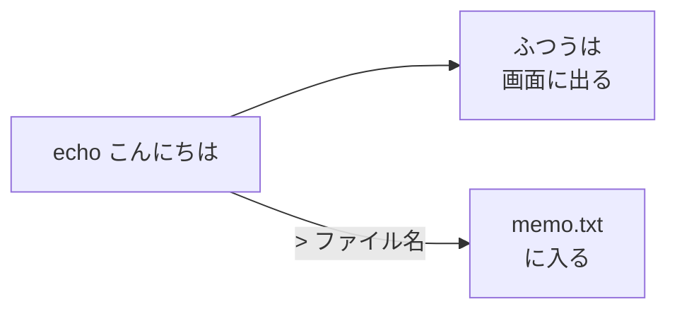
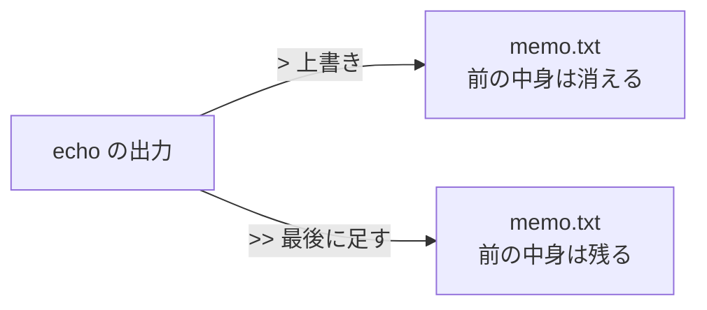

# 1-2 ファイルはただの文字 mkdir・echo・cat

所要 20分 ／ 種類：作る

## 今日のゴール
- 「ファイルは、名前の付いた文字の並び」だと分かる
- エディタを使わずに、ターミナルだけでファイルを作って、中身を見る
- `>`（上書き）と `>>`（足す）の違いが分かる

## ステップ

### 1. ファイルの正体

- **前提**：コンピュータが保存できるのは、突き詰めると数字の並びだけです。文字も、1文字ずつ番号にして保存しています
- **困りごと**：「ファイルはアプリで作るもの」と思っていると、画面もアプリも無い場所（サーバーなど）では何もできません。Claude も、アプリのボタンは押せません
- **解決**：多くのファイルは、**名前の付いた文字の並び**です。だから「文字を出す命令」の出力をファイルに流しこむだけで作れます
- `⏎` は改行。改行も「ここで行が変わる」という1つの文字です

**確かめ**：Python のプログラムのファイルの中身は？ ボタン：`ただの文字` / `アプリ専用の特別なデータ`
<!-- 先生用：ただの文字。0-1 の index.html も、Claude が文字を書いただけ。間違えたら「1-5 で自分で書くと分かります。中身は英語っぽい文字です。写真や動画は文字ではない」と1行で言い直す -->

### 2. フォルダを作る `mkdir`
**やってみよう**：ターミナルで、まず `pwd` を打って norl-cs101 にいるか確かめてください。いなければ 1-1 のやり方で戻ります。そのあと：

`mkdir playground/notes`
（`mkdir`＝**m**a**k**e **dir**ectory：ディレクトリ＝フォルダを作る）

`ls playground` で、`notes` ができたか見てください。

### 3. 画面に出る文字を、ファイルに向け直す `>`

- **前提**：0-2 で打った `echo こんにちは` は、言葉を**画面に**出しました
- **困りごと**：画面に出た文字は、消えたら残りません
- **解決**：`>` を付けると、出力の行き先を画面から**ファイル**に向け直せます（リダイレクト＝向け直す）

**やってみよう**：ターミナルで打ってください。

`echo こんにちは > playground/notes/memo.txt`

### 4. 中身を見る `cat`、最後に足す `>>`
**やってみよう**：ターミナルで、順に打ってください。

| 打つもの | 元の英語 | 意味 |
|---|---|---|
| `cat playground/notes/memo.txt` | con**cat**enate（つなげる） | ファイルの中身を画面に出す |
| `echo 2行目 >> playground/notes/memo.txt` | | ファイルの**最後に**1行足す |
| `cat playground/notes/memo.txt` | | もう一度見る |

`cat` は本来「いくつものファイルをつなげて出す」コマンドです。1つだけ渡すと、その中身がそのまま出ます。

### 5. `>` と `>>` の違い

**やってみよう**：ターミナルで打ってください。
1. `echo 上書き > playground/notes/memo.txt`
2. `cat playground/notes/memo.txt` ── 前の2行はどうなりましたか？
3. `echo 2行目 >> playground/notes/memo.txt` で、もう一度2行以上にしておく（次のレッスンで使います）
4. `ls -l playground/notes`（`-l`＝**l**ong：くわしく）で、ファイルの大きさ（バイト＝文字の量）も見てみましょう

**確かめ**：毎日1行ずつ書き足していく日記のファイルがあります。書き足すときに使うのは？ ボタン：`>` / `>>`
<!-- 先生用：>>。間違えたら「> は上書きなので、それまでの日記が全部消えてしまう」と1行で言い直す -->

## チェック
`/check`：`playground/notes/memo.txt` が2行以上あれば合格。

## AIとの関係
Claude がファイルを「作る」「書き換える」と言うとき、やっているのはこれと同じ、文字の並びを書くことです。プログラムも、Webページも、設定ファイルも、ほとんどが文字です。だから、あなたも `cat` で中身を確かめられます。
