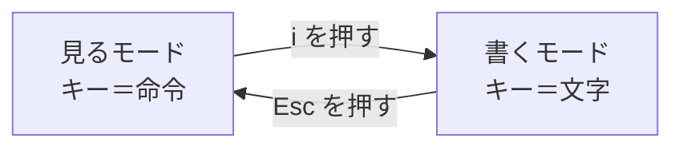

# 1-3 vi は5つだけ

所要 20分 ／ 種類：作る

## 今日のゴール
- vi が「モード」を切り替えて使うエディタだと分かる
- vi でファイルを開いて、書いて、保存して、閉じる
- 困ったときの「逃げ方」を知っている。**閉じ方が分かれば怖くない**

## ステップ

### 1. なぜ、文字だけのエディタが要るの？

- **前提**：サーバー（0-3 で、番号で呼んだ相手のコンピュータ）には、たいてい画面もマウスもありません。文字だけで操作します
- **困りごと**：そこでは、メモ帳のようなアプリは使えません
- **解決**：ほぼどこにでも最初から入っている、文字だけのエディタ（文章を書き直す道具）が **vi** です。`vi`＝**vi**sual（画面を見ながら編集する）
- クセはありますが、覚えるのは5つだけです

### 2. vi には「モード」が2つある

- **前提**：vi にはメニューもマウスもありません。保存も終了も、キーボードで伝えるしかありません
- **困りごと**：`q` を押したとき、文字の「q」を書きたいのか、「終了して」という命令なのか、区別できません
- **解決**：**モード**を分ける。見るモードではキーが「命令」、書くモードではキーが「文字」になります
- vi を開いた直後は、**見るモード**です

**確かめ**：書くモードのまま `:wq`（保存して閉じる命令）と打つと？ ボタン：`保存して閉じる` / `「:wq」という文字が書きこまれる`
<!-- 先生用：「:wq」という文字が書きこまれるだけ。間違えたら「書くモードでは、どのキーもただの文字。命令の前には必ず Esc で見るモードに戻る」と1行で言い直す。ステップ4で実際に試してもよい -->

### 3. まず、逃げ方を覚える
vi で困ったら、これで**何も保存せずに**抜けられます。

`Esc` を押す → `:q!` と打つ → Enter

（`q`＝**q**uit：やめる、`!`＝「いいから、強制で」）

**やってみよう**：ターミナルで、
1. `vi playground/notes/memo.txt` を打つ。1-2 で書いた中身が見えます
2. 何もせずに `:q!` → Enter
3. 元のターミナルに戻れたら `やった` を押してください

**逃げ方を先に覚えておけば、vi の中で何が起きても大丈夫です。**

### 4. 書いて、保存して、閉じる
| キー | 元の英語 | 意味 |
|---|---|---|
| `i` | **i**nsert（差しこむ） | 書くモードに入る |
| `Esc` | escape（抜け出す） | 見るモードに戻る |
| `:wq` | **w**rite + **q**uit | 保存して閉じる |
| `:q!` | quit ＋ 強制 | 保存せずに閉じる（逃げる） |
| 矢印キー | | 移動 |

**やってみよう**：ターミナルで、
1. `vi playground/notes/memo.txt`
2. 矢印キーで一番下の行へ行き、`i` を押す。画面の左下に `-- INSERT --` と出たら書くモードです
3. 右矢印キーで行のいちばん後ろまで行き、Enter で改行して、好きな言葉を1行書く
4. `Esc` → `:wq` → Enter
5. `cat playground/notes/memo.txt` で、足した行があるか確かめる

うまくいかなくなったら、ステップ3の逃げ方で抜けて、やり直せば大丈夫です。

`nano` という、もっと簡単なエディタもあります（`nano ファイル名` で開き、`Ctrl+X` で終了）。どちらを使っても構いません。

**確かめ**：書いている途中で、何をしたか分からなくなりました。ファイルを壊さずに vi から抜けるのは？ ボタン：`Esc → :q! → Enter` / `Esc → :wq → Enter`
<!-- 先生用：Esc → :q! → Enter。:wq だと、分からなくなった中身のまま保存されてしまう。間違えたら「w は保存。壊れたかもしれない中身を保存しないのが :q!」と1行で言い直す -->

## チェック
`/check`：`playground/notes/memo.txt` が3行以上あれば合格（vi で1行足せた）。

## AIとの関係
サーバーの中など、vi しか無い場所は意外と多いです。Claude が「vi で設定を直してください」と言っても、もう固まりません。それに、Claude が書いたファイルを、自分で開いて読み、少し直すこともできます。
