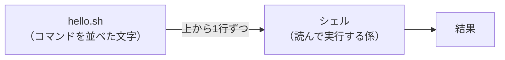
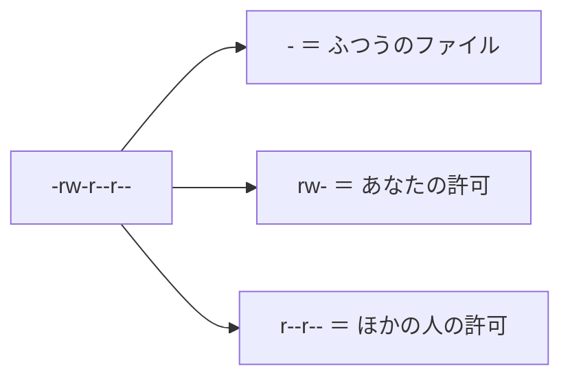
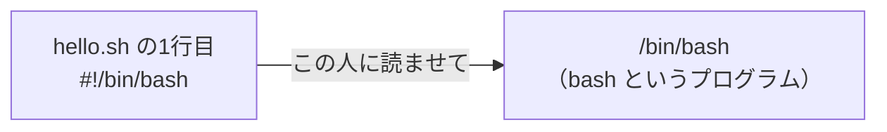

# 1-4 シェルスクリプトと実行権限 chmod

所要 25分 ／ 種類：作る

## 今日のゴール
- コマンドを並べたファイル（シェルスクリプト）を書いて、プログラムとして動かす
- **Permission denied** に一度出会い、なぜ止められたのか分かる
- `chmod +x` が「この文字を実行してよい」という許可だと分かる

## ステップ

### 1. シェルスクリプト：コマンドを並べたファイル

- **前提**：ターミナルで打った命令を読んで実行しているのは、**シェル**というプログラムです（shell＝貝の殻：コンピュータの外側で、人と話す係）。Mac には `zsh` や `bash` というシェルが入っています
- **困りごと**：毎回同じ命令を何行も打つのは面倒で、打ち間違いも起きます
- **解決**：命令をファイルに書いておき、シェルにまとめて読ませる。これが **シェルスクリプト** です

**やってみよう**：ターミナルで `vi playground/hello.sh` を開き（`i` で書くモード）、次の2行を書いて `Esc` → `:wq` で保存してください。

```bash
#!/bin/bash
echo "Hello, World!"
```

### 2. 動かしてみる
- `./` は「いま立っている場所から」という意味です（1-1 の `..` は「1つ上」でした）
- `./playground/hello.sh` は、「ここから見た playground の中の hello.sh を、プログラムとして動かして」という意味になります

**やってみよう**：ターミナルで `./playground/hello.sh` を打ってください。何が出ても大丈夫です。
<!-- 先生用：Permission denied（許可がない・拒否された）が出る。エラーを出せたことをほめる。「壊れた」と思っていたら、「ファイルは壊れていない。動かす許可が無いだけ」と伝え、次のステップへ -->

### 3. なぜ「実行の許可」があるのか

- **前提**：ファイルはただの文字なので、メモなのかプログラムなのか、見た目では区別できません
- **困りごと**：ダウンロードしただけの文字が、どれでも実行できたら、悪いプログラムもうっかり動いてしまいます
- **解決**：ファイルごとに「読める・書ける・実行できる」の許可を持たせ、**実行は、自分で許可したものだけ**にする

| 文字 | 元の英語 | 意味 |
|---|---|---|
| `r` | **r**ead | 読める |
| `w` | **w**rite | 書ける |
| `x` | e**x**ecute | 実行できる |
| `-` | | できない |

**やってみよう**：ターミナルで `ls -l playground/hello.sh` を打ち、左端の `-rw-r--r--` のような印を見てください。

**確かめ**：あなたの印（左から2〜4文字目）が `rw-` のとき、`hello.sh` を実行できる？ ボタン：`できない` / `できる`
<!-- 先生用：できない。x の場所が - だから。間違えたら、表の x を指して「r は読めるだけ。3文字目が x のときだけ実行できる」と1行で言い直す。印の最後に @ が付いていたら「Mac が付ける追加情報の印で、今は気にしなくてよい」と伝える -->


### 4. `chmod +x` で実行を許可する
**やってみよう**：ターミナルで、順に打ってください。
1. `chmod +x playground/hello.sh`
   （`chmod`＝**ch**ange **mod**e：許可の設定を変える。`+x`＝実行の許可を足す）
2. `ls -l playground/hello.sh` ── 印はどう変わりましたか？
3. `./playground/hello.sh` ── 今度は `Hello, World!` が出るはずです

**確かめ**：知らない人からもらったスクリプトに `chmod +x` を付けて動かす。これは？ ボタン：`中身を信じて実行すると決めること` / `Mac が中身の安全を確かめること`
<!-- 先生用：中身を信じて実行すると決めること。間違えたら「chmod は許可を変えるだけで、中身は調べない。0-2 の権限ダイアログと同じで、最後に許可するのは人間」と1行で言い直す -->

### 5. 1行目の `#!/bin/bash` は「読み手」の指定

- 1行目の `#!`（シバン）は、「このファイルは、ここに書いた読み手に読ませてね」という**宛名**です
- `/bin/bash` は 1-1 で習った**パス**です。`/bin` というフォルダの中にある、`bash` というプログラムのこと（`bin`＝**bin**ary：コンピュータが直接動かせる形のファイル）

**やってみよう**：ターミナルで `ls /bin` を打って、`bash` を探してください（`zsh` や、`ls` 自身も見つかります）。

## チェック
`/check`：`playground/hello.sh` に実行の許可があり、`./playground/hello.sh` で Hello が出れば合格。

## AIとの関係
Claude が「スクリプトに実行権限を付けます」と言ったら、やっているのは今の `chmod +x` です。知らないスクリプトに `x` を付けるのは「この文字を信じて実行する」という意味です。Claude が作ったスクリプトでも、何をするのか分からなければ、動かす前に「これ何をするの？」と聞きましょう。
