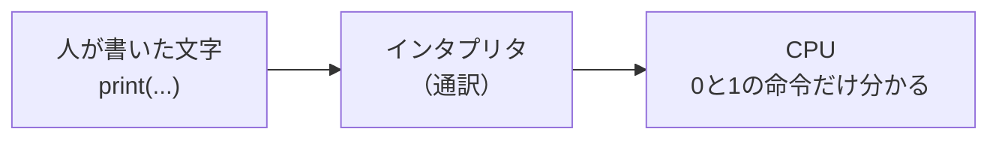
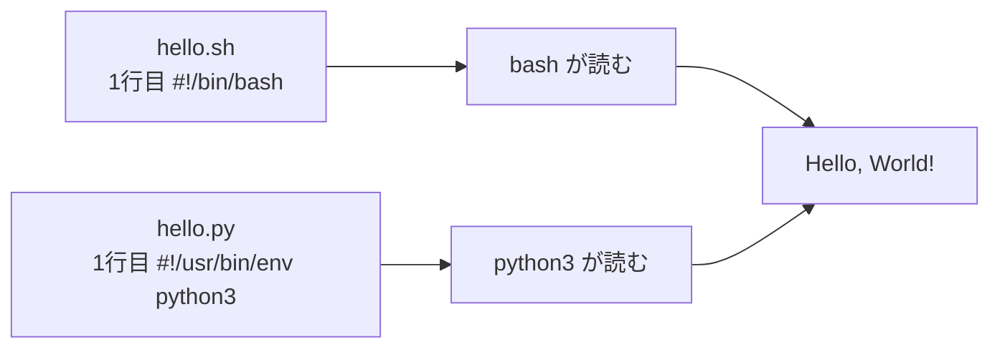

# 1-5 Python で Hello World

所要 20分 ／ 種類：作る

## 今日のゴール
- 「プログラミング言語」と「インタプリタ（通訳）」が何か分かる
- Python のプログラムを自分で書いて、動かす
- シェルスクリプトと Python の違いは、**読み手だけ**だと分かる

## ステップ

### 1. 「言語」って何？

- **前提**：コンピュータの頭脳（**CPU**＝Central Processing Unit）が分かるのは、0と1でできた「機械語」だけです
- **困りごと**：人間が0と1を並べてプログラムを書くのは、ほぼ無理です
- **解決**：人間が読める書き方（**プログラミング言語**）で書いて、**インタプリタ**（通訳のプログラム）に読ませる。通訳が、CPU に分かる命令に直しながら実行します
- **Python** は、そうした言語の1つです

### 2. hello.py を書く
- 名前の最後の `.py` は**拡張子**（ファイルの種類を表す名札）です。「これは Python のファイル」と、人やアプリに伝えます
- 中身は、1-2 と同じ**ただの文字**です

**やってみよう**：ターミナルで `vi playground/hello.py` を開き、画面に `Hello, World!` と出すプログラムを、**1行で**書いて保存してください。
- ヒント1：Python で文字を画面に出す命令は `print` です
- ヒント2：画面に出したい文字は `"..."` で囲みます

書けたら `やった` を押してください。先生がファイルを読んで確かめます。
<!-- 先生用：答えは print("Hello, World!")。答えをそのまま書かない。( ) を忘れると、ステップ3で「Missing parentheses」というエラーが出る。それは良い教材なので、先に直さない。詰まったらヒントを3段階で（方向性 → 使う道具 → ほぼ答え） -->

### 3. python3 に読ませて動かす
**やってみよう**：ターミナルで `python3 playground/hello.py` を打ってください。
- `python3` は、Python（バージョン3）の通訳のプログラムです
- エラーが出たら最高です。**エラーの最後の行**を読んで、`うまくいかない` を押してください。一緒に読みます

**確かめ**：1-4 では `chmod +x` をしないと動きませんでした。今回、していないのに動いたのはなぜ？ ボタン：`動かしているのは python3 だから` / `.py のファイルは最初から実行できるから`
<!-- 先生用：実行しているのは python3（すでに実行できるプログラム）で、hello.py は「材料」として読まれているだけ。間違えたら「0-2 の echo こんにちは と同じで、命令は python3、hello.py は材料」と1行で言い直す -->

### 4. 1-4 と同じ形にしてみる

- `#!/usr/bin/env python3` は「`python3` という読み手を探して、その人に読ませて」という宛名です（`env`＝**env**ironment：環境。くわしくは 4-2）

**やってみよう**：ターミナルで、
1. `vi playground/hello.py` で、**1行目に** `#!/usr/bin/env python3` を足して保存（`print` の行は2行目になります）
2. `chmod +x playground/hello.py`
3. `./playground/hello.py`

**確かめ**：`hello.sh` と `hello.py`、どちらも「ただの文字」で、どちらも `./` で動きました。2つの違いは？ ボタン：`1行目の宛名（読み手）` / `実行の許可の付け方`
<!-- 先生用：1行目の宛名（読み手が bash か python3 か）と、それに合わせた中身の書き方。間違えたら「どちらも chmod +x は同じ。違うのは誰が読むか。言語とは、読み手が分かる書き方のルール」と1行で言い直す -->

## チェック
`/check`：`python3 playground/hello.py` と `./playground/hello.py` の両方で Hello が出れば合格。

## AIとの関係
Claude は Python も bash も JavaScript も書きますが、どれも「どの読み手に渡すか」が違うだけです。Claude が書いたファイルの1行目や拡張子を見れば、誰が読むのか分かります。
