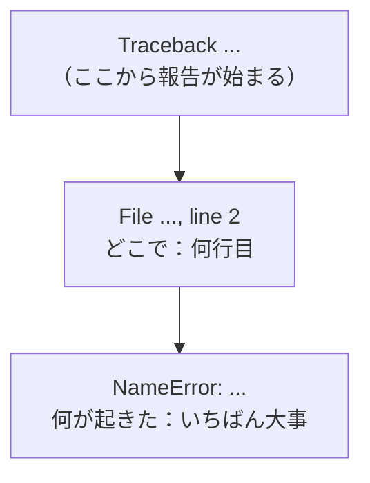
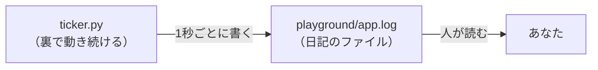

# 1-6 エラーとログ tail -f・grep

所要 25分 ／ 種類：作る

## 今日のゴール
- エラーメッセージを「下から」読んで、何が・どこで起きたか分かる
- プログラムが残す日記（**ログ**）を、流れるまま見る（`tail -f`）
- ログの中から、エラーの行だけを拾う（`grep`）

## ステップ

### 1. エラーは下から読む

- **前提**：プログラムは、止まるときに「なぜ止まったか」を書き残してくれます
- **困りごと**：長い英語がずらっと出るので、怖くて読まずに閉じたくなります
- **解決**：形が決まっています。**最後の行が「何が起きたか」**、その上が「どこで起きたか（何行目）」。だから下から読みます

**やってみよう**：ターミナルで、
1. `vi playground/hello.py` で、`print` を `prnt` に書き換えて保存（わざと壊します）
2. `python3 playground/hello.py`
3. 出てきたエラーを、最後の行から読む

**確かめ**：いま出たエラーの最後の行が言っているのは？ ボタン：`prnt という名前を知らない` / `hello.py が見つからない`
<!-- 先生用：「prnt という名前は知らない（定義されていない）」。何行目で起きたかも一緒に指す。間違えたら「最後の行の NameError は、名前が分からないという意味」と1行で言い直す。答えたら、prnt を print に戻して、もう一度動くのを確かめてもらう（1-5 の hello.py を元どおりにしておく） -->

### 2. ログ：見えないプログラムの日記

- **前提**：Webサーバーのようなプログラムは、何日も裏で動き続け、画面には何も出さないことが多いです
- **困りごと**：動いているのか、止まったのか、外からは分かりません
- **解決**：プログラム自身に、やったことを**ログ**（動いた記録）としてファイルに書かせる。人間は、そのファイルを読みます

**やってみよう**：先生がターミナルパネルに新しいタブ（ticker）を開き、そこでログを書き続けるプログラム `ticker.py` を動かします。あなたは何もしなくて大丈夫です。ticker のタブを、ちらっと見てください。
<!-- 先生用：別タブで、リポジトリのフォルダから python3 lessons/01-terminal/06-errors-and-logs/ticker.py を実行する。受講者の「練習」タブは空けておく -->

### 3. `tail -f` で、流れを見る
**やってみよう**：自分の「練習」タブに戻って、

`tail -f playground/app.log`

- `tail`＝しっぽ（ファイルの最後の数行を出す）、`-f`＝**f**ollow（追いかける）
- 新しい行が書かれるたびに、下に増えていきます
- 見られたら、`Ctrl+C` で止めてください。`Ctrl+C` は「いま動いているものを中断して」の合図です。vi と同じで、**止め方を先に覚えておく**と安心です

**確かめ**：いま `Ctrl+C` で止めたのは？ ボタン：`tail` / `ticker.py`
<!-- 先生用：tail だけ。ticker.py は別のタブで動き続けている。間違えたら「Ctrl+C はそのタブで動いているものだけを止める。もう一度 tail -f を打つと、新しい行が増えている」と1行で言い直す -->

### 4. `grep` で、エラーの行だけ拾う
- **困りごと**：本物のログは、何万行にもなります。目で全部は読めません
- **解決**：探したい言葉を含む行だけを出す。`grep`＝**g**lobal **r**egular **e**xpression **p**rint（パターンに合う行を表示）。「探して見せて」と覚えれば十分です

**やってみよう**：練習タブで、順に打ってください。
1. `grep ERROR playground/app.log` ── ERROR を含む行だけが出ます
2. `grep -c ERROR playground/app.log` ── 何回あったか数えます（`-c`＝**c**ount）
3. 10秒ほど待って、もう一度 `grep -c ERROR playground/app.log`
<!-- 先生用：2回目が増えていなければ、もう少し待って打ち直してもらう（ERROR は平均7秒に1回くらい）。終わったら、先生が ticker のタブで Ctrl+C を押して止める -->

## チェック
`/check`：ターミナルパネルで `tail -f` と `grep` を使えていれば合格。

## AIとの関係
Claude は「サーバーを起動しました」「直しました」と言います。たいてい本当ですが、**いつも本当とは限りません**。エラーを下から読み、ログを自分の目で見れば、Claude の報告を裏取りできます。卒業制作でも使います。
