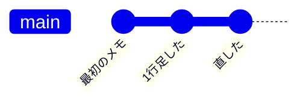
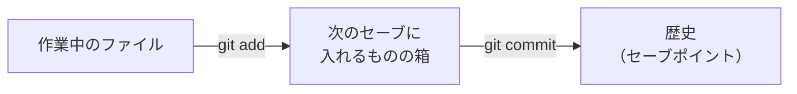
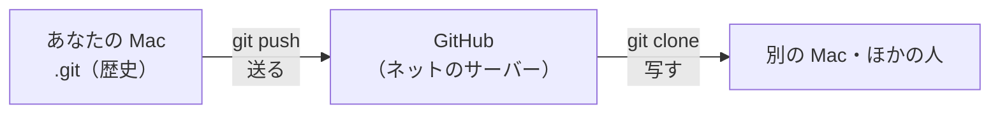

# 1-7 git と GitHub

所要 30分 ／ 種類：作る

## 今日のゴール
- ファイルの「セーブポイント」（コミット）を作り、歴史と違いを見られる
- `add`（選ぶ）と `commit`（セーブ）の2段階になっている理由が分かる
- git と GitHub の違いが分かる

## ステップ

### 1. なぜ git が要るの？

- **前提**：ファイルは書き換えると、前の中身が消えます（1-2 の `>` で見ましたね）
- **困りごと**：「直したら動かなくなった、前に戻したい」。`memo_最終.txt`、`memo_最終2.txt` とコピーが増えて、どれが最新か分からなくなります
- **解決**：好きなときに**セーブポイント（コミット）**を作り、歴史として全部残す道具が **git** です。いつでも前に戻れて、何が変わったかも見られます
- `git` は略語ではなく、作者が冗談で付けた名前です

### 2. このフォルダで git を始める
**やってみよう**：ターミナルで、norl-cs101 にいることを `pwd` で確かめてから、順に打ってください。
1. `mkdir playground/mygit`
2. `cd playground/mygit`
3. `git init`（**init**ialize：このフォルダで、セーブの仕組みを使い始める）
4. `ls -a`（`-a`＝**a**ll：名前が `.` で始まる、隠れたものも全部見せる）

`.git` という隠れたフォルダができました。ここが、**セーブの歴史をしまっておく倉庫**です。
<!-- 先生用：git init で「hint: Using 'master' as the name ...」と英語の注意が出ることがある。エラーではなく「初期設定のお知らせ」なので気にしなくてよい、と伝える -->

### 3. セーブは2段階：`add` で選び、`commit` で確定

- **前提**：作業中は、いくつものファイルを同時に変えます
- **困りごと**：全部をまとめてセーブしたくないときがあります。関係ない書きかけのファイルや、パスワードの入ったファイルなどです
- **解決**：`git add` で「次のセーブに入れるもの」を選び、`git commit` でセーブを確定する

**やってみよう**：ターミナルで（いまは `playground/mygit` の中です）、順に打ってください。
1. `echo 最初のメモ > memo.txt`
2. `git status`（status：状態。まだ箱に入っていないファイルが赤く出ます）
3. `git add memo.txt`
4. `git status`（今度は緑。箱に入りました）
5. `git commit -m "最初のメモ"`（`-m`＝**m**essage：このセーブに付けるメモ）

初めての `git commit` で、名前やメールを聞かれたら、`うまくいかない` を押してください。先生が設定を手伝います。
<!-- 先生用：git config --global user.name と user.email を、受講者自身に打ってもらう。値はチャットに書かせない。メールは GitHub に push すると公開されるので、気になるなら GitHub の noreply アドレス（あとで設定できる）でもよいと伝える -->

**確かめ**：パスワードの入ったファイルを、うっかりセーブしないために止められるのは？ ボタン：`git add で選ばない` / `git commit のあとで消す`
<!-- 先生用：git add の段階で、そのファイルを選ばない（箱に入れない）。間違えたら「commit したら歴史に残ってしまう。箱に入れる前に git status で確かめる」と1行で言い直す。7-6 の .gitignore はこれを自動でやる仕組み、と予告してもよい -->

### 4. 2つ目のセーブと、歴史
**やってみよう**：ターミナルで、順に打ってください。
1. `echo 2行目 >> memo.txt`（1-2 の `>>`：最後に足す）
2. `git add memo.txt`
3. `git commit -m "1行足した"`
4. `git log --oneline`（log：記録。`--oneline`＝1つのセーブを1行で）

新しいセーブが上、古いセーブが下に並びます。

### 5. 何が変わったかを見る `git diff`
**やってみよう**：ターミナルで `git diff HEAD~1` を打ってください。
- `diff`＝**diff**erence（違い）。`HEAD`＝いま立っているセーブ、`~1`＝その1つ前
- `+` で始まる緑の行が、足された行です（消した行は `-` で赤く出ます）

画面の下に `:` や `(END)` が出て止まっていたら、`q`（**q**uit）で戻れます。見終わったら `cd ../..` で norl-cs101 に戻ってください（`..` を2回＝2つ上）。

### 6. GitHub：セーブの歴史をネットに置く

- **前提**：ここまでの歴史は、あなたの Mac の `.git` の中にしかありません
- **困りごと**：Mac が壊れたら、歴史ごと消えます。人と一緒に作ることもできません
- **解決**：歴史を、インターネットの向こうのサーバーに置いておく。それが **GitHub** です。`git push`（押し出す）で送り、`git clone`（複製）で写します。実際に送るのは 4-6 でやります
- `github.com` も 0-3 で見た名前（ドメイン）で、裏では GitHub のサーバーの番号につながっています

**やってみよう**：このコース自体も GitHub に置いてあります。ブラウザで [norl-inc/norl-cs101](https://github.com/norl-inc/norl-cs101) を開き、「Commits」を押して、このコースのセーブの歴史を見てください。

4-6 で GitHub のアカウントを使います。持っていなければ、時間のあるときに、[github.com](https://github.com) で**自分で**作っておいてください（パスワードはチャットに書かないでください）。

**確かめ**：いま、あなたの Mac が壊れたら、`playground/mygit` のセーブの歴史は？ ボタン：`残らない` / `GitHub に残る`
<!-- 先生用：残らない。まだ push していないので、Mac の .git の中にしか無い。間違えたら、図の push の矢印を指して「まだ一度も送っていない」と1行で言い直す -->

## チェック
`/check`：`playground/mygit` で git を始めていて、コミットが2つ以上あれば合格。

## AIとの関係
Claude はよく「コミットしますか？」と聞きます。コミットはセーブポイントなので、**Claude に大きな変更をさせる前にコミットしておけば、失敗しても戻れます**。そして変更のあとは `git diff` で、Claude が何を変えたかを自分の目で確かめられます。AI と安心して作業するための、いちばんの保険です。
