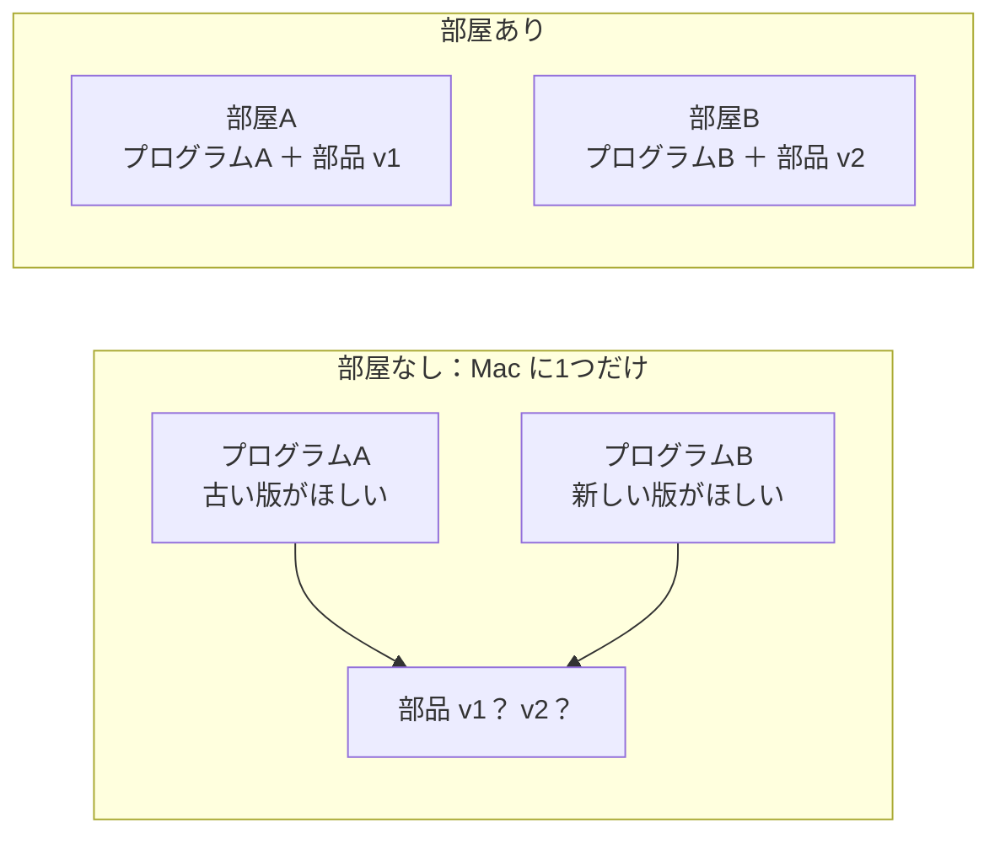
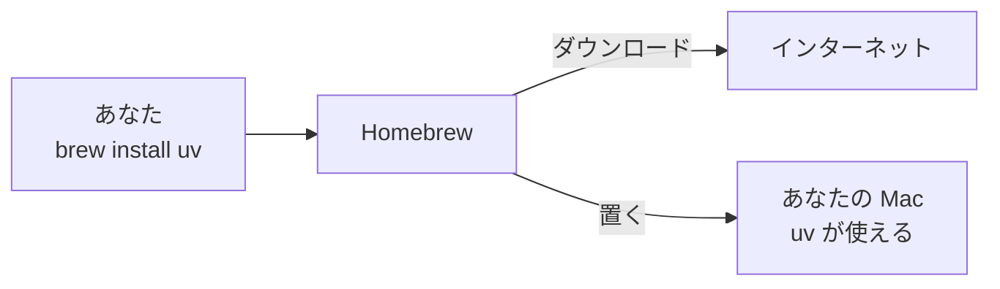
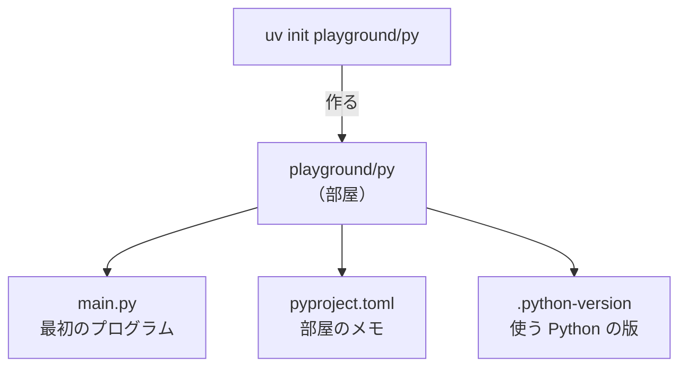
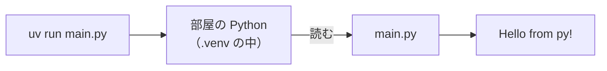

# 2-1 uv で Python の環境を作る

所要 20分 ／ 種類：作る

## 今日のゴール
- Python に「作業部屋」（仮想環境）が要る理由が分かる
- `uv` で部屋を作り、その中でプログラムを動かせる
- 部屋の中身が「ただの文字のメモ」だと分かる（第2部の実験は、全部この部屋でやります）

## ステップ

### 1. なぜ「部屋」が要るの？

- **前提**：Python のプログラムは、他人が作った部品（**パッケージ**）を借りて動きます。部品にも Python 自体にも、バージョン（版）があります
- **困りごと**：Mac に全部を1つずつしか入れないと、A は古い版、B は新しい版を欲しがったとき、どちらかが動かなくなります
- **解決**：プロジェクトごとに専用の**部屋**（**仮想環境**）を作り、そこに必要な部品だけを入れます。部屋作りを一瞬でやってくれる道具が **uv** です

**確かめ**：ある日、プログラムBのために部品を新しくしたら、昨日まで動いていたプログラムAが動かなくなりました。部屋を分けていれば防げたのはなぜ？ ボタン：`A の部屋の部品は昨日のまま残るから` / `部屋が部品を自動で A に合わせるから`
<!-- 先生用：A の部屋の部品は、B の部屋で何をしても変わらないから。間違えたら「部屋は勝手に直してくれない。分かれているから、B の変更が A に届かないだけ」と図の右側を指して1行で言い直す -->

### 2. uv を入れる

- **前提**：Mac には最初から入っていない道具があります。uv もその1つです
- **困りごと**：道具ごとに配布サイトを探して、手で入れるのは大変で、危ないこともあります
- **解決**：道具を入れる係 **Homebrew** に頼むと、決まった場所から取ってきて入れてくれます。コマンドは `brew`（Homebrew＝「自家醸造」から）

**やってみよう**：先生がターミナルを開きます。そこで順に打ってください。
1. `brew install uv`（install＝入れる）
2. `uv --version`（version＝版）。`uv 0.x.x` のような版の番号が出れば、入っています

> `brew` が見つからない（`command not found`）ときは、チャットで「uv の公式インストーラの入れ方を教えて」と頼んでください。**入れる前に、何をダウンロードして実行するのかを説明してもらいましょう。**

<!-- 先生用：brew が無い場合は、公式インストーラ（curl で取ってきて sh で実行する形）を案内する。何をどこから取ってきて実行するのかを一言で説明してから打ってもらう -->

### 3. 部屋を作って、中を見る

**やってみよう**：norl-cs101 の中で、順に打ってください。
1. `uv init playground/py`（init＝**init**ialize：使い始めの準備をする。1-7 の `git init` と同じ言葉です）
2. `ls -a playground/py`（`-a`＝**a**ll：`.` で始まる隠れたファイルも全部見せる）

| ファイル | 役目 |
|---|---|
| `main.py` | 最初のプログラム |
| `pyproject.toml` | この部屋の名前と、必要な部品のメモ。toml＝**T**om's **O**bvious **M**inimal **L**anguage（設定を書く形式） |
| `.python-version` | この部屋で使う Python の版 |

3. `cat playground/py/pyproject.toml` で、メモの中身を見る。ただの文字ですね（1-2 の「ファイルはただの文字」です）

### 4. 部屋の中で動かす

- 1-5 の `python3 hello.py` は、**Mac 全体の** Python で動かしていました
- `uv run`（run＝走らせる）は、**この部屋の** Python と部品で動かします
- 初めての `uv run` では、uv が部屋の本体 `.venv`（**v**irtual **env**ironment＝仮想環境）を作ります。Python のダウンロードが入ると、少し時間がかかります

**やってみよう**：順に打ってください。
1. `cd playground/py`（ここから第2部は、ずっとこのフォルダで作業します）
2. `uv run main.py` → `Hello from py!` と出れば成功
3. `ls -a` → さっきは無かった `.venv` が増えているはずです

> プロンプト（打つ場所の左側）に `(base)` と出ていたら、**conda** という別の道具の部屋に入っている印です。データサイエンスでよく使われます。このコースでは uv を使うので、気にしなくて大丈夫です。

**確かめ**：`python3 main.py` と `uv run main.py`。どちらも main.py を動かしますが、何が違う？ ボタン：`どの部屋の Python と部品で動かすか` / `main.py を読み込む速さ`
<!-- 先生用：どの Python（どの部屋の部品）で動かすか。python3 は Mac 全体の、uv run は playground/py の部屋の。間違えたら「今は部品を使っていないから結果は同じ。でも部品を足すと、部屋の外の python3 からは見えない」と1行で言い直す -->

### 5. 自分の言葉を表示させる
**やってみよう**：
1. `vi main.py` で開く（1-3 の5つ：`i` で書く → `Esc` → `:wq` で保存して閉じる）
2. `print("Hello from py!")` の `"..."` の中を、自分の好きな言葉に変える
3. `uv run main.py` で、もう一度動かす

自分の言葉が出たら、部屋づくりは完成です。

<!-- 先生用：ここは確かめ不要。ターミナルパネルで出力を見てほめる。print の行以外を消してしまってエラーになったら、エラーの最後の行を読ませてから :q! と vi の開き直しで直す -->

## チェック
`/check`：`playground/py/` ができていて、`uv run main.py` が動けば合格。

## AIとの関係
Claude が「`uv add requests` で部品を足して、`uv run` で実行します」と言ったら、やっているのは今日の部屋づくりの続きです。**どの部屋で、どの部品を足したか**を見れば、Claude の作業が追えます。
