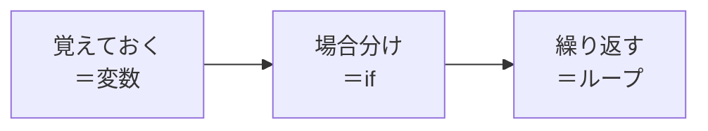
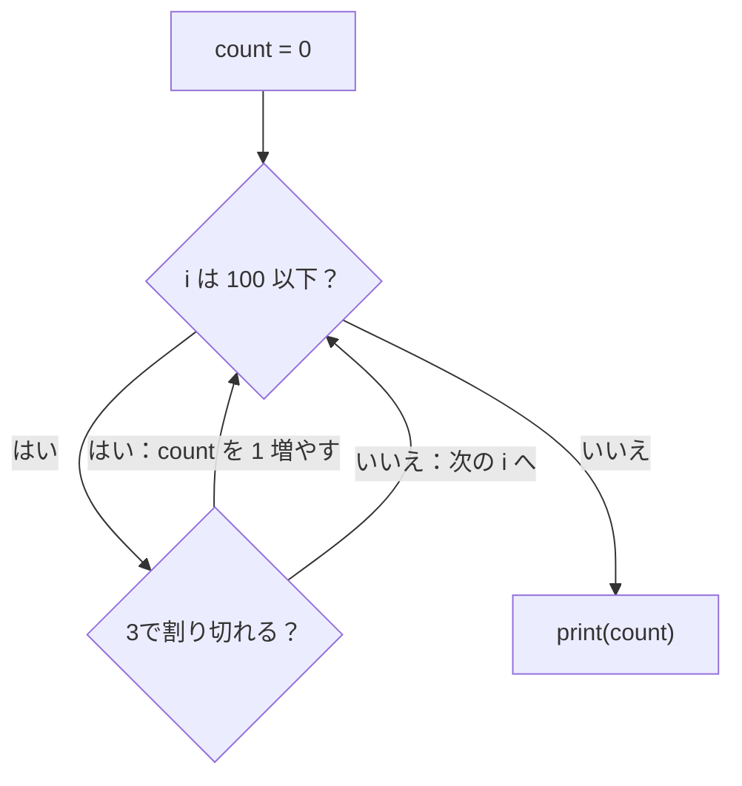
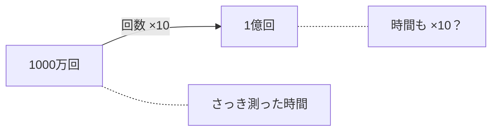

# 2-2 変数・if・ループ

所要 25分 ／ 種類：作る

## 今日のゴール
- プログラムの3つの基本（**変数・if・ループ**）を読めるようになる
- 「ループを回す回数 ＝ 仕事の量」を、自分の Mac の時間で感じる

## ステップ

### 1. プログラムは、3つの道具の組み合わせ

- **前提**：コンピュータは、決まった手順を、疲れず高速にくり返すのが得意です
- **困りごと**：でも手順に「覚えておく」「場合分け」「くり返し」が無いと、複雑な仕事を書けません
- **解決**：覚えておく＝**変数**、場合分け＝**if**（もし〜なら）、くり返し＝**ループ**。どんなプログラムも、ほぼこの3つの組み合わせです

| 名前 | 意味 | 例 |
|---|---|---|
| 変数 | 値に名前を付けた箱 | `count = 0`（count という箱に 0 を入れる） |
| if | 条件で分かれる | `if i % 3 == 0:`（3で割った余りが0なら） |
| ループ | 同じことをくり返す | `for i in range(1, 11):`（i を 1 から 10 まで変えながら） |

- Python では、**行頭の空白4つ（字下げ）**で「ここから中身」を表します
- `=` は「入れる」、`==` は「同じか比べる」。別物です

### 2. 書いて、動かす


**やってみよう**：ターミナルで（`playground/py` の中で。違う場所にいたら `cd playground/py`）。
1. `vi loop.py` で開いて、次を書く（写してOK。意味が読めれば十分です）

   ```python
   count = 0
   for i in range(1, 101):
       if i % 3 == 0:
           count += 1
   print(count)
   ```

2. `uv run loop.py` で動かす

| 書いたもの | 意味 |
|---|---|
| `range(1, 101)` | 1 から 100 まで（**終わりの数は含まない**のが Python の決まり） |
| `%` | 割り算の余り |
| `count += 1` | count を 1 増やす（`count = count + 1` の短い書き方） |
| `print` | 画面に出す（print＝印刷する） |

**確かめ**：`range(1, 101)` を `range(1, 11)` に変えたら、表示されるのは？ ボタン：`3` / `10`
<!-- 先生用：3（3, 6, 9 の3つ）。10 と答えたら「count が増えるのは if の中だけ」と、図の分かれ道を指して1行で言い直す。試すなら試してから range(1, 101) に戻してもらう -->

### 3. 1000万回まわしてみる
- **前提**：ループは、書いた回数だけ中身をくり返します。1回の中身がどんなに小さくても、回数分の仕事をします
- まずは、コンピュータが**どれくらい速いのか**を測ってみます

**やってみよう**：
1. `loop.py` の `range(1, 101)` を `range(1, 10_000_001)` に変える（1000万。`_` は読みやすくするための区切りで、無視されます）
2. 動かす前に、何秒かかりそうか、チャットに予想を書いてください
3. `time uv run loop.py`（time＝時間を測る）

数字のあとに、`... 0.84s user ... 0.86 total` のような1行が出ます。**`total` の前の数字**が、実際にかかった秒数です（環境によっては `real` という行で出ます）。

<!-- 先生用：Mac なら 1000万回で 1秒前後のことが多い。「1000万回でこれだけ？」という驚きが狙い。予想が大きく外れたら、「1秒に数百万回、if を確かめている」と言い直す。real が見つけにくければ、ターミナルパネルを読んで場所を指してあげる -->

### 4. 回数を10倍にすると、時間は？

- **前提**：ループの中身が同じなら、1回あたりの時間もほぼ同じです
- だから**回数が10倍なら、時間もだいたい10倍**になるはずです。本当か、測って確かめます

**やってみよう**：
1. `range(1, 10_000_001)` に `0` を1つ足して、`range(1, 100_000_001)`（1億）にする
2. もう一度 `time uv run loop.py`。さっきの時間と比べる
3. 終わったら `range(1, 101)` に戻しておく（`/check` がすぐ終わるように）

**確かめ**：1億回で 8秒かかる Mac なら、10億回はだいたい？ ボタン：`80秒くらい` / `16秒くらい`
<!-- 先生用：80秒くらい（×10）。実際には打たせなくてよい。「回数が分かれば、動かす前に時間が読める」がポイント。間違えたら「1000万→1億で何倍になった？ 回数が10倍なら、時間も10倍」と1行で言い直す -->

## チェック
`/check`：`playground/py/loop.py` に `for` と `if` があり、動いて数字を表示すれば合格。1000万回に変えたときの時間を、先生に口で伝えられるとなお良いです。

## AIとの関係
Claude が書くコードの大半は、変数・if・ループの組み合わせです。「このループは何回まわる？」と考える癖がつくと、AI が書いた遅いコードに気づけます。2-6 で、その目を使います。
