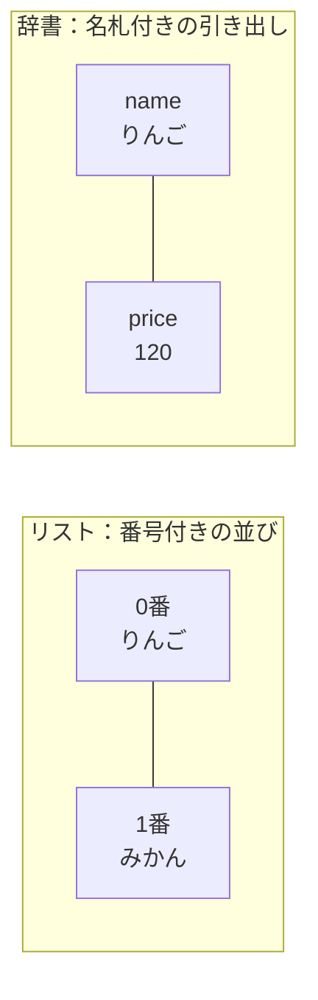
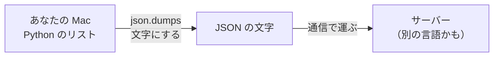
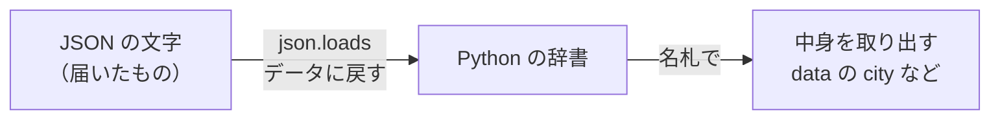

# 2-3 リストと辞書 ＝ JSON の形

所要 25分 ／ 種類：作る

## 今日のゴール
- **リスト**と**辞書**を読めるようになる
- それが Web の世界の共通語 **JSON** と、ほぼ同じ形だと知る
- なぜ JSON という「文字の書き方」が要るのか、説明できる

## ステップ

### 1. 2つの入れ物：リストと辞書

- **前提**：2-2 の変数は、1つの箱に1つの値でした
- **困りごと**：商品が100個あったら、変数を100個作るのは無理です。しかも1つの商品には「名前」と「値段」があり、まとめて扱いたい
- **解決**：並べて持つ **リスト**（`[ ]`）と、名札を付けて持つ **辞書**（`{ }`、英語で dict＝dictionary）を使います

組み合わせると、商品の一覧が書けます。

```python
items = [
    {"name": "りんご", "price": 120},
    {"name": "みかん", "price": 80},
]
```

- `items[0]` で0番目の商品（**番号は0から数えます**）
- `items[0]["price"]` で、その商品の `price` の引き出しの中身（120）

**確かめ**：`items[1]["price"]` は？ ボタン：`80` / `120`
<!-- 先生用：80。120 と答えたら「番号は0から。0番がりんご、1番がみかん」と図の番号を指して1行で言い直す -->

### 2. 商品の一覧を作って、JSON の文字にする
**やってみよう**：ターミナルで（`playground/py` の中で）。
1. `vi shop.py` で、好きな商品を**3つ**入れた `items` を書く（上の例を真似してOK）
2. 1行目に `import json` を足す（import＝取り込む。JSON を扱う部品を借ります）
3. 最後の行に、次の1行を足す

   ```python
   print(json.dumps(items, ensure_ascii=False, indent=2))
   ```

4. `uv run shop.py` で動かす

| 書いたもの | 意味 |
|---|---|
| `json.dumps` | Python のデータを、JSON の**文字**にする（**dump** **s**tring：文字として書き出す） |
| `ensure_ascii=False` | 日本語をそのまま出す（ASCII＝英数字だけの文字の表。それに限らなくていい、という指定） |
| `indent=2` | 見やすく字下げする（indent＝字下げ） |

`print` は、この `json.dumps` の1行だけにしてください（`/check` は、出力が JSON だけかを確かめます）。

出てきたものは、書いた `items` とほぼ同じ見た目のはずです。**でも、もう Python のデータではなく、ただの文字です。** なぜわざわざ文字にするのかを、次で見ます。

<!-- 先生用：出力をターミナルパネルで確かめてほめる。違いを聞かれたら「最後のカンマが消えた、字下げが2つになった程度。見た目はほぼ同じ、でも中身は文字の並び」と答える -->

### 3. なぜ「文字」にするの？

- **前提**：0-3 で見たとおり、Mac とサーバーは、番号（IPアドレス）で相手を見つけて通信します。通信で運べるのは、文字（0と1の並び）だけです
- **困りごと**：Python のリストは、Python がメモリの中で使う専用の形で、そのままでは運べません。しかも相手は Python ではなく、別の言語で動いているかもしれません
- **解決**：どの言語でも読み書きできる、**文字だけの書き方**を決めました。それが **JSON**（**J**ava**S**cript **O**bject **N**otation：JavaScript 式のデータの書き方）です
- Web のサービス（天気、ショッピングサイト、Claude）は、プログラム向けの窓口 **API**（**A**pplication **P**rogramming **I**nterface）で、JSON をやりとりしています

**確かめ**：サーバーが Python ではない別の言語で動いていても、JSON で送れば受け取ってもらえるのはなぜ？ ボタン：`どの言語でも読める、共通の文字の書き方だから` / `サーバーが Python に合わせて動いてくれるから`
<!-- 先生用：JSON はただの文字で、書き方のルールがどの言語でも共通だから。間違えたら「共通の書類の書式を決めておけば、どの国の役所でも読める」と1行でたとえ直す -->

### 4. 逆向き：JSON の文字を、Python のデータに戻す

- サーバーから届くのも、JSON の**文字**です
- 文字のままでは、「気温だけ取り出す」ができません。だから Python のデータに戻します
- `json.loads`（**load** **s**tring：文字から読み込む）が、`dumps` の逆をします

**やってみよう**：
1. `vi read.py` で、**別のファイル**に次の3行を書く

   ```python
   import json
   data = json.loads('{"city": "Tokyo", "temp": 18}')
   print(data["city"], data["temp"])
   ```

2. `uv run read.py` → `Tokyo 18` と出れば成功
3. わざと `data["temp"]` を `data["Temp"]`（T を大文字）にして、もう一度動かす。エラーの**最後の行**を読む
<!-- 先生用：エラーの最後の行 KeyError: 'Temp' の KeyError は「名札（key）が無い」という意味、と添える。読めたら temp に戻してもらう -->

第3部で、天気サイトの裏側を覗きます。そこで流れてくる JSON を見て「あ、辞書とリストだ」と読めれば勝ちです。

## チェック
`/check`：`playground/py/shop.py` が JSON だけを表示し、2件以上の商品（それぞれ `name` と `price` あり）が入っていれば合格。

## AIとの関係
Claude に頼みごとを送るときも、返事が返ってくるときも、裏の通信の中身は JSON です。`{` と `[` の入れ子を見て怖がらず読めるのが、AI の裏側を理解する第一歩です。
