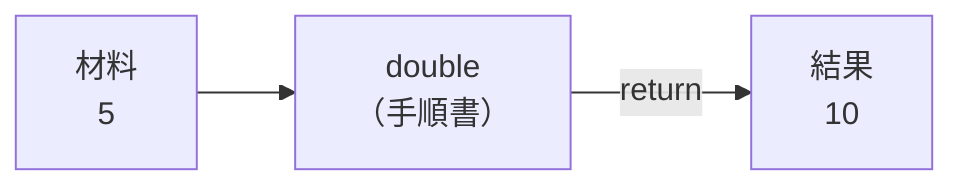
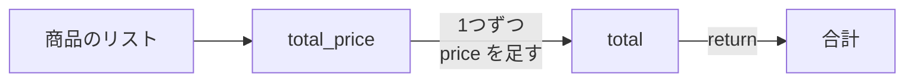
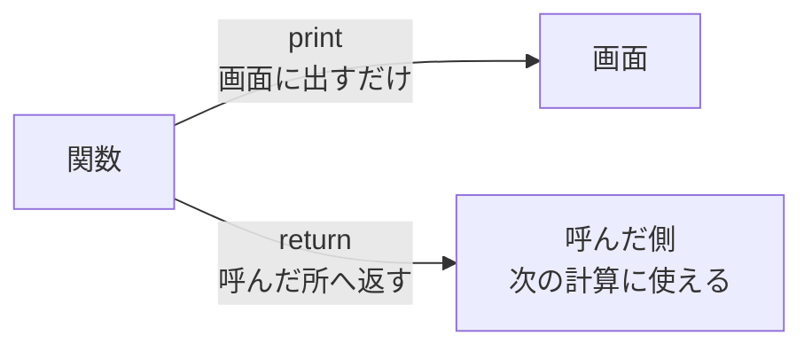

# 2-4 関数

所要 20分 ／ 種類：作る

## 今日のゴール
- **関数**（名前を付けた手順書）を読める
- 自分で2つ書いて、呼び出せる
- `return`（結果を返す）と `print`（画面に出す）の違いが分かる

## ステップ

### 1. なぜ関数？

- **前提**：プログラムが長くなると、同じ手順が何か所にも出てきます
- **困りごと**：コピペで増やすと、直すときに全部の場所を直し忘れます。長すぎて、何をしているかも読めなくなります
- **解決**：手順に名前を付けて1か所に書き、必要なときに名前で呼びます。これが**関数**。「材料を渡すと、結果を返してくれる小さな機械」です

```python
def double(x):
    return x * 2

print(double(5))   # 10
```

| 部分 | 意味 |
|---|---|
| `def double(x):` | double という手順書を作る。材料は x（def＝**def**ine：定義する） |
| `return x * 2` | 結果として x の2倍を返す（return＝返す） |
| `double(5)` | 手順書を使う（**呼び出す**） |

`#` から右は、Python が読み飛ばすメモ（コメント）です。

**確かめ**：`double(double(3))` は？ ボタン：`12` / `6`
<!-- 先生用：12（内側の double(3) が 6、それをもう一度 double して 12）。6 と答えたら「内側から。まず double(3) の結果が、外側の double の材料になる」と、図の矢印を2回たどって1行で言い直す -->

### 2. 税込み価格を返す関数を書く
**やってみよう**：ターミナルで（`playground/py` の中で）`vi funcs.py` を開き、関数 `add_tax(price)` を**自分で**書きます（名前は合わせてください）。
- 税込み価格（10%増し）を返す関数です。`add_tax(1000)` は `1100`
- ヒント：上の `double` と同じ形。`price * 1.1` で考える
- 最後に、使ってみる行を足す

  ```python
  print(add_tax(1000))
  print(add_tax(100))
  ```

- `uv run funcs.py` で動かす

`add_tax(100)` の結果が、`110` ではなく **`110.00000000000001`** になったはずです。
- **前提**：コンピュータは、小数も0と1で覚えます
- **困りごと**：`1.1` のような小数は、0と1ではぴったり書き切れません（1÷3 を `0.333…` と書き切れないのと同じです）。だから、ほんの少しずれます
- **解決**：お金のように整数でほしいときは、`round(...)`（round＝丸める）で丸めます

**やってみよう**：`round` を使って、`add_tax(100)` が `110` になるように直してください。
<!-- 先生用：答えのコードは書かない。詰まったら「round(ここに計算) の形で、計算をかっこで包む」までヒントを出す -->

### 3. 合計を返す関数を書く


**やってみよう**：同じ `funcs.py` に、関数 `total_price(items)` を**自分で**書き足します。
- 2-3 のような商品のリスト（辞書のリスト）を受け取って、`price` の合計を返す関数です
- ヒント：2-2 の `count = 0` と同じように、`total = 0` の箱を用意して、ループで足していく
- ヒント：1つの商品の値段は、2-3 の `item["price"]` の形で取り出せる
- 最後に、使ってみる行を足して `uv run funcs.py`

  ```python
  print(total_price([{"name": "a", "price": 100}, {"name": "b", "price": 200}]))
  ```

  `300` と出れば成功です

<!-- 先生用：/check は total_price([]) が 0 になるかも確かめる。エラーや None になる場合は、return の位置（for の中に入っていないか、字下げ）を見てもらう -->

### 4. return を消すと、どうなる？

- `print` は、**人間の目**に見せるだけです
- `return` は、関数を呼んだ場所に**値を渡し**、次の計算に使えるようにします
- 何も `return` しない関数は、`None`（＝何も返ってこなかった）を返します

**やってみよう**：
1. `add_tax` の `return` を `print` に書き換えて、`uv run funcs.py`
2. 最後の行に `print(add_tax(1000) + 1)` を足して、もう一度動かす。エラーの**最後の行**を読む
3. 確かめたら、`return` に戻して、足した行も消す

**確かめ**：画面には `1100` が出ていたのに、`+ 1` でエラーになったのはなぜ？ ボタン：`print は画面に出すだけで、値を返さないから` / `1100 が文字になっていて足せないから`
<!-- 先生用：print は画面に出しただけで、呼んだ側には何も返していない（None が返った）。間違えたら、図の2本の矢印を指して「画面行きと、呼んだ側行きは別の道」と1行で言い直す。最後に return に戻したかをファイルで確かめる -->

## チェック
`/check`：`add_tax` と `total_price` が正しい答えを返せば合格。

## AIとの関係
Claude が書いたコードを読むときは、まず `def` の行だけ拾ってください。関数の名前と材料を並べるだけで、プログラム全体の地図になります。`total_price(items)` と書いてあれば、中を読まなくても何をするか想像できます。
