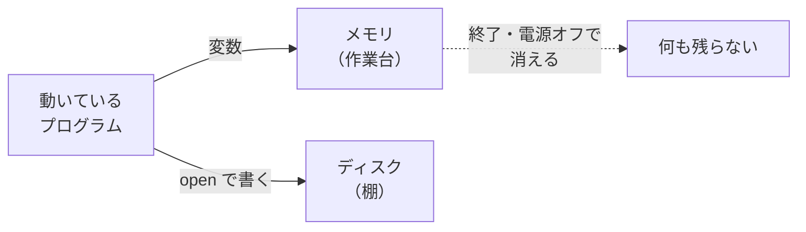
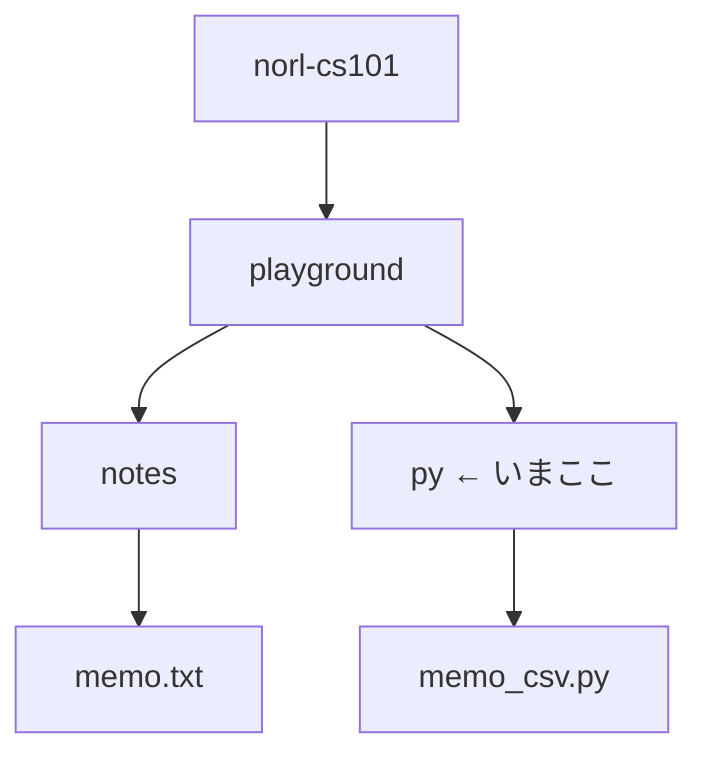
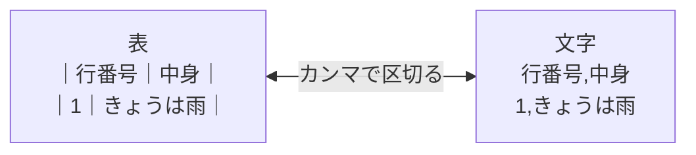
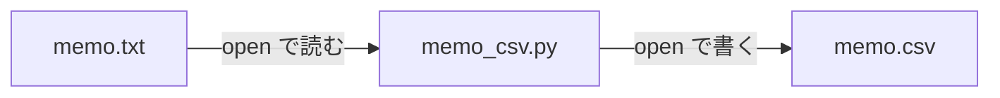
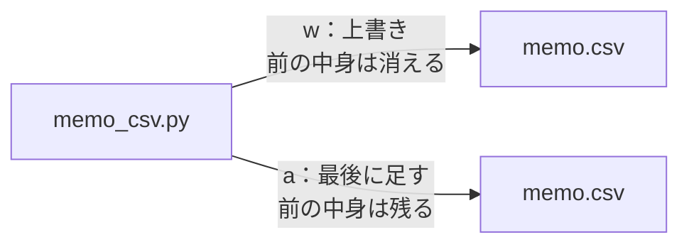

# 2-5 ファイルを読み書き

所要 25分 ／ 種類：作る

## 今日のゴール
- プログラムの結果が終わると消える理由と、ファイルに残す意味が分かる
- Python からファイルを**読んで**、**書ける**
- 1-2 で作った `memo.txt` から、表の形式 CSV を作る

## ステップ

### 1. なぜファイルに書くの？

- **前提**：プログラムの変数は、**メモリ**（作業台）に置かれます。速いけれど、プログラムが終わると片付けられて消えます
- **困りごと**：計算した結果や集めたデータが、終了と同時に無くなります
- **解決**：残したいものは**ファイル**にして、**ディスク**（棚）にしまいます。次回は、そこから読み込みます

**確かめ**：アプリで書きかけの文章が、急な電源オフで消えてしまいました。図で言うと？ ボタン：`まだメモリにだけあって、ディスクに無かった` / `ディスクにしまった文章が壊れた`
<!-- 先生用：まだメモリ（作業台）にだけあって、ディスク（棚）に保存されていなかった。間違えたら「棚のものは無事。作業台の上のものが、棚にしまう前に片付けられた」と図の点線を指して1行で言い直す -->

### 2. Python でファイルを読む

- `playground/py` から見ると、`memo.txt` は「1つ上（`..`）の `notes` の中」。だから `../notes/memo.txt` と書きます（`..` は 1-1 で出てきた「1つ上」）

```python
with open("../notes/memo.txt", encoding="utf-8") as f:
    lines = f.readlines()
print(lines)
```

| 書いたもの | 意味 |
|---|---|
| `open(...)` | ファイルを開く（open＝開く） |
| `encoding="utf-8"` | 文字の番号表は UTF-8 で読む（文字も番号で保存されている。日本語を正しく読むための指定） |
| `with ... as f:` | 開いたファイルを `f` と呼び、使い終わったら自動で閉じる。今は決まり文句で大丈夫です |
| `f.readlines()` | 1行ずつのリストにする（read lines：行を読む） |

**やってみよう**：
1. 先に `cat ../notes/memo.txt` で、memo.txt が**2行以上**あるか見る。無い・1行だけなら、1-2 の `echo ... >>` で足しておく
2. `vi memo_csv.py` で、上の3行を書く
3. `uv run memo_csv.py` で動かす

### 3. CSV：表を、文字だけで書く

- **前提**：ファイルに保存できるのは、ただの文字です
- **困りごと**：でも、表（行と列）の形で残したいことがよくあります
- **解決**：列の区切りを `,`（カンマ）、行の区切りを改行にすれば、表が文字だけで書けます。これが **CSV**（**C**omma-**S**eparated **V**alues：カンマで区切った値）。Excel でも開けます

```
行番号,中身
1,きょうは雨
2,Python をはじめた
```

### 4. memo.txt を CSV にして書き出す


**やってみよう**：`memo_csv.py` を書き足して、次をさせます（`print(lines)` の行は消してOK）。
1. 読むときと同じ `with` の形で、`memo.csv` を**書くモード**で開く：`with open("memo.csv", "w", encoding="utf-8") as f:`（`"w"`＝**w**rite：書く）
2. その中（字下げして）で、1行目に `行番号,中身` と書く：`f.write("行番号,中身\n")`（write＝書く。`\n` で改行）
3. 続けて（同じく字下げの中で）、memo の各行を `番号,中身` の形で書く
   - ヒント：`for n, line in enumerate(lines, 1):` で、1 から番号を付けながらループできる（enumerate＝数え上げる）
   - ヒント：`line.strip()` で、行の終わりの改行を取れる（strip＝はぎ取る）
   - ヒント：memo.txt に空の行があったら、2-2 の `if` で飛ばす
4. `uv run memo_csv.py` → `cat memo.csv` で中身を見る
5. memo.txt に1行足して（`echo ... >> ../notes/memo.txt`）、もう一度動かして `cat memo.csv`
<!-- 先生用：答えのコードは書かない。詰まったらヒントの順に1つずつ -->

### 5. `"w"` と `"a"` の違い

- 1-2 の `>`（上書き）と `>>`（足す）と同じ関係です。`"a"` は **a**ppend（付け足す）
- Python もシェルも、同じ「ただの文字のファイル」を触っています

**やってみよう**：
1. `memo.csv` を開く所の `"w"` を `"a"` に変える
2. `uv run memo_csv.py` を**2回**動かして、`cat memo.csv`
3. 見たら `"w"` に戻して、もう一度 `uv run memo_csv.py`（`/check` のために、きれいな CSV にしておきます）

**確かめ**：Claude に「毎回の作業の記録（ログ）をファイルに残して」と頼んだとき、使ってほしいのは？ ボタン：`"w"` / `"a"`
<!-- 先生用：「a」。ログは前の記録を消さずに足していくもの。間違えたら「w だと毎回、前の記録が消える。2. で見たとおり」と1行で言い直す -->

## チェック
`/check`：`playground/py/memo.csv` ができていて、1行目が見出し、残りの行数が `memo.txt` の空でない行数と同じなら合格。

## AIとの関係
Claude が「ファイルを読み込んで加工し、CSV に保存しました」と言ったら、今日書いた形のコードが動いています。**どのファイルを読んで、どこに書いたか**を確認する癖をつけましょう。`"w"` は上書きなので、大事なファイルに向けられていないかは要チェックです。
