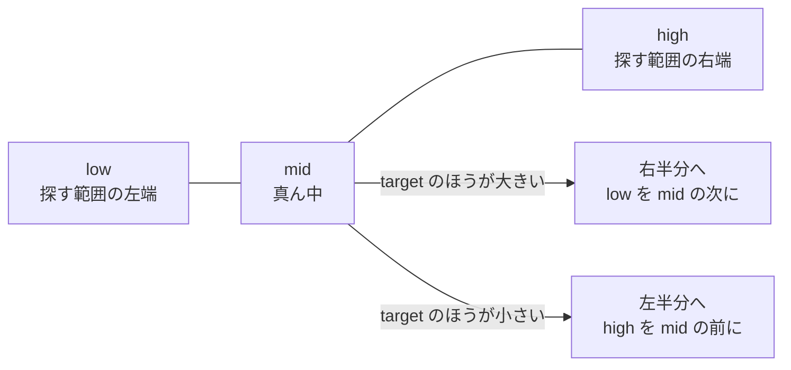
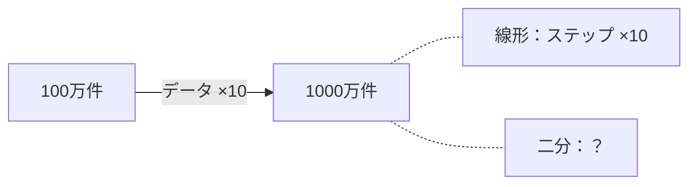

# 2-6 100万件で探す：線形探索 vs 二分探索

所要 30分 ／ 種類：作る

## 今日のゴール
- 同じ「探す」でも、やり方しだいで**何千倍も速さが違う**ことを、自分の Mac の時間で体感する
- 二分探索の考え方（半分に絞る）を、自分の言葉で説明できる
- データが10倍に増えたとき、どちらのやり方が困るか分かる

## ステップ

### 1. なぜ「やり方」が問題なの？

- **前提**：コンピュータは、1回の確認は一瞬です。でも、1回ごとに少しずつ時間がかかります（2-2 の「回数 ＝ 仕事の量」）
- **困りごと**：データが100万件、1億件になると、全部を1つずつ見るやり方では、何秒も何分もかかります
- **解決**：データを並べておき、**見る回数そのものを減らします**。こうした手順の工夫を**アルゴリズム**と呼びます

| 名前 | やり方 | 100万件なら最大 |
|---|---|---|
| 線形探索 | 先頭から1つずつ見る | 100万回 |
| 二分探索 | 真ん中を見て、半分に絞る（**小さい順に並んでいるデータ限定**） | 約20回 |

紙の辞書で単語を引くとき、1ページ目から読む人はいませんよね。真ん中あたりを開いて「探している言葉はもっと後ろだ」と半分に絞る。それが二分探索です。

**確かめ**：二分探索は、並んでいないデータ（シャッフルしたトランプの山など）には使えません。なぜ？ ボタン：`真ん中を見ても、どちらの半分にあるか決められないから` / `バラバラだと、半分に分けられないから`
<!-- 先生用：真ん中を見ても、探し物が右と左のどちらにあるか決められないから（半分を捨てられない）。間違えたら「辞書がバラバラの順だったら、真ん中を開いても『もっと後ろ』と言えない」と1行で言い直す -->

### 2. 提供プログラムを読む
**やってみよう**：ターミナルで。
1. いまいる場所を確かめる：`pwd`。`.../playground/py` なら、`cd ../..` で norl-cs101 に戻る
2. 提供プログラムを自分の部屋にコピー：`cp lessons/02-python/06-binary-search/search.py playground/py/search.py`（`cp`＝**c**o**p**y：コピー）
3. `cd playground/py` → `cat search.py` で、中を読む

2-4 の作戦で、まず `def` の行だけ拾ってください。

| 関数 | 何をする？ |
|---|---|
| `linear_search` | 線形探索。先頭から1つずつ見る |
| `binary_search` | 二分探索。**まだ未完成**（①②③の3か所が空いている） |
| `run` | どちらかの探し方で50回探し、時間とステップ数（見た回数）を表示する |

### 3. 動かして、エラーを読む
**やってみよう**：`uv run search.py`
- 線形探索の時間が出たあと、二分探索で**エラー**になります。**これはわざとです**
- エラーの最後の行を読んで、何と言っているかチャットに書いてください

<!-- 先生用：「答えが違います：二分探索で…」と読めればOK。エラーを読めたことをほめる。線形探索の秒数は次のステップで使うので覚えておいてもらう -->

### 4. 二分探索の①②③を直す

- `low`（低い）と `high`（高い）は、まだ探している範囲の両端の**位置**です。`mid` は **mid**dle（真ん中）
- 毎回、真ん中を見て、探し物が無い側の半分を捨てます

**やってみよう**：`vi search.py` で、`binary_search` の中の①②③を直します。答えは自分で（詰まったら `/hint`）。

| 印 | 考え方 |
|---|---|
| ① | `low` と `high` の真ん中の位置。足して2で割る（`//` は割り算の切り捨て。位置は整数でないといけないので） |
| ② | 真ん中の値 `data[mid]` より、`target` のほうが大きい？ |
| ③ | 右半分を探すので、`low` を `mid` の1つ先へ |

直したら `uv run search.py`。最後まで動けば成功です。
<!-- 先生用：答えのコードは書かない。ヒントは「方向性 → 使う道具 → ほぼ答え」の順 -->

### 5. 何倍違う？
**やってみよう**：`uv run search.py` の出力で、次の2つを見比べてください。
- 線形探索と二分探索の**秒数**。最後の行に「約◯倍速い」と出ます
- **のべステップ数**（50回探して、合計で何回見たか）

数千倍の違いが出たはずです。結果は同じでも、仕事の量がまったく違います。

<!-- 先生用：ここは確かめ不要。出力をターミナルパネルで見て、倍率とステップ数を一緒に声に出して読む。「線形はのべ数千万回、二分は千回くらい」 -->

### 6. データを10倍にしたら？

線形探索は、データが10倍なら見る回数も10倍です。では、二分探索は？

**やってみよう**：
1. 動かす前に、二分探索の1回あたりのステップが何回くらい増えるか、チャットに予想を書く
2. `vi search.py` で、2か所の `2_000_000` を `20_000_000` に変える
   - `data = list(range(0, 2_000_000, 2))` の行（データを1000万件に）
   - `targets = [random.randrange(0, 2_000_000) ...` の行（探す数の範囲も合わせる）
3. `uv run search.py`（線形探索は10秒以上かかることがあります。表示の「100万件」はそのままですが、中身は1000万件です）
4. 見終わったら、2か所とも `2_000_000` に戻す（`/check` が速く終わるように）

**確かめ**：データが10倍になっても、二分探索のステップは1回あたり3〜4回しか増えませんでした。なぜ？ ボタン：`半分に3〜4回絞れば、元の大きさに戻るから` / `Python が途中を自動で飛ばしてくれるから`
<!-- 先生用：10倍のデータも、半分に3〜4回絞れば元の大きさに戻るから（2を3〜4回かけると約10）。予想が「10倍」なら、それが普通の感覚で、だからこそ驚く所だと伝える。間違えたら「1000万件 → 3〜4回半分にすると 100万件くらい。そこからは前と同じ」と1行で言い直す -->

## チェック
`/check`：`playground/py/search.py` が最後まで動き、二分探索が正しい答えを返せば合格。

## AIとの関係
AI が書いたコードが「動くけど遅い」ことがあります。そのとき「ここ、毎回全部見てない？」と指させるのが、今日の収穫です。Claude に「もっと速くできる？」と聞くと、データベースの索引（第4部）など、同じ発想の道具を提案してくれます。ただし二分探索は**並んでいるデータ限定**。その前提が守られているかも、見るところです。
