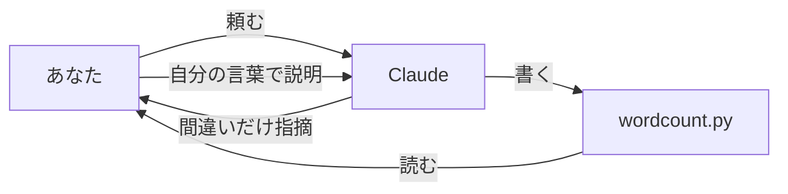

# 2-7 Claude に書かせたコードを読んで説明する

所要 25分 ／ 種類：覗く

## 今日のゴール
- Claude が書いたコードを、**1行ずつ自分の言葉で説明**できる
- 実行する前に、結果を読みで当てられる
- 1か所、自分の手で変えられる

このレッスンだけは **Claude がコードを書きます**。そのかわり、**説明するのはあなた**です。

## ステップ

### 1. なぜ「読む」練習？

- **前提**：AI は間違えます。間違えなくても、頼んだことを**少し違う形**で実現することがあります
- **困りごと**：読めないコードは、合っているか確かめられません。信じるか、捨てるかしかありません
- **解決**：自分の言葉で説明できるまで読みます。説明できれば、どこまで任せていいかを自分で決められます。書けなくても、読めれば十分です

**確かめ**：Claude に「日記に今日の1行を足すプログラム」を頼み、エラーなく動きました。でも中で `open(..., "w")` を使っていたら？ ボタン：`前の日記が消えている` / `最後に今日の1行が足されている`
<!-- 先生用：前の日記が消えている（2-5 の "w" は上書き）。動いても、頼んだことと少し違うことをしている場合がある。間違えたら「エラーが出ないのは『動いた』だけ。『頼んだとおり』かは読まないと分からない」と1行で言い直す -->

### 2. Claude に書いてもらう
**やってみよう**：チャットに、次の文を送ってください。

> playground/py/wordcount.py を作って。playground/notes/memo.txt を読んで、行数と、各行の文字数を表示するプログラム。20行以内で、関数を1つ使って。

書き終わったら、ターミナルで `cat wordcount.py`（`playground/py` の中で）。自分の目でも見てください。

<!-- 先生用：ここは先生（Claude）自身が書く。2-2〜2-5 で出たものだけ（変数・for・if・リスト・def・return・open・with・strip・len など）で書き、ファイル名は ../notes/memo.txt（playground/py から実行する前提）。書いたあと、コードの説明はしない。「説明はこのあと、あなたにしてもらいます」とだけ言う。len が初出なら、聞かれたとき「len＝length：長さ」と答える -->

### 3. まず、印を付けて読む
説明を聞く前に、目で読みます。2-4 の作戦どおり、**まず `def` の行**から。

| 探すもの | 見つける印 | 出てきたレッスン |
|---|---|---|
| 関数 | `def` で始まる行 | 2-4 |
| 変数 | `=` の左側 | 2-2 |
| ループ | `for` | 2-2 |
| 条件 | `if` | 2-2 |
| ファイルを開く所 | `open` | 2-5 |

### 4. 1行ずつ、自分の言葉で説明する
**やってみよう**：チャットに「1行目から、私が自分の言葉で説明するね。合っているか教えて」と送り、上から順に説明していきます。
- 分からない行は飛ばさず、**その行だけ**「ここ、何をしてる？ 例を出して」と聞いてください
- 分からない単語は、ステップ3の表のレッスンのどれかに出てきたはずです

<!-- 先生用：正解を先に言わない。受講者の説明の「間違い」と「あいまいな所」だけを直す。合っていたら短くほめて次の行へ。1メッセージで1〜3行ずつ進める。全体を説明できたら次のステップへ -->

### 5. 動かす前に、結果を当てる
コードが読めていれば、動かす前に結果が分かるはずです。

**やってみよう**：
1. `cat ../notes/memo.txt` で、memo.txt の中身を見る
2. 動かす前に、何が表示されるか（何行で、それぞれ何文字か）を、チャットに予想として書く
3. `uv run wordcount.py`

**確かめ**：予想と文字数がずれていたら、まず見るべき行は？ ボタン：`行末の改行を取っている所（strip）` / `ファイルを開いている所（open）`
<!-- 先生用：strip の所（行末の改行 \n を文字数に入れるかどうか）。空の行を数えるかどうか（if）も効く。予想が合っていたら「読めている証拠」とほめ、ずれるならここ、と一緒にコードで指さす。間違えたら「open はファイルを開くだけ。1文字ずつの数え方を変えるのは strip」と1行で言い直す -->

### 6. 1か所だけ、自分で変える
**やってみよう**：Claude には頼まず、`vi wordcount.py` で**自分の手で**1か所変えます。たとえば：
- 表示の文言を変える
- 空の行を数えないようにする（`if` を足す）
- 文字数が10より多い行だけ表示する

変えたら `uv run wordcount.py`。
<!-- 先生用：変更と結果の対応をターミナルパネルで確かめる。エラーが出たら、まずほめて、最後の行を読ませる。字下げのずれが多い -->

## チェック
`/check`：チェックの自動判定はありません。次の3つを先生（Claude）がチャットとターミナルパネルで確認します。
- `playground/py/wordcount.py` があり、`uv run wordcount.py` が動く
- 全体を説明でき、ほとんどの行を自分の言葉で言えた
- 自分の手で1か所変えて、実行結果が変わった

## AIとの関係
これからは、コードを書くのはほとんど Claude になります。でも「何をするコードか」を読める人だけが、任せていい範囲を決められます。**書けなくても、読んで説明できれば十分**。これが第2部のゴールです。
