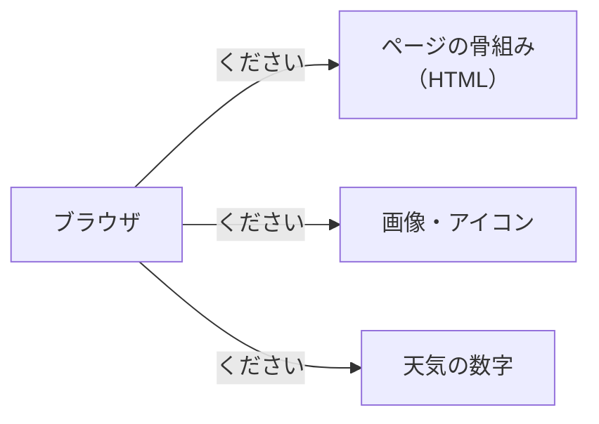
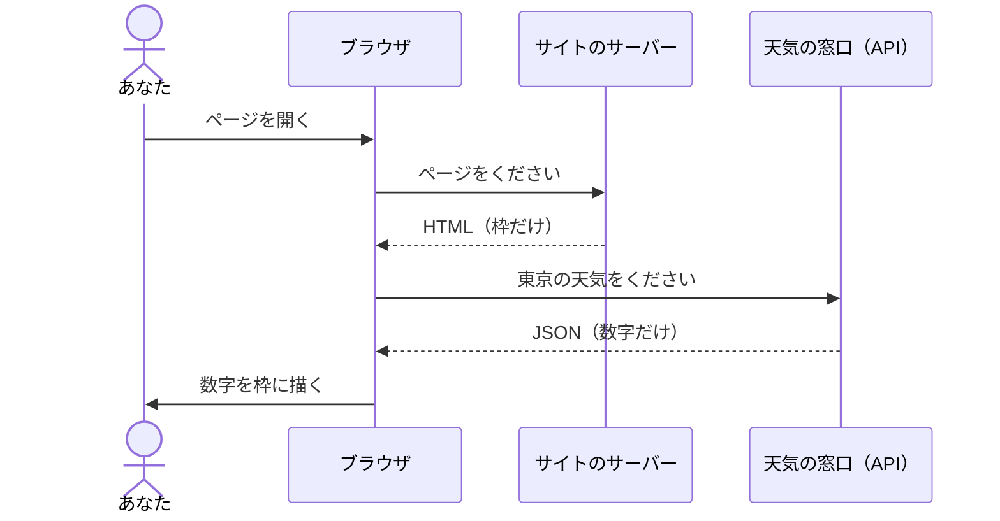
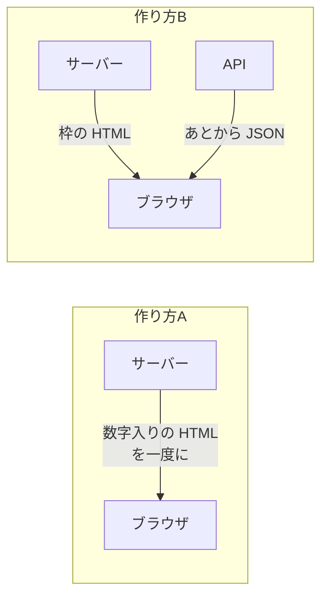

# 3-1 DevTools で天気サイトの裏側を覗く

所要 25分 ／ 種類：覗く

## 今日のゴール
- ブラウザに付いている道具（DevTools）で、ページの裏の通信を見られるようになる
- 天気の数字が、ページとは別に **JSON** で届いているのを自分の目で見つける
- 「画面」と「データ」が別の窓口に分かれている理由が分かる

## ステップ

### 1. ページは「何十回」にも分けて届いている

- **前提**：0-3 で、ブラウザは名前を番号に変えてから、相手に「ページください」と頼むと見ました。実は1回では終わりません。**部品ごとに何十回も**「ください」と頼んでいます
- 骨組みは **HTML**（**H**yper**T**ext **M**arkup **L**anguage：ページの骨組みを書く言葉。3-4 で自分で書きます）
- **困りごと**：この何十回のやりとりは、ふだん画面には出ません。何がどこから来たのか、見えないままです
- **解決**：ブラウザには開発者用の道具 **DevTools**（**Dev**eloper **Tools**）が付いています。その **Network** タブが、やりとりを1行ずつ記録して見せてくれます

**先にルール（大事）**
- **ログインしていないページだけ**を見ます。Network には送ったもの全部が映るので、ログイン中だと自分の個人情報も映るからです
- 見るだけ。書き込んだり、ボタンを連打したりしません。自動で大量にアクセスするのもダメです

**やってみよう**：Chrome で、ログイン不要の天気サイトを開いてください。サイトは変わるので、うまく開けなければ「いま使えるサイトを一緒に探して」とチャットに書いてください。

| 候補 | メモ |
|---|---|
| Yahoo!天気、tenki.jp、ウェザーニュース | 日本の天気。広告が多いけど見られることが多い |
| weather.gov（アメリカ気象局） | 公的機関のサイト。データの窓口も公開されている |
| open-meteo.com | 3-3 で使う無料の天気の窓口。トップページに天気の例が出る |

### 2. DevTools を開いて、通信の行を眺める
**やってみよう**：天気サイトの上で、次の順に操作してください。
1. ページの上で右クリック →「検証」（`Cmd + Option + I` でも開きます）
2. 開いた画面の上のタブから **Network** を選ぶ
3. ページを**リロード**（`Cmd + R`）。下に行がずらっと並びます

- 1行が、ステップ1の図の矢印1本です
- 左の名前が「何をください」と頼んだか、Status の数字が返事の結果です（200 なら成功。3-3 でくわしく）

### 3. 数字は、あとから別に届く：API と JSON

- **前提**：天気の数字は、刻一刻と変わります。一方、ページの枠（見出しやメニュー）はほとんど変わりません
- **困りごと**：数字を HTML に直接書くと、変わるたびにページごと作り直しです。それに、飾りの多い画面用の文章から気温だけ探し出すのは、プログラムには大変です
- **解決**：枠は先に送り、数字だけを**データ専用の窓口**からあとで受け取って、枠に埋めます
  - その窓口が **API**（**A**pplication **P**rogramming **I**nterface）。プログラムが「これください」と頼める窓口です。レストランの注文口のようなもの
  - 渡す書式が **JSON**（**J**ava**S**cript **O**bject **N**otation）。`{"temperature": 17.2}` のように、名札と値を並べただけの文字です。2-3 で見た辞書とリストの形そのままです

**確かめ**：気温が 17℃ から 18℃ に変わりました。受け取り直すのはどれ？ ボタン：`枠の HTML と数字の JSON の両方` / `数字の JSON だけ`
<!-- 先生用：数字の JSON だけ。枠は変わっていないので、そのまま使える。だから分けると速くて軽い。「両方」と答えたら「メニューや見出しは変わっていないので、枠は前のまま使い回せる」と1行で言い直す -->

### 4. Fetch/XHR で絞って、JSON を見つける
**やってみよう**：Network タブで、次の順に操作してください。
1. Network の上の方にある **Fetch/XHR** を押す。「あとから別の窓口に聞いた通信」だけに絞るボタンです（Fetch＝取ってくる。XHR＝**X**ML**H**ttp**R**equest：昔からある「あとから聞く」仕組みの名前）
2. もう一度リロード（`Cmd + R`）
3. 名前に `forecast`、`weather`、`api`、`json` などが入っている行をクリック
4. 右側の **Preview**（折りたたんで見やすくしたもの）か **Response**（届いた文字そのまま）を見る

気温や降水確率の数字が見えたら、大成功です。

### 5. 見つからなかったら：作り方は2通りある

- Fetch/XHR に何も出ないサイトもあります。失敗ではありません
- それは**作り方A**：サーバーの側で数字を HTML に埋めてから送っているサイトです
- 今日見つけたのは**作り方B**。最近のサイトや、Claude が作るアプリの多くはこちらです

## チェック
自動チェックはありません。`/check` と言うと、先生が「見つけた JSON の名札を2つ教えて」と聞きます。答えられれば合格です。

## AIとの関係
Claude に「このサイトのデータを取ってきて」と頼むと、画面の HTML を読むより、こうした JSON の窓口を使う方が速くて正確です。「数字がどこから来ているか」を知っていれば、Claude の作戦を読めます。
