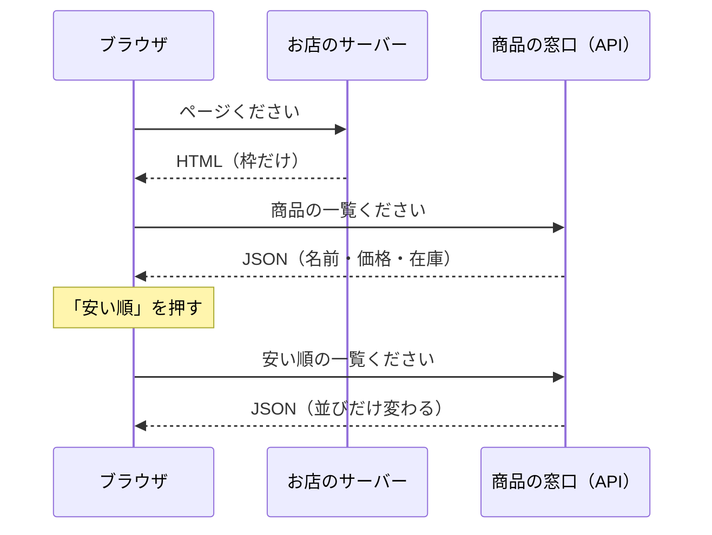
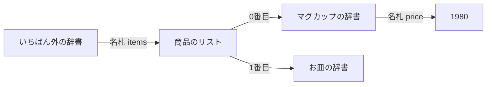

# 3-2 DevTools でショッピングサイトの裏側を覗く

所要 25分 ／ 種類：覗く

## 今日のゴール
- 商品一覧ページの裏で、**価格や在庫の JSON** が流れているのを見つける
- JSON の中から「1つ目の商品の価格」までの道順を読める
- 「見た目は違うのに、しくみは天気サイトと同じ」と気づく

## ステップ

### 1. 並び替えても、ページ全体は作り直さない

- **前提**：3-1 で、枠（HTML）と数字（JSON）は別に届くと見ました。お店のページも同じ作りのことが多いです
- **困りごと**：お店では「安い順」「次のページ」が何度も押されます。そのたびにページ全体を作り直して送ると、遅くて重くなります
- **解決**：枠はそのまま。**商品の JSON だけ**を API（3-1：プログラム向けの窓口）に頼み直して、商品カードを描き直します

**先にルール**：3-1 と同じです。**ログインしない・見るだけ・大量アクセスしない**。カートに入れたり、買ったりはしません。

**やってみよう**：ログイン不要の商品一覧ページを開いてください。サイトは変わるので、「いま見られる商品一覧を一緒に探して」とチャットに頼んでも大丈夫です。

| 候補 | メモ |
|---|---|
| 楽天市場、Yahoo!ショッピングなどの検索結果 | 商品が並ぶ。JSON が見えるかはサイトしだい |
| ブランドの公式通販サイトのカテゴリページ | 小さめのお店のほうが見つけやすいことも |
| 学習用のダミーショップ（先生が探します） | 本物のお店ではなく、練習用に公開されているもの |

### 2. 「次のページ」を押して、増えた行を見る
**やってみよう**：商品一覧の上で、次の順に操作してください。
1. DevTools を開く（右クリック →「検証」）→ **Network** → **Fetch/XHR**
2. 一度、Network の行を消す（左上の、丸に斜線のアイコン。Clear＝消去）
3. **「次のページ」か「並び替え」**を押す（見るだけの操作です）
4. 新しく増えた行をクリックして、**Preview** を見る
5. `price`、`stock`、`name`、`items`、`products` のような名札を探す

JSON が見当たらないサイトもあります（3-1 の作り方A）。それも発見です。別のサイトで試しましょう。

### 3. JSON の形を読む：価格までの道順
見つけた JSON は、たとえばこんな形です（名札はサイトによって違います）。

```json
{ "items": [ { "name": "マグカップ", "price": 1980, "inStock": true },
             { "name": "お皿",       "price": 2400, "inStock": false } ] }
```


- `{ }` は名札つきの箱（辞書）、`[ ]` は番号つきの並び（リスト）。2-3 でやった形です
- リストの番号は **0 から**数えます
- Preview では、▶ を押すと中が開きます。リストの横には件数が出ます

**やってみよう**：自分が見つけた JSON で、Preview の ▶ を開いて、1つ目の商品の価格までたどってください。

**確かめ**：上の例の JSON で、「お皿」の価格までの道順は？ ボタン：`items → 2 → price` / `items → 1 → price`
<!-- 先生用：items → 1 → price。リストの番号は 0 から数えるので、マグカップが 0、お皿が 1。「2」と答えたら「1つ目が 0 番なので、2つ目は 1 番」と1行で言い直す。3-7 の data["current"]["temperature_2m"] の下地になる -->

### 4. 天気と比べる：見た目は違っても、形は同じ
| | 天気サイト（3-1） | ショッピングサイト |
|---|---|---|
| 見た目 | 地図・アイコン | 写真・カード |
| 裏の JSON | 気温・降水確率のリスト | 価格・在庫のリスト |
| 形 | `{ }` と `[ ]` の組み合わせ | **同じ** |

- どんなサイトでも、データは `{ }` と `[ ]` の組み合わせで届きます
- だから、一度読み方を覚えれば、どのサイトの JSON も読めます。これが API と JSON の強みです

**確かめ**：画面の値段が「0円」なのに、Network の JSON は `"price": 1980` でした。おかしいのはどっち？ ボタン：`データ（お店のサーバー）` / `画面に描く部分`
<!-- 先生用：画面に描く部分。データは正しく届いているので、JSON を画面に描くところで間違えている。「データ」と答えたら「JSON には 1980 と正しく届いている。だから間違いはその後」と1行で言い直す。この切り分けが「AIとの関係」につながる -->

## チェック
自動チェックはありません。`/check` と言うと、先生が「どの名札に価格が入っていた？ リストの中身は何件だった？」と聞きます。答えられれば合格です。

## AIとの関係
Claude にアプリを作らせると、画面とデータは別々に作られます。何かおかしいとき、Network の JSON を見れば「データが変なのか、画面が変なのか」を切り分けられます。それを伝えるだけで、Claude の直しはぐっと速くなります。
