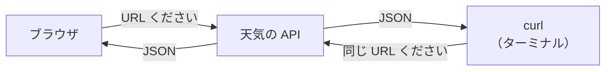
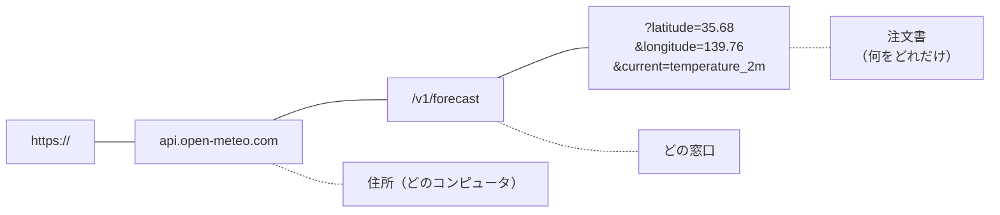
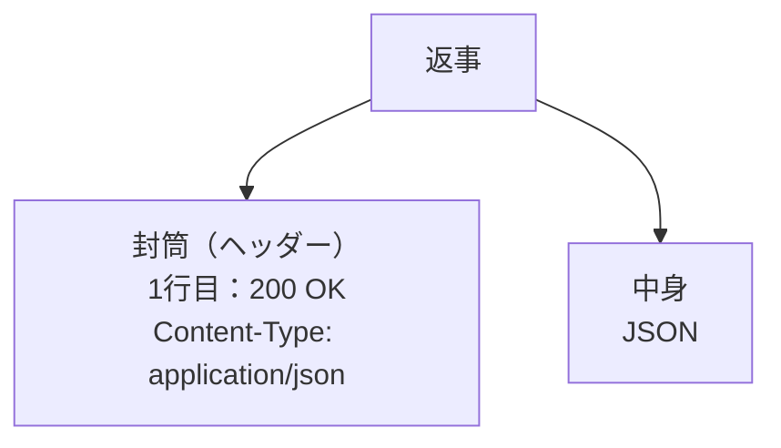

# 3-3 curl で API を直接叩く

所要 20分 ／ 種類：作る

## 今日のゴール
- ブラウザを使わずに、ターミナルから天気の API を呼ぶ
- URL の `?` から後ろを書き換えて、頼む中身を変えられる
- 返事の「封筒」（ヘッダー）と、結果の番号（ステータスコード）を読める

## ステップ

### 1. ブラウザの代わりに、curl で頼む

- **前提**：ブラウザは、0-1 で見た **HTTP**（Web のやりとりのルール）で「この URL ください」と頼み、返事を受け取っています。3-1 の Network の1行1行がそれです
- **困りごと**：ブラウザは返事を受け取ると、すぐ画面に描いてしまいます。返事そのものを見るには、毎回 DevTools を開いて探すことになります
- **解決**：ターミナルから同じルールで頼める道具 **`curl`**（**c**lient **URL**：URL に頼みに行く係）を使います。返事を飾らず、届いた文字のまま見せてくれます

今日は、キー（合言葉）不要で無料の天気 API、**Open-Meteo** を使います。

**やってみよう**：先生が開いたターミナルで、次を打ってください（長いので、コピーして貼り付けて大丈夫です）。

```bash
curl "https://api.open-meteo.com/v1/forecast?latitude=35.68&longitude=139.76&current=temperature_2m"
```

1行の JSON が返ってきます。その中の `"temperature_2m"` の後ろの数字が、東京の今の気温（℃）です。

次に、**同じ URL をブラウザのアドレス欄に貼って**開いてみてください。

<!-- 先生用：ターミナルは norl-cs101 のいちばん上のフォルダにいる状態にしておく（ステップ3で playground/ に保存するため） -->

### 2. URL の `?` から後ろは「注文書」

- **前提**：0-1 で、URL は「方式・住所・ポート・パス」の部品でできていると見ました
- **困りごと**：同じ天気の窓口に、「どこの」「何を」知りたいかも伝えたい。場所ごとに別の窓口を作るのは無理です
- **解決**：パスの後ろに `?` を付け、`名前=値` を `&` でつないで書きます。これを**クエリ**（query：問い合わせ）と呼びます。窓口に出す注文書のようなものです

| 部分 | 意味 |
|---|---|
| `latitude=35.68` `longitude=139.76` | 場所（緯度・経度。東京あたり） |
| `current=temperature_2m` | 欲しいもの（今の、地上2mの気温） |

**やってみよう**：ターミナルで、URL を書き換えてもう一度打ってください。
1. `current=temperature_2m` を `current=temperature_2m,wind_speed_10m` に変える。風速も返ってきますか？
2. 緯度・経度を、行ってみたい街のものに変える（「〇〇の緯度経度は？」とチャットで聞いて大丈夫です）

返ってきた JSON の `"time"` を見てください。今の時刻と、少しずれていませんか？

**確かめ**：`"time"` が、日本の時刻より9時間ずれているのはなぜ？ ボタン：`緯度・経度の書き方がずれているから` / `世界の基準の時刻で答えているから`
<!-- 先生用：世界の基準の時刻（GMT。JSON の "timezone":"GMT" に書いてある）で答えているから。日本は GMT より9時間進んでいる。間違えても、注文書に &timezone=Asia/Tokyo を足すと日本時間になることを見せ、「注文書に書かないことは、窓口の決まり（初期値）で答える」と1行で伝える -->

### 3. 結果をファイルに保存する
画面に出すだけでなく、ファイルに残すこともできます。

**やってみよう**：次を打ってください。
```bash
curl -s "https://api.open-meteo.com/v1/forecast?latitude=35.68&longitude=139.76&current=temperature_2m" -o playground/weather.json
```

| 付けたもの | 元の英語 | 意味 |
|---|---|---|
| `-s` | silent（静かに） | 途中経過などの余計な表示を消す |
| `-o playground/weather.json` | output（出力） | 画面ではなく、このファイルに書く |

画面には何も出ません。できたファイルを `cat playground/weather.json`（1-2 の `cat`）で見てみてください。さっきと同じ JSON が入っています。

### 4. 返事の「封筒」：ヘッダーとステータスコード

- **前提**：返事には、中身のほかに「うまくいったか」「中身は何の形式か」の情報も要ります
- **困りごと**：中身だけだと、受け取ったプログラムには、成功したのか失敗の知らせなのか分かりません
- **解決**：中身の前に**ヘッダー**（封筒の表書き）を付け、1行目に結果を3桁の番号で書きます。これが**ステータスコード**。番号なら機械にも一目で分かります

**やってみよう**：`-i`（include：ヘッダーも含める）を付けて打ってください。
```bash
curl -i "https://api.open-meteo.com/v1/forecast?latitude=35.68&longitude=139.76&current=temperature_2m"
```

| 見る場所 | 意味 |
|---|---|
| 1行目 `HTTP/... 200 OK` | ステータスコード。200＝成功 |
| `Content-Type: application/json` | 中身は JSON です、という表書き |
| `X-RateLimit-Limit` | 呼んでいい回数の上限（呼びすぎると 429 が返る） |

続けて、わざと失敗させます。
1. URL の `forecast` を `forecas` に変えて、`-i` 付きで打つ
2. 元に戻して、今度は `current=temperature_2m` を `current=temp` に変えて打つ

| 番号 | 意味 |
|---|---|
| 200 | 成功 |
| 400 | 頼み方がおかしい |
| 404 | そんな場所はない |
| 429 | 呼びすぎ |
| 500 | 向こう側の故障 |

**確かめ**：`forecas` では 404、`current=temp` では 400 でした。400 になったのは、URL のどこを間違えたから？ ボタン：`クエリ（注文書）` / `パス（どの窓口）`
<!-- 先生用：クエリ（注文書）。forecas は「窓口（パス）」の間違いなので、そんな窓口はない＝404。temp は窓口は合っていて注文書の中身がおかしい＝400。間違えたら「お店の住所を間違えた（404）」と「お店で存在しないメニューを頼んだ（400）」のたとえで1〜2行言い直す -->

## チェック
`/check`：`playground/weather.json` に、気温が入った Open-Meteo の JSON が保存されていれば合格。

## AIとの関係
Claude が「API を叩いて確認しました」と言うとき、たいてい今の `curl` と同じことをしています。ステータスコードが 200 かどうか、400 なのか 404 なのかを自分で見られれば、報告の裏取りができます。
