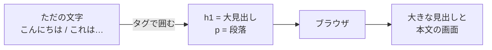
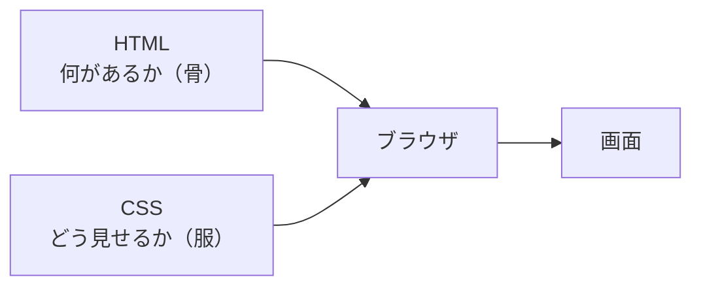

# 3-4 HTML と CSS：ページの骨と服

所要 25分 ／ 種類：作る

## 今日のゴール
- 自分で Web ページを書いて、ブラウザで開く
- **HTML ＝ 中身と骨組み、CSS ＝ 見た目**、と分けている理由が分かる
- DevTools の Elements で、ブラウザが読んだ HTML を覗ける

## ステップ

### 1. HTML：文字に「意味の札」を付ける

- **前提**：ブラウザは、文字のファイルを読んで画面を描きます。HTML（3-1）は、プログラムではなく**ただの文字のファイル**です（1-2 の「ファイルはただの文字」）
- **困りごと**：ただ文字を並べただけでは、どこが見出しで、どこが本文か、ブラウザには分かりません
- **解決**：`<h1>こんにちは</h1>` のように、**タグ**（`< >` で書く札）で文字を囲んで意味を付けます。`<h1>` で始めて `</h1>` で閉じる、の組です

**やってみよう**：先生が開いたターミナルで、次を打ってください。
1. `mkdir -p playground/web`（1-2 の `mkdir`。`-p`＝parents：途中のフォルダもまとめて作る。もうあってもエラーにしない）
2. `vi playground/web/index.html` で、次を書いて保存（1-3 の vi。貼り付けても、見ながら打っても大丈夫です）

```html
<!DOCTYPE html>
<html lang="ja">
<head>
  <meta charset="utf-8">
  <title>わたしのページ</title>
</head>
<body>
  <h1>こんにちは</h1>
  <p>これは私が書いた最初のWebページです。</p>
</body>
</html>
```
<!-- 先生用：ターミナルは norl-cs101 のいちばん上のフォルダにいる状態で。vi が不安そうなら、:wq までを一緒に確認する -->

### 2. ブラウザで開いて、head と body を見分ける
**やってみよう**：ターミナルで `open playground/web/index.html` と打ってください（`open`＝開く。Mac のコマンドで、ファイルをいつものアプリで開きます）。

| 部分 | 役目 |
|---|---|
| `<head>…</head>` | ページ**について**の情報（文字の種類、題名など）。画面の本文には出ない |
| `<body>…</body>` | 画面に出る中身 |
| `<h1>…</h1>` | 大見出し |
| `<p>…</p>` | 段落（**p**aragraph） |

アドレス欄は `file://...` になっています。0-1 の `http://localhost:8000` と違い、**サーバーを通さず、Mac のファイルを直接**開いている印です（サーバーは 3-6 で立てます）。

### 3. CSS：見た目は別に書く

- **前提**：ページには、たくさんの見出しや段落が並びます
- **困りごと**：見た目を HTML の1つ1つに混ぜて書くと、「見出しの色を変えたいだけ」のときも、全部の見出しを探して直すことになります
- **解決**：見た目は **CSS**（**C**ascading **S**tyle **S**heets：見た目の指定を重ねていく書き方）として別にまとめます。「どこを」「どう見せる」の組を1回書けば、当てはまる所すべてに効きます。服だけ着替えられるのです

**やってみよう**：`index.html` の `</head>` の**すぐ上**に、次を足して保存し、ブラウザをリロード（`Cmd + R`）してください。

```html
<style>
  body { font-family: sans-serif; background: #fff8e7; }
  h1   { color: tomato; }
</style>
```

| 書いたもの | 日本語にすると |
|---|---|
| `h1 { color: tomato; }` | h1 を、トマト色に |
| `body { background: #fff8e7; }` | ページ全体の背景を、この色に（`#` の後ろは色の番号） |

好きな色や、文字の大きさ（`h1` の中に `font-size: 40px;`）に変えて遊んでください。壊れたら戻せば大丈夫です。

**確かめ**：友だちのページの見た目だけをまねしたい（文章は自分のまま）。もらうのはどっち？ ボタン：`HTML` / `CSS`
<!-- 先生用：CSS。見た目は CSS に分けてあるので、服だけ借りて着替えられる。HTML と答えたら「HTML をもらうと、中身の文章まで友だちのものになる。借りたいのは骨ではなく服」と1行で言い直す -->

### 4. DevTools の Elements で覗く
**やってみよう**：ブラウザで、次の順に操作してください。
1. 右クリック →「検証」→ 上のタブから **Elements**
2. 自分が書いた HTML が見えます。`<h1>` の行をクリック
3. 右側（または下）の **Styles** に `color: tomato` が出ます。`tomato` をダブルクリックして `blue` に変える
4. 見出しが青くなったら、ページを**リロード**

**確かめ**：Elements で青にしたのに、リロードしたら元の色に戻ったのはなぜ？ ボタン：`ファイルは変わっていなかったから` / `ブラウザが保存に失敗したから`
<!-- 先生用：ファイルは変わっていなかったから。DevTools で変えたのは「ブラウザが読み込んだ写し」だけで、リロードで index.html を読み直したので元に戻った。間違えたら「写しに落書きしただけで、原本はそのまま」と1行で言い直し、「試しに変えて、気に入ったらファイルに書く」使い方ができる、と伝える -->

## チェック
`/check`：`playground/web/index.html` に見出しとスタイル（色の指定）があれば合格。

## AIとの関係
Claude が作るページの大半は、今日の形（HTML ＋ CSS ＋ 次回の JavaScript）です。「ここの色を変えて」と頼む代わりに、自分で `color` の行を探して直せます。Elements で試してから頼めば、「この見出しを `blue` に」と正確に伝えられます。
