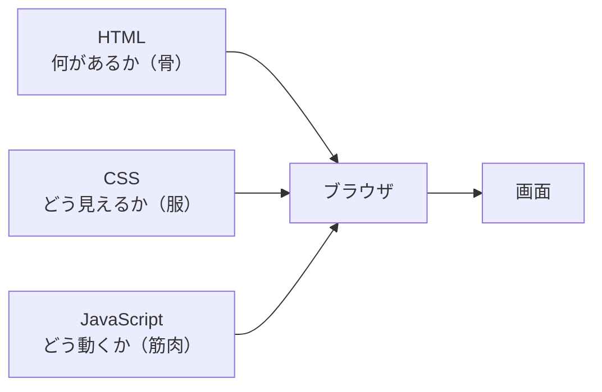
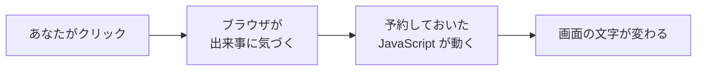

# 3-5 JavaScript：ページを動かす

所要 25分 ／ 種類：作る

## 今日のゴール
- ボタンを押すと数が増えるページにする
- **JavaScript ＝ ブラウザの中で動くプログラム**だと分かる
- DevTools の Console で、ページに直接命令したり、赤いエラーを読んだりできる

## ステップ

### 1. 三役：HTML・CSS・JavaScript

- **前提**：3-4 の HTML と CSS は「置いてあるだけ」です。書いたとおりの画面が出て、それきり自分では変わりません
- **困りごと**：「押された」「入力された」「時間が経った」という出来事に反応できません。ボタンを置いても、押して何も起きないページになります
- **解決**：ブラウザの中で動くプログラム **JavaScript**（略して JS）に、反応を書いておきます。ページを開いたあとも、ブラウザが画面を動かし続けてくれます
- 名前は似ていますが、Java という別の言語とは関係ありません

**確かめ**：JavaScript が要るのはどっち？ ボタン：`開いたとき見出しが赤い` / `クリックしたら見出しが赤くなる`
<!-- 先生用：クリックしたら赤くなる、のほう。開いたとき赤いだけなら CSS でできる（置いてあるだけで赤い）。逆を選んだら「赤いこと」ではなく「クリックという出来事で変わること」に JS が要る、と1行で言い直す -->

### 2. ボタンと表示場所を置く
**やってみよう**：3-4 で作った `playground/web/index.html` を vi で開き、`<body>` の中、最初の `<p>` の下に次の2行を足して保存してください。

```html
<button id="btn">押してみて</button>
<p id="msg">まだ押されていません</p>
```

ブラウザをリロードして、ボタンを押してみてください。……何も起きませんね。ステップ1の「困りごと」そのものです。

- `id="btn"` は**名札**です。ページの中で1つだけの名前を付けます
- 名札を付けても、見た目は変わりません

### 3. 「押されたら」を書く

- **前提**：ブラウザは、ページを開いたあともずっと、クリックやキー入力を見張っています。この出来事を**イベント**（event）と呼びます
- **困りごと**：でもブラウザは、出来事が起きたときに**何をすればいいか**を知りません
- **解決**：「この部品で、この出来事が起きたら、これをやって」と、JavaScript で**予約**しておきます

**やってみよう**：`</body>` の**すぐ上**に次を足して保存し、リロードしてボタンを何回か押してください。

```html
<script>
  const btn = document.getElementById("btn");
  const msg = document.getElementById("msg");
  let count = 0;
  btn.addEventListener("click", function () {
    count = count + 1;
    msg.textContent = count + " 回押されました";
  });
</script>
```

| 行 | 日本語にすると |
|---|---|
| `document.getElementById("btn")` | ページ（document）から、名札（id）が btn の部品を探して |
| `let count = 0;` | 押された回数を入れる変数を、0 で用意（2-2 の変数） |
| `addEventListener("click", …)` | クリック（click）されたら、この中をやって、と予約（listen＝耳をすます） |
| `msg.textContent = …` | msg の文字（text）を書き換えて |

覚えなくて大丈夫です。表と見比べて「何をしているか」が読めれば十分です。

**確かめ**：ボタンを3回押したあと、ページをリロードすると、表示は？ ボタン：`3 回押されました` / `まだ押されていません`
<!-- 先生用：「まだ押されていません」に戻る（答えたあと、実際にリロードしてもらう）。count はブラウザがその場で覚えていただけで、どこにも保存していないから、読み直すと count = 0 から。間違えたら「ホワイトボードに書いた数は、消して書き直すと残らない」と1行で言い直し、「覚えておくには保存する場所が要る」→ 4-4 データベースにつながる、と一言添える -->

### 4. Console：ブラウザの中の JavaScript に直接話しかける
- **Console** は、ブラウザの中の JavaScript に、1行ずつ直接命令できる場所です。ターミナルのブラウザ版のようなものです
- エラーが起きたときに、赤い文字で知らせてくれる場所でもあります

**やってみよう**：DevTools（右クリック →「検証」）の **Console** タブを開き、`>` の後ろに1行ずつ打って Enter を押してください。

```js
document.title
document.body.style.background = "pink"
```

1行目では文字が返ってきて、2行目ではページの背景がピンクになります。
<!-- 先生用：Chrome の Console は、初めて貼り付けると警告が出て「allow pasting」と打つよう求められる。だまされて悪いコードを貼る事故を防ぐ仕組み。ここは短いので手で打ってもらうのがよい -->

### 5. わざと壊して、赤いエラーを読む
**やってみよう**：
1. Console を開いたままにする
2. `index.html` の `getElementById("btn")` を `getElementById("btm")` に変えて保存
3. ブラウザをリロードして、Console を見る。赤いエラーが出ます
4. ボタンも押してみる

エラーは、だいたいこういう文です：`Uncaught TypeError: Cannot read properties of null (reading 'addEventListener')`

| 部分 | 意味 |
|---|---|
| `null` | 「何もない」。btm という名札の部品は見つからなかった |
| `reading 'addEventListener'` | 何もないものに、予約をしようとした |
| 右端の `index.html:15` など | エラーが起きたファイルと行番号 |

<!-- 先生用：エラーはページを開いたときに出る。<script> は読み込んだ瞬間に上から実行され、btm が見つからず止まるので、予約もされずボタンも動かない。読み終えたら btm を btn に戻してもらう -->

## チェック
`/check`：`playground/web/index.html` にボタンと、クリックで動くスクリプトがあれば合格。

## AIとの関係
Claude が作ったアプリで画面が動かないとき、**Console の赤いエラー**が最初の手がかりです。スクショより、エラーの文と行番号をそのまま渡す方が、Claude は早く直せます。
