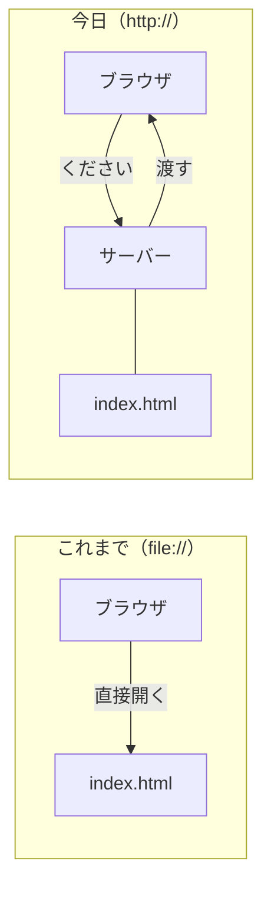
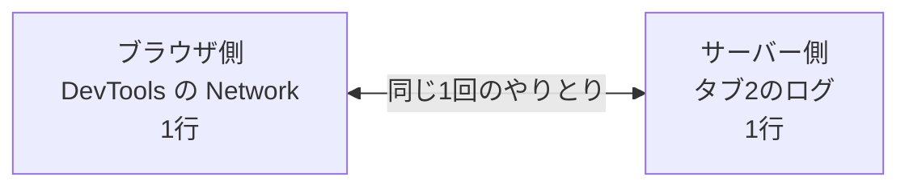

# 3-6 Webサーバーを立てる

所要 20分 ／ 種類：作る

## 今日のゴール
- 自分の Mac を「Webサーバー」にして、3-5 のページを `http://` で開く
- ページを開くたびに、**サーバー側のログ**が1行ずつ増えるのを見る
- 0-1 で Claude が実行した `python3 -m http.server` が何だったのか分かる

## ステップ

### 1. ファイルを開くのと、サーバーから受け取るのは違う

- **前提**：3-4・3-5 では、`file://` で Mac のファイルを**直接**開きました。でも、ほかの人のコンピュータの中のファイルを、直接開くことはできません
- **困りごと**：だから Web では、「ください」と頼まれたら渡してくれる係がいないと、誰もページを受け取れません
- **解決**：頼まれるのを**ずっと待ち続けるプログラム**を動かしておきます。これが **サーバー**（server：仕える人、給仕係）です。頼みは 0-1 で見た **HTTP** のルールで届きます

### 2. サーバーを起動する
先生が、サーバー用のタブ（タブ2）を開きます。最初のタブ（タブ1）は、あなたが打つために空けておきます。

**やってみよう**：**タブ2**で、次の2行を順に打ってください。
```bash
cd playground/web
python3 -m http.server
```

| 部分 | 意味 |
|---|---|
| `cd playground/web` | 渡したいファイルがあるフォルダへ移る（1-1 の `cd`＝change directory）。サーバーはこのフォルダの中身を渡す |
| `python3 -m http.server` | Python に最初から入っている部品（**m**odule）の、`http.server`（HTTP のサーバー）を動かす |

`Serving HTTP on :: port 8000 (http://[::]:8000/) ...` と出て、プロンプト（`%`）が戻ってきません。これは**待っている**状態です。`8000` は 0-1 で見た窓口の番号（ポート）です。
<!-- 先生用：Address already in use と出たら、0-1 や 0-3 のサーバーが 8000 番で残っている。先生がそのタブを Ctrl+C で止めてから、もう一度打ってもらう -->

**確かめ**：このタブ2で、続けて `ls` を打ったら？ ボタン：`ファイルの一覧が出る` / `何も実行されない`
<!-- 先生用：何も実行されない。サーバーがそのタブを使い続けている（待ち続けている）ので、新しい命令を受け付けない。だから打つ用のタブ1を別に空けておいた、と種明かしする。間違えたら「店番中の人は、別の用事を頼まれても手が離せない」と1行で言い直す -->

### 3. 開いて、ログを読む
**やってみよう**：ブラウザで `http://localhost:8000` を開いてください。3-5 で作ったページが出たら、**タブ2**を見てください。1行増えています。

```
::1 - - [07/Nov/2026 16:30:35] "GET / HTTP/1.1" 200 -
```

| 部分 | 意味 |
|---|---|
| `::1`（または `::ffff:127.0.0.1`） | 頼みに来た相手の番号。0-3 の `127.0.0.1` と同じ「自分自身」で、新しい書き方（IPv6）のもの |
| `GET` | 「ください」という頼み方（HTTP の頼み方の種類） |
| `/` | どれをください。`/` はトップ。サーバーは決まりで `index.html` を渡す |
| `200` | 成功（3-3 で見た番号） |

`GET /favicon.ico ... 404` という行も出ているかもしれません。タブに出す小さなアイコンを、ブラウザが自分から頼んでいるのです。用意していないので 404 です。

### 4. 同じ出来事を、2つの側から見る

- 3-1 で見た Network の1行は、相手のサーバーでは、こういうログの1行になっていたのです
- 今日は両方とも自分の Mac なので、両側を同時に見られます

**やってみよう**：
1. ブラウザで DevTools →**Network** を開いて、リロード。Network の行とタブ2のログが、1回ずつ増えるのを見比べる
2. 存在しないページ `http://localhost:8000/nothing.html` を開く。ブラウザとタブ2の両方を見る

### 5. サーバーを止める
**やってみよう**：
1. **タブ2**で `Ctrl + C` を押す（control キーを押しながら C。動いているものを止める合図です）。プロンプトが戻ってきます
2. ブラウザで `http://localhost:8000` をリロード。「接続が拒否されました」のような画面になります

0-1 で Claude が実行した `python3 -m http.server` は、まさに今日のこれです。Claude が止めない限り、別のタブで待ち続けていました。

**確かめ**：サーバーを止めたあと、`open playground/web/index.html`（`file://`）でページは開ける？ ボタン：`開けない` / `開ける`
<!-- 先生用：開ける。ファイルはそのまま残っていて、いなくなったのは「渡す係」だけ。file:// は係を通さず直接開くので関係ない。間違えたら「給仕係が帰っても、料理（ファイル）は台所に残っている」と1行で言い直し、タブ1で試してもらってもよい -->

## チェック
自動チェックはありません。`/check` と言うと、先生がターミナルパネルを見て、ログに `GET` と `200` の行があったか、404 を見たかを確かめます。

## AIとの関係
Claude が「サーバーを起動しました」と言ったら、どのタブで、どのポートで待っているかを確かめられます。ページが開かないとき、ログに行が増えているかを見れば、「頼みが届いていない」のか「届いたけど失敗した」のかが分かります。
