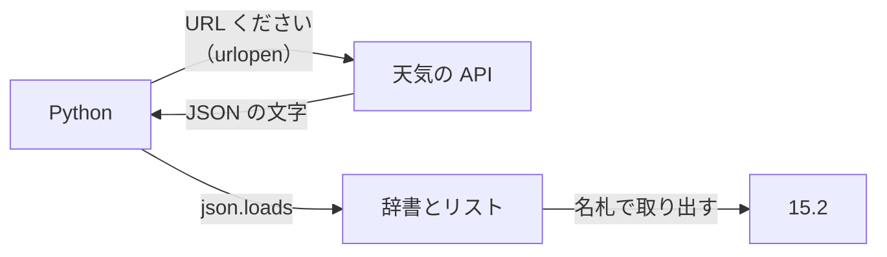
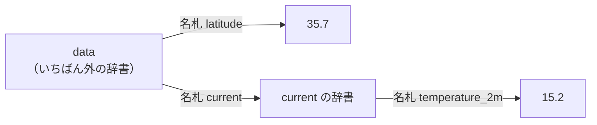

# 3-7 Python で API を叩く

所要 25分 ／ 種類：作る

## 今日のゴール
- 3-3 で `curl` でやったことを、Python でやる
- 届いた JSON の文字を辞書に戻して、**気温だけ**を取り出して表示する
- `KeyError` が出たら、何を確かめればいいか分かる

## ステップ

### 1. 届くのは「ただの文字」

- **前提**：ネットを通って届くのは、**文字の並び**だけです。Python の辞書やリストは、そのままでは運べません。3-3 の `weather.json` も、中身は文字でした
- **困りごと**：文字の塊から「`temperature_2m` の後ろの数字」を切り貼りして探すのは、ずれたり間違えたりのもとです
- **解決**：JSON は書き方が決まっているので、`json.loads`（**load** **s**tring：文字を読み込む）で、辞書とリストに一発で戻せます。2-3 で使った道具です。あとは名札で取り出すだけ

### 2. 気温までの道順を読む
3-3 で見た JSON を、見やすく並べるとこうなります。

```json
{
  "latitude": 35.7,
  "current": {
    "time": "2026-11-07T07:30",
    "temperature_2m": 15.2
  }
}
```


- 気温は、辞書 `current` の中の `temperature_2m` です
- Python では、名札を外から順に `[ ]` でつなぎます：`data["current"]["temperature_2m"]`
- 3-2 で、価格までの道順（items → 0 → price）をたどったのと同じです

**確かめ**：`current=temperature_2m,wind_speed_10m` と頼んだとき、風速を取り出す書き方は？ ボタン：`data["current"]["wind_speed_10m"]` / `data["wind_speed_10m"]`
<!-- 先生用：data["current"]["wind_speed_10m"]。風速も current の辞書の中に入るから。data["wind_speed_10m"] と答えたら「current= で頼んだものは、全部 current の { } の中に入る」と1行で言い直す -->

### 3. 書いて動かす
**やってみよう**：タブ1で `vi playground/weather.py` を開いて、次を書いて保存してください（見ながら打っても、貼り付けても大丈夫です）。

```python
import json
from urllib.request import urlopen

url = "https://api.open-meteo.com/v1/forecast?latitude=35.68&longitude=139.76&current=temperature_2m"
with urlopen(url) as res:
    data = json.loads(res.read())

print("東京の今の気温は", data["current"]["temperature_2m"], "度")
```

保存したら、`python3 playground/weather.py` で実行してください。

| 行 | 日本語にすると |
|---|---|
| `from urllib.request import urlopen` | Python に最初から入っている、URL を開く道具（**url** **open**）を使う |
| `with urlopen(url) as res:` | この URL に頼んで、返事を `res`（response：返事）と呼ぶ |
| `json.loads(res.read())` | 返事の文字を読んで（read）、辞書に戻す |
| `print(…, data["current"]["temperature_2m"], …)` | 道順をたどって、気温だけ表示 |

うまくいったら、`print(data)` という行を最後に足して実行し、辞書の全体も眺めてみてください。眺めたら、その行は消しておきます（`/check` は「気温だけ」を表示しているかを見ます）。

`urllib` は最初から入っている道具です。もっと楽に書ける `requests` という部品もありますが、今日は入れなくて大丈夫です。

### 4. わざと壊す：KeyError
- **前提**：辞書からは、名札で取り出します
- **困りごと**：存在しない名札を言われたら、Python は何を取り出せばいいか分かりません。黙って適当な値を返すと、間違いに気づけません
- **解決**：Python はそこで止まり、**KeyError**（key＝名札のエラー）と、見つからなかった名札を教えてくれます

**やってみよう**：`"temperature_2m"` を `"temp"` に変えて保存し、実行してください。エラーの**最後の行**を読んでから、元に戻してください。

```
KeyError: 'temp'
```

**確かめ**：Claude に作ってもらったプログラムで KeyError が出ました。まず見るのは？ ボタン：`プログラムの文法` / `実際に返ってきた JSON の中身`
<!-- 先生用：実際に返ってきた JSON の中身（print(data) や curl）。本当にその名札があるか確かめる。「文法」と答えたら「文法は合っていて動いている。JSON の形が、プログラムの想像と違うのが KeyError」と1行で言い直す。API の仕様が変わった、頼み方（URL）が違う、などが原因になる -->

### 5. 挑戦：風速と、場所
ここからは挑戦です。できたところまでで大丈夫です。

**やってみよう**：
1. 風速（`wind_speed_10m`）も表示する。URL の `current=` に足すのも忘れずに
2. 場所を変える。緯度・経度を変数 `lat` と `lon` にして、URL に埋め込めたら上級者です

詰まったら `/hint` と書いてください。

## チェック
`/check`：`playground/weather.py` を実行すると、JSON 全体ではなく気温だけが表示されれば合格。（ネットがつながっている必要があります）

## AIとの関係
Claude が外のサービスと話すときも、中身は「URL を呼んで、JSON を辞書として読み、必要な所だけ使う」です。KeyError が出たら、返ってきた JSON の形が想像と違うサインです。
そして「必要な所だけ取り出す」は、AI 自身にも大事です。大きな JSON を丸ごと Claude に読ませると、Claude が一度に読める量（**コンテキスト**。第5部でくわしく）をそのぶん使ってしまいます。
