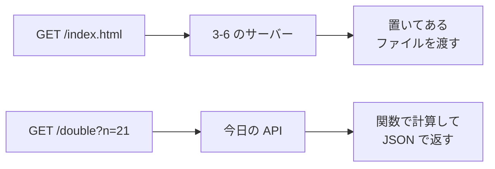

# 3-8 FastAPI で自分の API を作る

所要 30分 ／ 種類：作る

## 今日のゴール
- 今まで「頼む側」だった API を、**自分で作る側**になる
- 「URL と Python の関数を対応させる」という API の作りが分かる
- 作った API を、ブラウザ・`curl`・自動の説明書（`/docs`）から呼ぶ

## ステップ

### 1. 渡すだけのサーバーと、答えを作るサーバー

- **前提**：3-6 のサーバーは、フォルダに**置いてあるファイルを渡すだけ**でした
- **困りごと**：「21 を 2 倍にして」のように、**頼まれてから答えを作る**ことはできません。しかも、頼みの受け取り、JSON への変換、変な入力のお断りまで毎回自分で書くのは大変です
- **解決**：**FastAPI**（fast＝速い ＋ API）という部品が、「この URL に頼みが来たら、この Python の関数を呼ぶ」という対応づけを引き受けます。あなたが書くのは関数だけです

### 2. 準備：uv でプロジェクトを作る
2-1 でやった `uv` で、部品を入れます。

**やってみよう**：タブ1で、次の3行を順に打ってください。
```bash
uv init playground/api
cd playground/api
uv add fastapi uvicorn
```

| 部分 | 意味 |
|---|---|
| `uv init playground/api` | ここを1つの Python プロジェクトにする（init＝initialize：始める準備） |
| `uv add fastapi uvicorn` | 2つの部品を入れる |
| `fastapi` | API を簡単に書ける部品 |
| `uvicorn` | それを動かすサーバー（3-6 の `http.server` の本格版） |

続けて、このレッスンの出発点（スターター）を `main.py` としてコピーします（`cp`＝copy）。
```bash
cp ../../lessons/03-web/08-fastapi/starter.py main.py
```
<!-- 先生用：uv init が作った main.py は、この cp で上書きされてよい。タブ1は norl-cs101 のいちばん上から始める。uv が無ければ 2-1 に戻る -->

### 3. 出発点を読んで、起動する
**やってみよう**：`vi main.py` で中身を読んでください（まだ書き換えなくて大丈夫です）。

```python
@app.get("/hello")
def hello():
    return {"message": "こんにちは"}
```

| 行 | 日本語にすると |
|---|---|
| `@app.get("/hello")` | `GET /hello` が来たら、すぐ下の関数を呼んで |
| `def hello():` | hello という関数（2-4） |
| `return {"message": "こんにちは"}` | この辞書を返す |

読んだら vi を閉じます。先生がサーバー用のタブ（タブ2）を開くので、そこで次を打ってください。
```bash
cd playground/api
uv run uvicorn main:app --reload
```
- `main:app` は「`main.py` の中の `app`」、`--reload` は「保存したら読み直して」という意味です
- `Uvicorn running on http://127.0.0.1:8000` と出たら、待っている状態です。`127.0.0.1` で待つので、この Mac の中からだけ頼めます（0-3）

ブラウザで `http://127.0.0.1:8000/hello` を開いてください。続けてタブ1で `curl http://127.0.0.1:8000/hello` も打ってください。

**確かめ**：関数が `return` したのは**辞書**なのに、届いたのは **JSON の文字**でした。変えたのは誰？ ボタン：`FastAPI` / `ブラウザや curl`
<!-- 先生用：FastAPI。ネットには文字しか通れない（3-7）ので、送る前に FastAPI が辞書を JSON の文字に変えている。3-7 の json.loads のちょうど逆向き。「ブラウザや curl」と答えたら「受け取る側に届く時点で、もう文字になっている。変えたのは送る側」と1行で言い直す -->

### 4. `/docs`：自動でできる説明書
- **前提**：API には画面がありません。使う人は「どの URL に、何を渡せば、何が返るか」を知らないと使えません
- **困りごと**：説明書を人が手で書くと、コードを直したときに書き忘れて、説明書とずれていきます
- **解決**：FastAPI は、コードから説明書を**自動で**作ります。コードを直せば、説明書も一緒に変わります

**やってみよう**：ブラウザで `http://127.0.0.1:8000/docs` を開いてください。
1. `GET /hello` の行を押して開く
2. **Try it out** →**Execute** を押す
3. 下に、返ってきた JSON と、ステータスコード `200` が出ます

### 5. `/double` を自分で書く
**やってみよう**：`main.py` の `TODO` を読んで、`/double?n=21` で `{"n": 21, "result": 42}` を返す窓口を書いてください。
- ヒント1：`/hello` の書き方をまねる
- ヒント2：`n` は関数の引数にするだけ。型は `n: int`（int＝**int**eger：整数）
- 保存すると、`--reload` のおかげでタブ2のサーバーが自動で読み直します

書けたら、タブ1で試してください。
```bash
curl "http://127.0.0.1:8000/double?n=21"
```
`/docs` もリロードして、新しい行が増えたか見てください。詰まったら `/hint` と書いてください。

**確かめ**：URL の `?n=21` の `21` は、Python のどこに届いた？ ボタン：`@app.get の行` / `関数の引数 n`
<!-- 先生用：関数の引数 n。FastAPI が、クエリ（3-3 の注文書）の名前と、関数の引数の名前を突き合わせて渡している。間違えたら「@app.get は窓口の名前（/double）を決めるだけ。注文書の n=21 は、同じ名前の引数 n に入る」と1行で言い直す。答えを書かせる課題なので、先生はコードを書かない -->

### 6. わざと壊す：422
- **前提**：API には、外から何が送られてくるか分かりません
- **困りごと**：もし `n=abc` が来たら？ Python では文字の `"abc"` を 2 倍すると `"abcabc"` になり、エラーにならずに変な答えを返してしまいます
- **解決**：`n: int`（整数）と書いておいたので、FastAPI が関数を呼ぶ前に**門前払い**します。それが **422**（受け取ったけど、中身が処理できない）です

**やってみよう**：タブ1で打って、返事とタブ2のログを見てください。
```bash
curl -i "http://127.0.0.1:8000/double?n=abc"
```
返事の JSON の `detail` に、どこ（`query` の `n`）が、なぜ（整数ではない）だめだったかが書いてあります。

見終わったら、**タブ2**で `Ctrl + C` を押してサーバーを止めてください。

## この先につながる話
3-3 で叩いた Open-Meteo も、中身はこういう作りです。そして第5部の **MCP**（**M**odel **C**ontext **P**rotocol）**サーバーは「AI 向けの API」**です。人間向けの画面の代わりに、AI が使いやすい窓口を用意する、という発想は今日と同じです。

## チェック
`/check`：`uv run uvicorn` で `playground/api` を一時的に動かし、`/double?n=21` が 42 を返せば合格。（`uv` が必要です）

## AIとの関係
「API を作って」と Claude に頼むと、出てくるのはこの形（関数と URL の対応）です。`/docs` を開けば、何が作られたかを、コードを読まなくても一覧で確かめられます。
