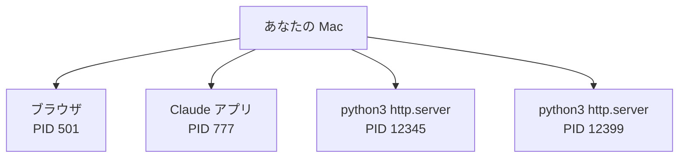
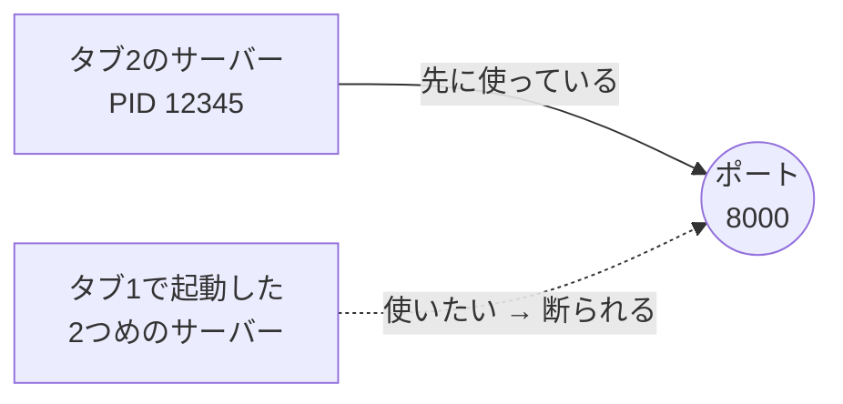
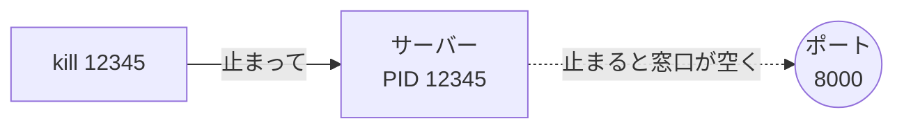

# 4-1 プロセス ps・lsof・kill

所要 20分 ／ 種類：作る

## 今日のゴール
- 動いているプログラム（**プロセス**）を、番号（PID）で見つけられる
- `Address already in use` が出たとき、何が起きているか分かる
- 犯人のプロセスを見つけて、止められる

## ステップ

### 1. 動いているプログラムには、番号が付いている

- **前提**：Mac は、たくさんのプログラムを同時に動かしています。画面に出ていない裏方も含めて、数百個あります。動いているプログラム1つ1つを**プロセス**と呼びます
- **困りごと**：同じプログラムを2つ動かすこともあります（図の下の2つ）。名前だけでは「どっちを止めたいのか」を区別できません
- **解決**：動き出すたびに、OS（Mac の基本ソフト）が**番号**を付けます。これが **PID**（**P**rocess **ID**：プロセスの番号）。銀行の整理券と同じで、同じ用事の人が2人いても、番号で呼び分けられます

**やってみよう**：先生がターミナルパネルにタブを2つ用意します（タブ1は調べる用、タブ2はサーバー用）。
1. タブ2で、第3部でやったサーバーを立てます：
   `cd playground/web && python3 -m http.server 8000`
   （`&&` は「前のコマンドがうまくいったら、次もやる」）
2. タブ1で、動いているプロセスを探します：
   `ps aux | grep http.server`
   - `ps`＝**p**rocess **s**tatus（プロセスの状態）。`aux` は「全員の分を、詳しく」という指定です
   - `|`（パイプ）＝左のコマンドの結果を、右のコマンドに渡す。ここでは「全部の一覧」を 1-6 の `grep` に渡して、`http.server` の行だけ拾っています

| 見る場所 | 意味 |
|---|---|
| 左端 | 誰が動かしているか（あなたのユーザー名） |
| 2列目の数字 | **PID** |
| 右端 | 何のコマンドか |

`grep http.server` 自身の行も1つ出ます。右端が `grep` の行は、気にしなくて大丈夫です。

### 2. 1つの窓口には、1つのプロセスだけ

- **前提**：ネットで待つプログラムは、**ポート**（窓口の番号）を1つ使います。0-1 の URL に出てきた `:8000` がそれです（くわしくは 4-3）
- **困りごと**：2つのプログラムが同じ窓口に座ると、ブラウザから届いた「ページください」を、どちらに渡せばいいか決まりません
- **解決**：OS が「**先に座った1つだけ**」と決めています。後から来たプログラムは断られ、エラーになります

**やってみよう**：タブ1で、**同じ**サーバーをもう1つ立ててみてください。
`cd playground/web && python3 -m http.server 8000`
エラーが出たら、1-6 でやったように**最後の行**を読みます。
→ `OSError: [Errno 48] Address already in use`（その番号の窓口は、もう使われています）

**確かめ**：タブ1で `8000` を `8001` に変えて起動したら、エラーは？（答えたら試して、`Ctrl+C` で止めます） ボタン：`同じエラーが出る` / `エラーは出ない`
<!-- 先生用：出ない。窓口の番号が違えば、別の窓口なので両方動ける。「出る」と答えたら、「同じ建物でも、8000番窓口と8001番窓口は別の席」と1行で言い直す -->

### 3. 窓口を使っているのは誰？ lsof で調べる
- **前提**：実際には、サーバーのタブが見えないことがよくあります。タブを閉じてしまった、Claude が裏で起動した、昨日のものが残っている……
- **困りごと**：`Address already in use` と言われても、誰が窓口を使っているのか分かりません
- **解決**：「この窓口を使っているのは誰？」と OS に聞くコマンドがあります

**やってみよう**：タブ1で次を打ってください。
`lsof -i :8000 -sTCP:LISTEN`
- `lsof`＝**l**i**s**t **o**pen **f**iles（開いているファイルの一覧）。Mac では、ポートもファイルの仲間として数えるので、「ポートを開いているのは誰？」も聞けます
- `-i :8000` は「8000番の窓口について」、`-sTCP:LISTEN` は「待ち受けている（客を待っている）ものだけ」

| 列 | 意味 |
|---|---|
| `COMMAND` | プログラムの名前 |
| `PID` | ステップ1で見たのと同じ番号 |

### 4. 番号を指して止める：kill

- **前提**：ふだんは、サーバーのタブで `Ctrl+C` を押して止めます
- **困りごと**：タブが見えないと、`Ctrl+C` を押す場所がありません
- **解決**：PID を指して、OS から「止まってください」と合図を送ります。それが `kill`（殺す、の意味の英語）です

**やってみよう**：タブ1で順に打ってください。
1. `kill 番号`（番号は、ステップ3で見つけた PID）
2. `lsof -i :8000 -sTCP:LISTEN` → 何も出なければ、窓口が空いた証拠です
3. タブ2を見てください。サーバーが終わって、プロンプト（入力待ちの印）が戻っています
4. タブ1で、ステップ2のコマンド（8000番）をもう一度。今度は起動するはずです。確かめたら `Ctrl+C` で止めます

覚えておくこと：
- `kill` で止まらない頑固なプロセスには `kill -9 番号`（強制終了）。保存の途中でも止まるので、最後の手段です
- ふだんは `Ctrl+C`。`kill` は「画面が見えないとき」の道具です

**確かめ**：PID を確かめずに、てきとうな数字で `kill` すると？ ボタン：`関係ないプログラムが止まるかも` / `エラーが出るだけで安全`
<!-- 先生用：関係ないプログラム（ブラウザや保存中のアプリなど）を止めてしまうかもしれない。だから必ず ps や lsof で PID を確かめてから kill する。間違えたら整理券のたとえで「別の番号を呼ぶと、別の人が帰らされる」と1行で言い直す -->

## チェック
`/check`：ターミナルパネルで `Address already in use` を出し、`lsof` で見つけた PID を `kill` で止められていれば合格（先生がパネルを見て確認します）。

## AIとの関係
Claude は裏でサーバーを起動し、止め忘れることがあります。「ポートが使用中です」と言われたら、犯人はたいてい前に起動した古いプロセスです。`lsof` で自分で見つけられれば、Claude に「PID 12345 が残っているよ」と教えられます。
