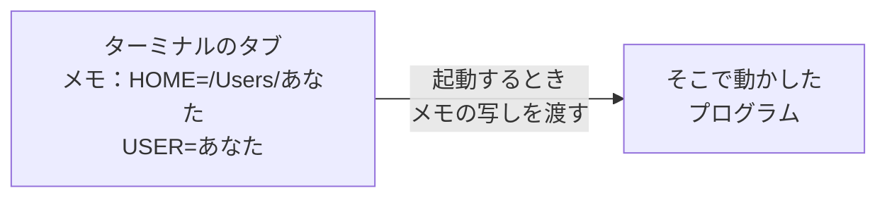
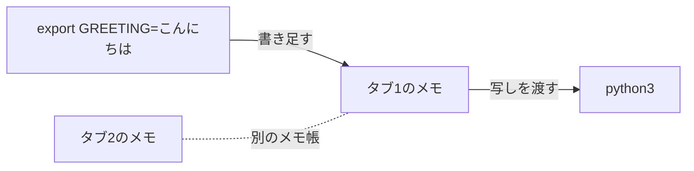
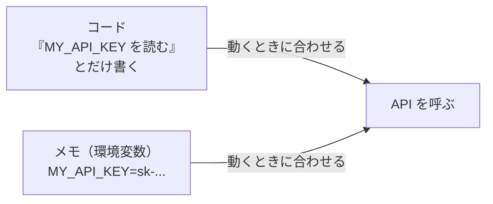
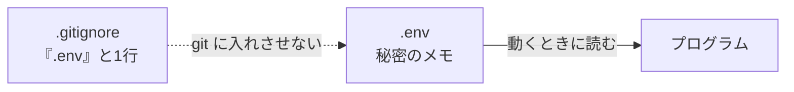

# 4-2 環境変数と API キー

所要 25分 ／ 種類：作る

## 今日のゴール
- プログラムの外から値を渡す「**環境変数**」を、見て・作って・読める
- 秘密の値（API キー）を**コードに書かない**理由とやり方が分かる
- `.env` と `.gitignore` で、秘密を git に入れない形を作る

## ステップ

### 1. ターミナルは「メモ」を持っている

- **前提**：プログラムは、動いている Mac のことを知りたいときがあります。「この人のホームフォルダはどこ？」「ユーザー名は？」など
- **困りごと**：その答えは人や Mac ごとに違います。コードに書き込むと、他の人の Mac では間違いになります
- **解決**：ターミナルが「名前と値」のメモを持っていて、そこから動かしたプログラムに写しを渡します。このメモが**環境変数**です。プログラムは「`HOME` というメモを見る」とだけ書けば、どの Mac でも正しい値を受け取れます

**やってみよう**：先生がターミナルを用意します。タブ1で次を打ってください。
1. `echo $HOME` → あなたのホームフォルダが出ます。`$` は「この名前のメモの値を入れて」の印です
2. `env | head` → メモの一覧の、先頭の10行だけ
   （`env`＝**env**ironment：環境。`head`＝頭＝先頭だけ表示。`|` は 4-1 で見た「左の結果を右に渡す」）

### 2. 自分でメモを作って、Python から読む

**やってみよう**：タブ1で順に打ってください。
1. `export GREETING=こんにちは`
   （`export`＝外に出す。「このタブから動かすプログラムにも、このメモを渡す」という意味）
2. `echo $GREETING` → `こんにちは`
3. Python から読む：
   `python3 -c 'import os; print(os.environ["GREETING"])'`
   （`-c` は「この1行を実行して」。`os.environ` が、Python から見たメモです）
4. 先生が新しいタブ（タブ2）を開きます。そちらで `echo $GREETING` を打ってください

### 3. なぜ API キーは環境変数に入れるのか

- **前提**：コードは、コピーされ、共有されます。GitHub に上げる、人に見せる、Claude に読ませる。書いたものは全部付いていきます
- **前提**：**API キー**は、サービスを使うときの合言葉です。**パスワードと同じ**で、盗まれるとあなたの名前で使われ、お金がかかることもあります
- **困りごと**：キーをコードに直接書くと、コードと一緒に漏れます
- **解決**：コードには「`MY_API_KEY` というメモを読む」とだけ書き、値はメモ（環境変数）に置きます。鍵を扉に貼らず、持ち主のポケットに入れておくのと同じです

**確かめ**：`os.environ["MY_API_KEY"]` と書いたコードを GitHub に公開しました。キーは？ ボタン：`漏れた` / `漏れていない`
<!-- 先生用：漏れていない。コードに書いてあるのはメモの「名前」だけで、値はあなたの Mac のメモにしかない。「漏れた」と答えたら、図の左の箱を指して「コードに入っているのは、ポケットの名前だけ」と1行で言い直す -->

### 4. .env に書いて、git から隠す

- **困りごと**：`export` は、タブを閉じると消えます。毎回打つのは面倒です
- **解決（その1）**：メモを `.env` というファイルに書いておき、プログラムが動くときに読む習慣があります
- **でも新しい困りごと**：`.env` もファイルなので、`git add .` で一緒にコミットされ、push すれば公開されます（1-7）
- **解決（その2）**：`.gitignore`（git に「これは無視して」と伝えるリスト）に `.env` と書きます

**やってみよう**：タブ1で順に打ってください。
1. `mkdir playground/envdemo && cd playground/envdemo && git init`
2. `vi .env` で、次の1行を書いて保存します。**ダミーの値**です（本物のキーは使いません）
   ```
   MY_API_KEY=sk-test-1234567890abcdef
   ```
3. `vi .gitignore` で、`.env` と1行だけ書いて保存します
4. `git status` → 一覧に `.gitignore` は出ますが、`.env` は出ません。git が無視している証拠です
5. 念のため：`git check-ignore -v .env` → 「`.gitignore` の何行目で無視しているか」が出ます

### 5. 用意したプログラムで読む
**やってみよう**：タブ1（`playground/envdemo` にいるまま）で順に打ってください。
1. `python3 ../../lessons/04-infra/02-env-vars/show_env.py`
   → `MY_API_KEY を読めました: sk-t********` と出ます（全部は見せない作りです）
   （`..` は1つ上のフォルダ。2回で `norl-cs101` に戻ってから、レッスンのフォルダへ）
2. `cat ../../lessons/04-infra/02-env-vars/show_env.py` で中身を読みます。キーの値は、どこにも**書かれていません**。`.env` を開いて、メモに登録しているだけです

**確かめ**：キーを新しいものに変えるとき、書き換えるのは？ ボタン：`.env と show_env.py の両方` / `.env だけ`
<!-- 先生用：.env だけ。コードは「名前」しか知らないので、触らなくていい。これが「値をコードの外に置く」いちばんの便利さ。「両方」と答えたら「show_env.py には値が1文字も書かれていない。だから直す所がない」と1行で言い直す -->

### 6. 本物のキーを扱うときのルール
- **コードに書かない**。チャットにも貼らない（このコースのチャットにも、Claude にも貼りません）
- **GitHub に上げない**。上げてしまったら、ファイルを消すだけでは足りません
- 漏れた疑いがあれば、キーを発行したサイトで**そのキーを止めて、作り直す**

## チェック
`/check`：`playground/envdemo/` に `.env`（`MY_API_KEY`）があり、`.gitignore` で除外され、`show_env.py` が読めて、`.py` にキーが書かれていなければ合格。

## AIとの関係
Claude にコードを書かせると、`os.environ["..."]` や「`.env` に入れてください」が出てきます。その意味はこの仕組みです。逆に、キーを「チャットに貼って」と促す画面や、コードに直書きされたキーを見たら、立ち止まってください。
