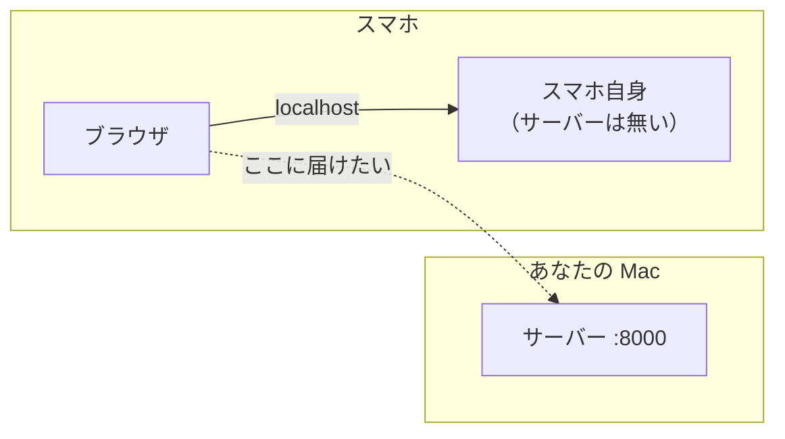
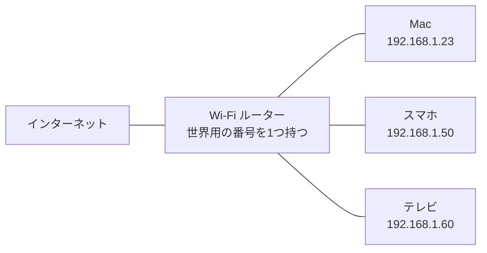
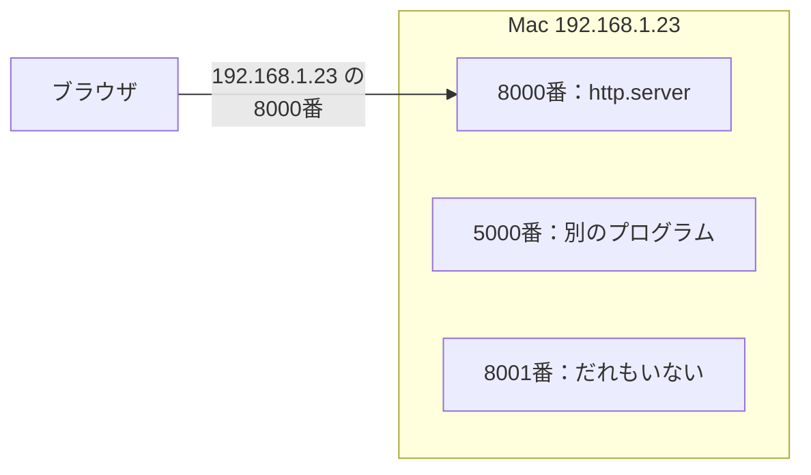
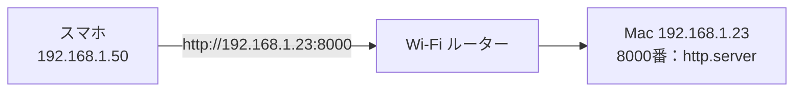
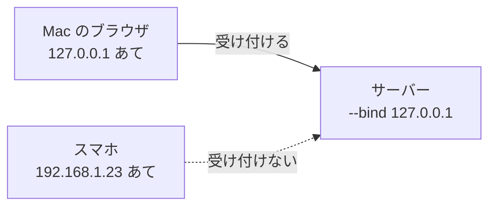
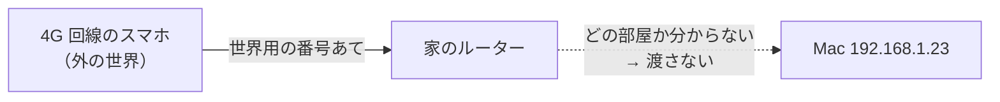

# 4-3 IPアドレス・DNS・ポート・localhost

所要 30分 ／ 種類：作る

## 今日のゴール
- Mac の「同じ Wi-Fi の中での番号」（内輪の IP アドレス）を見つけられる
- ポートが「Mac の中の、どのプログラムか」を決めていると分かる
- 自分の Mac のページを、**スマホで開く**

## ステップ

### 1. おさらい：スマホは localhost で、どこを見に行った？

0-3 で分かったことを、少しだけ振り返ります。
- 機械どうしは、**IP アドレス**（番号）で相手を見つけます。名前は DNS（電話帳）で番号に変わります
- `localhost`（`127.0.0.1`）だけは特別で、「いま使っている機械、自分自身」のこと
- **困りごと**：スマホから Mac に届けるには、`localhost` ではなく、**Mac の番号**を打つ必要があります。今日はそれを見つけて、使います

### 2. 家の中だけの番号：Mac の IP を見つける

- **前提**：0-3 で見た Google の `142.250.…` は、世界中から届く番号です。でも、この形の番号は約43億個しかなく、世界中のスマホやパソコンに1つずつ配るには足りません
- **困りごと**：家の Mac・スマホ・テレビにまで、世界用の番号を配る余裕はありません
- **解決**：Wi-Fi ルーターが、**同じ Wi-Fi の中だけで通じる番号**を配ります（`192.168.…` や `10.…` で始まることが多い）。マンションと同じで、建物の住所（世界用の番号）は1つ、中の部屋には部屋番号、という形です
- 同じ Wi-Fi の中のネットワークを **LAN**（**L**ocal **A**rea **N**etwork：近くの範囲のネットワーク）と呼びます

**やってみよう**：先生がターミナルを用意します。タブ1で次を打ってください。
`ipconfig getifaddr en0`
- `ipconfig`＝**IP config**uration（IP の設定）。`getifaddr`＝get interface address（その口の番号を教えて）
- `en0` は Mac の1つ目のネットワークの口で、ふつうは Wi-Fi です。何も出なければ `en1` で試します
- 出てきた番号が、**LAN の中でのあなたの Mac の番号**です。このあと何度も使うので、先生がチャットに書き留めておきます

### 3. ポート：Mac の中の、どのプログラムか

- **前提**：4-1 で見たように、Mac の中ではたくさんのプログラムが動いていて、ネットで待つものは**ポート**（窓口の番号）を1つ使います
- **困りごと**：IP アドレスだけでは、Mac には届いても、**Mac の中のどのプログラム**あてか決まりません
- **解決**：番号のあとに、窓口の番号を付けます。`192.168.1.23:8000` は「この Mac の、8000番窓口」。0-1 の URL の `:8000` がこれでした
- いつもの `https://` のサイトでポートが見えないのは、「`https` なら 443番」と決まっていて省略されているからです（`http` なら 80番）

**やってみよう**：
1. 先生がサーバー用のタブ（タブ2）を開きます。そちらで：
   `cd playground/web && python3 -m http.server 8000`
2. Mac のブラウザで、次の3つを順に開きます（`番号` は、ステップ2で見つけたもの）
   - `http://localhost:8000`
   - `http://番号:8000`
   - `http://番号:8001`
3. タブ2のサーバーのログ（3-6 で見た記録）で、左端の「来た人」を見比べます
   - `localhost` で開いたとき：`::1` か `127.0.0.1`。どちらも「自分自身」の書き方です
   - 番号で開いたとき：`::ffff:192.168.…` のように、その番号が出ます（前の `::ffff:` は、新しい形式の番号で書いたときの飾りなので、気にしなくて大丈夫です）

**確かめ**：`:8001` だけ開けなかったのはなぜ？ ボタン：`Mac に届かなかったから` / `Mac には届いたが、窓口に誰もいなかったから`
<!-- 先生用：Mac には届いたけど、8001番の窓口で待っているプログラムがいなかったから。番号（建物）は同じで、窓口だけ違う。前者と答えたら「:8000 は同じ番号で開けた。建物には着いていて、8001番窓口が空席だった」と1行で言い直す -->

### 4. スマホから、Mac のページを開く

**やってみよう**：
1. スマホを、Mac と**同じ Wi-Fi** につなぎます
2. スマホのブラウザのアドレス欄に、`http://番号:8000` と打ちます。`http://` から全部打ってください（省くと、検索になったり、`https` で開こうとしたりします）
3. Mac に「"Python" へのネットワーク受信接続を許可しますか？」と出たら、それは「**外の機械から、この Mac のプログラムに話しかけてよいか**」の確認です。今回は自分のスマホだけなので「許可」で大丈夫です
4. ページが出たら、タブ2のログを見てください

開かないとき：
- スマホが別の Wi-Fi（ゲスト用など）や、モバイル回線になっていないか
- 番号の打ち間違いがないか
- 会社やカフェの Wi-Fi は、安全のために「機械どうしの通信」を禁止していることがあります。家の Wi-Fi で試してください

### 5. 自分あてだけ受け付けるサーバー

- **前提**：Mac は、`127.0.0.1`（自分あて）と `192.168.…`（LAN から）の、2つ以上の番号を持っています。さっきのサーバーは、**どの番号あてでも**受け付けていました
- **困りごと**：カフェの Wi-Fi などで、作りかけのページを、同じ Wi-Fi の他人に見られたくないことがあります
- **解決**：サーバーを起動するとき、「**この番号あての依頼だけ**受け付ける」と選べます。`--bind 127.0.0.1` は「自分あてだけ」（bind＝結びつける）

**やってみよう**：タブ2で `Ctrl+C` で止めて、`python3 -m http.server 8000 --bind 127.0.0.1` で立て直します。

**確かめ**：このとき **Mac のブラウザ**で `http://番号:8000`（LAN の番号）は？（答えたら試して、スマホでも再読み込みしてみます） ボタン：`Mac からなら開く` / `Mac からでも開かない`
<!-- 先生用：Mac でも開かない（意外なところ）。--bind は「どの番号あての依頼を受けるか」で、「誰から来たか」ではない。LAN の番号あては、Mac から送っても受け付けない。localhost:8000 なら開く。スマホも開かない。間違えたら「受付が見ているのは差出人ではなく、宛名の番号」と1行で言い直す。試したらタブ2を Ctrl+C で止めてもらう -->

### 6. インターネットの向こうからは？

- **前提**：外の世界から見えるのは、ルーターが持つ**世界用の番号1つ**だけです
- **困りごと**：外から来た依頼を、ルーターは「どの部屋（機械）に渡せばいいか」知りません。勝手に渡すと危ないので、ふつうは渡しません。しかも Mac は、ふたを閉じればサーバーごと止まります
- **解決**：世界用の番号と名前（DNS）を持ち、**24時間動いている誰かのコンピュータ**にページを置きます。それが 4-6 のデプロイです

**やってみよう**：タブ1で次を打ってください。4-6 で使う GitHub Pages の名前を、電話帳で引きます。
`dig +short github.io`
（`dig`＝**d**omain **i**nformation **g**roper：ドメインの情報を探る道具。0-3 の `nslookup` の仲間で、`+short` は答えの番号だけ出す指定）

## チェック
`/check`：スマホで自分の Mac のページが開けたら合格（先生がサーバーのログで、スマホの番号から来たアクセスを確認します。スマホがなければ、Mac の LAN の番号の URL を Mac のブラウザで開けて、localhost との違いを説明できれば OK）。

## AIとの関係
Claude が「`localhost:3000` で動いています」と言うときは、「**あなたの Mac の中だけ**で動いている」の意味です。スマホで見たいなら「LAN の番号で開けるようにして」、人に見せたいなら「デプロイして」と、正しく頼めます。ポート番号を見れば、「どのプログラムの窓口か」も見当がつきます。
