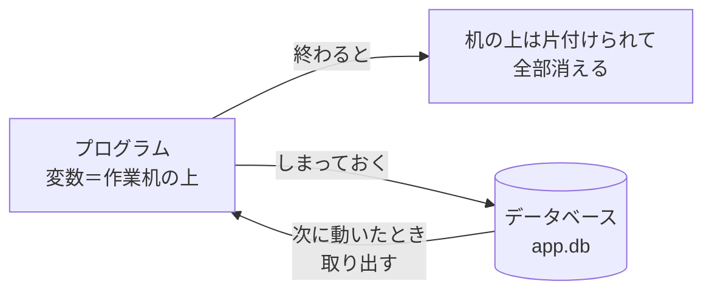
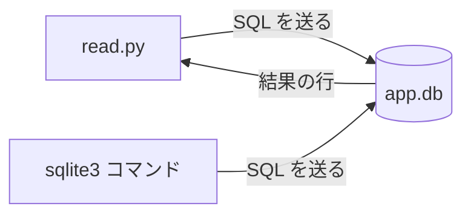

# 4-4 データベース SQLite と SQL 10文

所要 30分 ／ 種類：作る

## 今日のゴール
- アプリが「データを覚えておく」場所（**データベース**）を、自分で作る
- SQL の基本の文を読んで、何をしているか分かる
- Python から、同じデータベースを読む

## ステップ

### 1. なぜデータベース？

- **前提**：プログラムの変数は、メモリ（作業机）の上にあります。プログラムが止まると、机は片付けられて全部消えます
- **困りごと**：ユーザーや投稿、やることリストは、アプリを閉じても覚えておきたい。2-5 のようにファイルに書けば残りますが、「1件だけ書き換える」「条件に合うものだけ探す」「2人が同時に書き込む」を自分で作るのは大変です
- **解決**：データの出し入れを専門に引き受ける仕組みに任せます。それが**データベース**です。データを**表**（行と列）の形でしまいます
- 今日使う **SQLite** は、1つのファイルがそのままデータベースになる、いちばん軽いものです

### 2. 表を作る
| id | title | done |
|---|---|---|
| 1 | 牛乳を買う | 0 |
| 2 | 本を返す | 1 |

- **表**（テーブル）は、エクセルの1枚のシートのようなものです。**列**が「項目」、**行**が「1件」
- データベースに話しかける言葉が **SQL**（**S**tructured **Q**uery **L**anguage：決まった形の問い合わせ言葉。「シーケル」とも読む）。読めれば十分で、覚えなくて大丈夫です

**やってみよう**：先生がターミナルを用意します。タブ1で順に打ってください。
1. `mkdir -p playground/db`（`-p` は「無ければ作る、あってもエラーにしない」）
2. `sqlite3 playground/db/app.db`
   （`sqlite3`＝SQLite（SQL＋lite＝軽い）のバージョン3を操作するコマンド）
   プロンプトが `sqlite>` に変わります。ここからは SQL の世界です。出るときは `.quit`
3. 見やすくする設定：`.headers on` と `.mode column`（`.` で始まるのは SQL ではなく、sqlite3 への指示です）
4. 表を作ります。SQL は `;` で終わるのが約束です：
   `CREATE TABLE todos (id INTEGER PRIMARY KEY, title TEXT, done INTEGER DEFAULT 0);`

| 部分 | 意味 |
|---|---|
| `id INTEGER PRIMARY KEY` | 整数の列。1件ずつ違う番号で、**自動で振られる**（4-1 の PID のような整理券） |
| `title TEXT` | 文字の列 |
| `done INTEGER DEFAULT 0` | 整数の列。何も入れなければ `0`（0＝まだ、1＝終わった） |

### 3. 入れて、見る
**やってみよう**：`sqlite>` のまま、順に打ってください。
1. 3件入れます（文言は自由。1行ずつ打ちます）：
   `INSERT INTO todos (title) VALUES ('牛乳を買う');`
   （INSERT INTO＝〜に差し込む、VALUES＝値）
2. 全部見る：`SELECT * FROM todos;`（SELECT＝選ぶ、`*`＝全部の列、FROM＝〜から）
3. 条件で絞る：`SELECT title FROM todos WHERE done = 0;`（WHERE＝〜という条件で）
4. 並べ替え：`SELECT * FROM todos ORDER BY title;`（ORDER BY＝〜の順に）

### 4. 書き換えて、数えて、消す
**やってみよう**：`sqlite>` のまま、順に打ってください。
1. 書き換え：`UPDATE todos SET done = 1 WHERE id = 1;`（UPDATE＝更新、SET＝〜にする）
   もう一度 `SELECT * FROM todos;` で、1件目の `done` が変わったか確かめます
2. 数える：`SELECT COUNT(*) FROM todos WHERE done = 1;`（COUNT＝数える）
3. 消す：`DELETE FROM todos WHERE id = 3;`（DELETE＝消す）
4. 今の状態を見る：`.tables`（表の一覧）と `.schema`（表の作り）。終わったら `.quit`

| SQL | 意味 |
|---|---|
| `CREATE TABLE` | 表を作る |
| `INSERT` | 行を足す |
| `SELECT … WHERE` | 条件に合う行を見る |
| `ORDER BY` | 並べ替える |
| `UPDATE` | 行を書き換える |
| `DELETE` | 行を消す |
| `COUNT` | 数える |

**注意**：`UPDATE` と `DELETE` は、`WHERE` が「どの行か」を決めています。元に戻すボタンはありません。

**確かめ**：AI が `UPDATE todos SET done = 1;` を書いてきました。実行すると、変わるのは？ ボタン：`1件目の行だけ` / `全部の行`
<!-- 先生用：全部の行。WHERE が無いので「どの行か」の指定が無く、表の全員が対象になる。「1件目だけ」と答えたら「WHERE が『どの行か』を決める。無ければ全員」と1行で言い直す。AI が書いた UPDATE・DELETE を見るときは、まず WHERE があるかを見る、と念を押す -->

### 5. Python から読む

- さっきの `sqlite3` コマンドも、これから書く Python も、**同じ1つのファイル** `app.db` に SQL を送っています。FastAPI（3-8）のアプリも、同じやり方でデータベースを使います

**やってみよう**：タブ1で順にやってください。
1. 用意したひな形をコピーします（`cp`＝**c**o**p**y）：
   `cp lessons/04-infra/04-database/starter.py playground/db/read.py`
2. `vi playground/db/read.py` で開き、`TODO` の `"TODO"` の部分に、「まだ終わっていない（done が 0）todo の title を取る」SQL を書きます（ステップ3を思い出して）
3. `python3 playground/db/read.py` → `やること: …` が、まだの件数だけ出ます

**確かめ**：`read.py` を一文字も変えずに、表示される件数を1つ増やすには？ ボタン：`app.db に1件 INSERT する` / `できない（read.py を直すしかない）`
<!-- 先生用：sqlite3 で app.db を開き、INSERT で1件足す（または done を 0 に戻す UPDATE）。プログラムとデータは別物で、データベースの中身が変われば、同じプログラムでも結果が変わる。「できない」と答えたら「レシピ（read.py）が同じでも、冷蔵庫の中身（app.db）が増えれば料理は増える」と1行で言い直す。試してもらってよい。ただし done = 1 の行は1件以上残す（/check が見る） -->

## チェック
`/check`：`playground/db/app.db` に `todos` があり、更新（done=1）の行があり、`read.py` が未完了の todo を表示できれば合格。

## AIとの関係
「ユーザーを保存します」「データベースに追加しました」と Claude が言うとき、起きているのは今の `INSERT` です。`app.db` を `sqlite3` で自分で開けば、Claude の報告が本当かどうか、データを直接見て確かめられます。AI が書いた `UPDATE` や `DELETE` は、まず `WHERE` を見てください。
