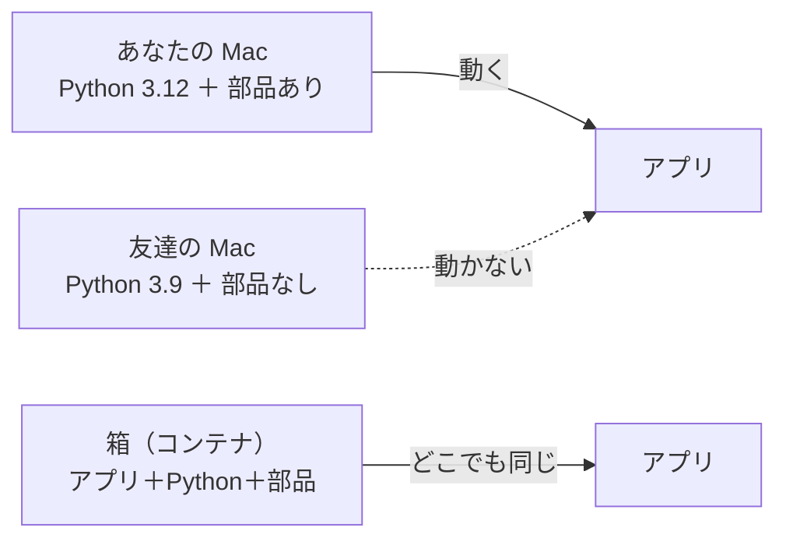
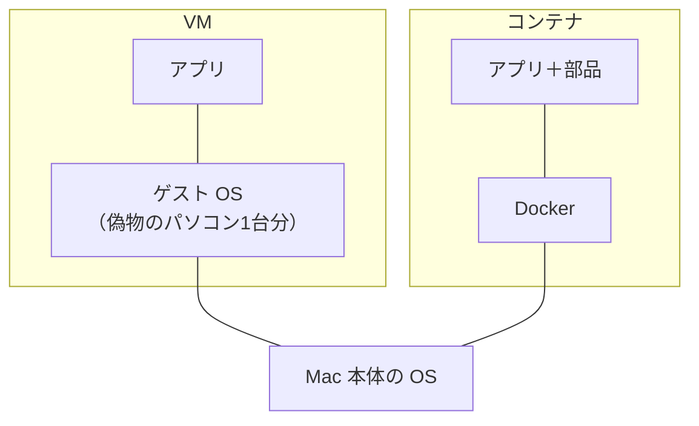
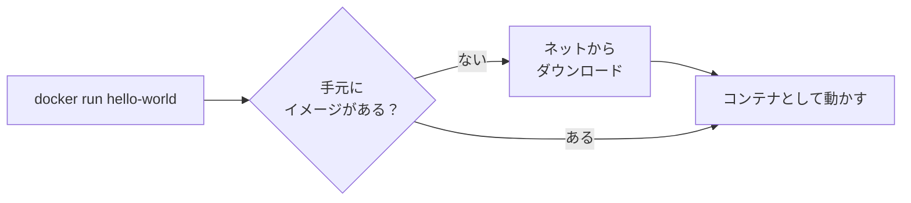

# 4-5 VM とコンテナ（Docker）

所要 30分 ／ 種類：作る

## 今日のゴール
- 「どこでも同じように動く箱」＝**コンテナ**が、なぜ要るのか分かる
- Docker でサーバーを動かし、ポートをつないで、ブラウザから開く
- ログを見て、止めて、片付けられる

## ステップ

### 1. なぜコンテナ？

- **前提**：プログラムは、動く環境に頼っています。OS（**O**perating **S**ystem：Mac の基本ソフト）、Python のバージョン、入れた部品……が、1台ごとに違います
- **困りごと**：「自分の Mac では動くのに、他の機械では動かない」がよく起きます。本番のサーバー（4-6 の「外のコンピュータ」）に置いたら動かない、も同じです
- **解決**：アプリと、それが頼っている部品を、**1つの箱にまとめて運びます**。これが**コンテナ**です。貨物船のコンテナと同じで、箱の中身は、どの港で開けても同じです

### 2. VM とコンテナの違い

- **VM**（**V**irtual **M**achine：仮想の機械）：パソコン1台を、**OS ごと**まるごと偽物で作ります。家を1軒まるごと建てるようなもので、重く、起動に時間がかかります
- **コンテナ**：OS の中心部分は本体と**共有**して、アプリと部品だけを箱に入れます。マンションの1部屋のようなもので、土台や水道は建物と共有。軽くて、すぐ起動します
- どちらも「中は外から仕切られている」のは同じです

### 3. Docker を入れて、最初の箱を動かす

- **イメージ**＝箱の設計図（料理でいうレシピ）。**コンテナ**＝それを動かした実物（作った料理）。1つのレシピから、何皿でも作れます
- **Docker** は、イメージを取ってきて、コンテナとして動かす道具です

**やってみよう**：
1. あなたがブラウザで、**Docker Desktop** か **OrbStack**（Mac 向けの軽い代わり）のどちらかを公式サイトからダウンロードして入れ、起動します。数百MBのダウンロードです。個人の学習用なら無料で使えます。メニューバーにアイコン（Docker はクジラ）が出れば準備完了です
2. 先生がターミナルを用意します。タブ1で：`docker --version` → バージョンが出れば OK
3. `docker run hello-world`
   初回は `Unable to find image … locally`（手元に無い）→ `Pulling`（取ってくる）と出て、そのあと `Hello from Docker!` が出ます

### 4. ポートをつないで、Web サーバーを開く

- **前提**：箱の中は、外から仕切られています。箱の中にも、自分だけのポート（窓口）があります
- **困りごと**：箱の中の 80番で Web サーバーが待っていても、Mac の外側からは、その窓口が見えません
- **解決**：Mac の窓口と、箱の中の窓口を**つなぎます**。4-3 の「番号＋窓口」に、もう1段の取り次ぎが増えたイメージです

**やってみよう**：タブ1で順にやってください。
1. nginx（「エンジン・エックス」と読む、人気の Web サーバー）を動かします：
   `docker run -d --name web -p 8080:80 nginx`

| 部分 | 意味 |
|---|---|
| `-d` | **d**etach（切り離す）＝裏で動かす。ターミナルはすぐ戻ってくる |
| `--name web` | このコンテナに `web` という名前を付ける |
| `-p 8080:80` | **p**ublish（公開する）＝ Mac の 8080番 → 箱の中の 80番 につなぐ |
| `nginx` | 使うイメージ |

2. ブラウザで `http://localhost:8080` → `Welcome to nginx!` が出ます
3. 動いているコンテナを見る：`docker ps`（4-1 の `ps` の Docker 版）

**確かめ**：`-p 8080:80` を `-p 9000:80` にして動かしたら、ブラウザで開くのは？ ボタン：`localhost:80` / `localhost:9000`
<!-- 先生用：9000。左が Mac 側の窓口、右が箱の中の窓口。ブラウザが叩くのは Mac 側なので左の番号。80 と答えたら「80番は箱の中の窓口で、Mac の外側からは見えない。ブラウザが叩くのは Mac 側（左）」と1行で言い直す -->

### 5. 箱の中のログを見る
- サーバーは、頼まれるたびにログ（記録）を書きます（3-6）。でもコンテナは裏で動いているので、画面に出ません
- `docker logs` で、箱の中のログを外から見られます

**やってみよう**：タブ1で：
1. `docker logs -f web`
   （`-f`＝**f**ollow：追いかける。1-6 の `tail -f` と同じです）
2. ブラウザを再読み込みすると、アクセスの行が増えます
3. `Ctrl+C` でログを見るのをやめます

**確かめ**：`Ctrl+C` を押したあと、ブラウザで `http://localhost:8080` は？（答えたら試します） ボタン：`もう開けない` / `まだ開ける`
<!-- 先生用：開ける。Ctrl+C で止めたのは「ログを見る係（docker logs）」だけで、コンテナ（nginx）は裏で動き続けている。docker ps にもまだ出ている。間違えたら「防犯カメラの画面を消しても、お店は営業中」と1行で言い直し、3-6 の http.server を Ctrl+C で止めたときとの違いを一言添える -->

### 6. 自分のページを載せて、片付ける
- `-v`＝**v**olume：「Mac のこのフォルダを、箱の中のここに見せる」。窓から中をのぞかせるようなもので、コピーはしません

**やってみよう**：タブ1で順に打ってください（`norl-cs101` のフォルダにいる状態で）。
1. 一度消します：`docker rm -f web`（`rm`＝**r**e**m**ove：消す。`-f`＝force：動いていても）
2. 自分のページを見せて動かします：
   `docker run -d --name web -p 8080:80 -v "$PWD/playground/web:/usr/share/nginx/html:ro" nginx`
   - `$PWD` は、いまいるフォルダが入った環境変数（4-2）。`pwd`（1-1）と同じ中身です
   - `/usr/share/nginx/html` は、nginx が「ここのファイルを配る」と決めている、箱の中の場所
   - `ro`＝**r**ead-**o**nly：読むだけ。箱の中からは書き換えられません
3. ブラウザを再読み込み → 3-4 で作った自分のページが出ます
4. 止める：`docker stop web` → `docker ps` から消えます
5. 片付け：`docker rm web`

4-1 の `python3 -m http.server` と比べると、**同じ**なのは「ポートで待つサーバー」であること。**違う**のは、Mac に何も入れずに動かせて、箱ごと消せることです。

## チェック
`/check`：Docker が動いていて、`hello-world` と `nginx` のイメージが手元にあれば合格（`docker logs -f` と `docker stop` はターミナルパネルで先生が確認します）。

## AIとの関係
Claude が `Dockerfile` を書くときは、その「箱の設計図（イメージ）の作り方」を文章にしています。「コンテナを起動しました」と言われたら `docker ps` で、うまくいかないときは `docker logs` で、自分の目で確かめられます。卒業制作でも使います。
