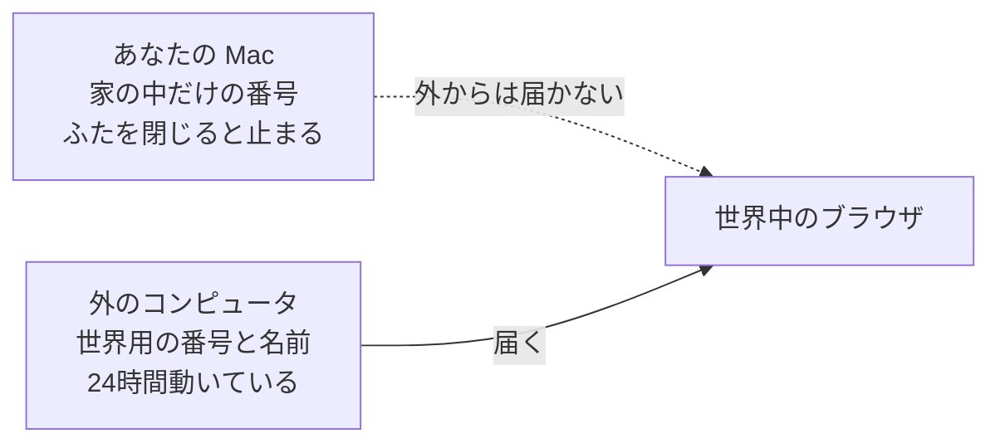
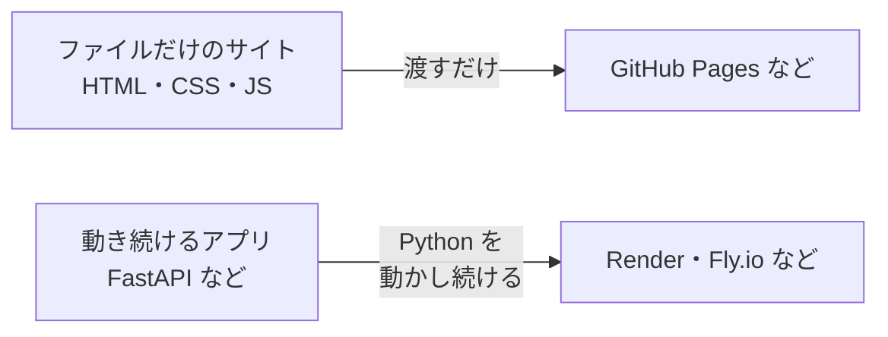

# 4-6 デプロイ：世界に公開する

所要 30分 ／ 種類：作る

## 今日のゴール
- `playground/web` のサイトを、**GitHub Pages**（無料・カード不要）で世界中から見られるようにする
- 公開する前に「何を出すのか」を自分で確かめられる
- 置ける場所が「ファイルだけのサイト」と「動き続けるアプリ」で違うと分かる

## ステップ

### 1. なぜデプロイが要る？

- **前提**：4-3 で見たように、Mac の番号（`192.168.…`）は家の中だけの番号です。外の世界からは届きません。しかも、ふたを閉じればサーバーも止まります
- **困りごと**：同じ Wi-Fi の人にしか見せられず、Mac を閉じたら見えなくなります
- **解決**：世界用の番号と名前（DNS）を持ち、24時間動いている**外のコンピュータ**に、ページを置きます。これが**デプロイ**（deploy：配置する）です
- 今日使う **GitHub Pages** は、GitHub にファイルを置くと、その役を無料で引き受けてくれます

### 2. 公開する前に：何を出すのか確かめる
- **前提**：GitHub Pages の無料プランは、**公開（Public）リポジトリ**が条件です。リポジトリの中身は、**誰でも読めます**
- **困りごと**：`.env`（4-2）や、個人情報、キーが混ざっていたら、そのまま世界に出ます。公開してから消しても、git の履歴には残ります
- **解決**：送る**前**に、フォルダの中身を自分の目で見ます

**やってみよう**：先生がターミナルを用意します。タブ1で次を打ってください。
`ls -a playground/web`
（`-a`＝**a**ll：全部。`.` で始まる「隠しファイル」も表示します）
`index.html` があること、`.env` のような秘密のファイルが**無い**ことを確かめます。

### 3. git にして、GitHub に送る

**やってみよう**：
1. タブ1で順に打ちます（1-7 の復習です）：
   - `cd playground/web`
   - `git init -b main`（`-b main`＝最初の枝の名前を `main` にする）
   - `git add .` → `git commit -m "first site"`
2. あなたがブラウザで GitHub を開き、**New repository** → 名前を決める（例 `my-site`）→ **Public** を選ぶ → 作成
3. GitHub の画面に出る `git remote add origin …` と `git push -u origin main` を、そのままタブ1で打ちます
   - `remote add origin`＝「送り先（origin）は、この GitHub のリポジトリ」と登録する
   - ログインの画面が出たら、あなた自身でログインしてください（パスワードはチャットに書きません）
4. GitHub のページを再読み込みして、`index.html` が並んでいれば成功です

### 4. GitHub Pages で公開する

**やってみよう**：あなたがブラウザで、GitHub のリポジトリを開いて操作します。
1. **Settings → Pages** を開く
2. Source を `Deploy from a branch`、Branch を `main` と `/ (root)` にして **Save**
3. 1〜2分待って再読み込みすると、Pages の画面に URL が出ます：
   `https://（ユーザー名）.github.io/（リポジトリ名）/`
4. Mac のブラウザで開いてみます

4-3 のステップ6で `dig` で引いた `github.io` は、この名前の大きな区分でした。

### 5. スマホの回線で開いて、更新する
**やってみよう**：
1. スマホの **Wi-Fi をオフ**にして（モバイル回線で）、さっきの URL を開きます。4-3 と違い、家の外からでも開けます
2. タブ1で `vi index.html` を開き、文字を少し直して保存します
3. `git add . && git commit -m "update" && git push`
4. 1〜2分後、スマホで再読み込みして、変わったのを見ます

**確かめ**：Mac のふたを閉じたら、このページはスマホで？ ボタン：`見られなくなる` / `まだ見られる`
<!-- 先生用：まだ見られる。ページを配っているのは GitHub のコンピュータで、Mac ではないから。間違えたら「Mac は原稿を印刷所に送っただけ。配っているのは印刷所（GitHub）」と1行で言い直す。Mac は「直したファイルを送る」ときだけ要る -->

### 6. ファイルだけのサイトと、動き続けるアプリ

- **前提**：GitHub Pages は、置かれたファイルを「そのまま渡す」だけです。これを**静的サイト**と呼びます
- **困りごと**：3-8 の FastAPI のように、頼まれるたびに **Python が計算して返事を作る**ものは、ファイルを渡すだけでは動きません
- **解決**：アプリを動かし続けてくれる置き場所（ホスティング）を使います。多くは無料枠がありますが、条件はよく変わるので、使う前に自分で確かめます。4-5 のコンテナごと預ける方法もあります

| 置くもの | 置き場所の例 |
|---|---|
| HTML/CSS/JS だけ | GitHub Pages、Cloudflare Pages、Netlify |
| FastAPI などの API | Render、Fly.io、Cloud Run など |
| データベース | 上のサービスの付属、または専用のサービス |

**確かめ**：4-4 の `app.db` を使う Python のアプリを公開するのに、GitHub Pages で足りる？ ボタン：`足りる` / `足りない`
<!-- 先生用：足りない。Python が動き続けてデータベースを読み書きする必要があるので、アプリを動かせるホスティングが要る。「足りる」と答えたら、「GitHub Pages は、刷ってあるチラシを配る係。注文を聞いて料理を作る係ではない」と1行で言い直す -->

## チェック
`/check`：`playground/web` の `origin` が GitHub を指し、Pages の URL が開ければ合格。ネットワークが無いとチェックできません。

## AIとの関係
Claude に「デプロイして」と頼むと、`git push` や設定変更を実行します。それは**世界に公開する操作**です。何を公開するのか（秘密のファイルは無いか）を、押す前に自分で確かめられるのが、このレッスンの収穫です。
