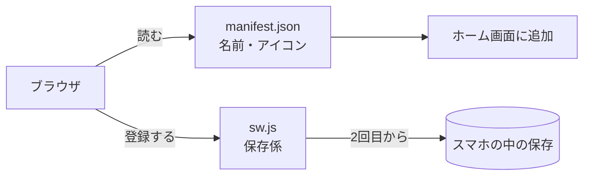
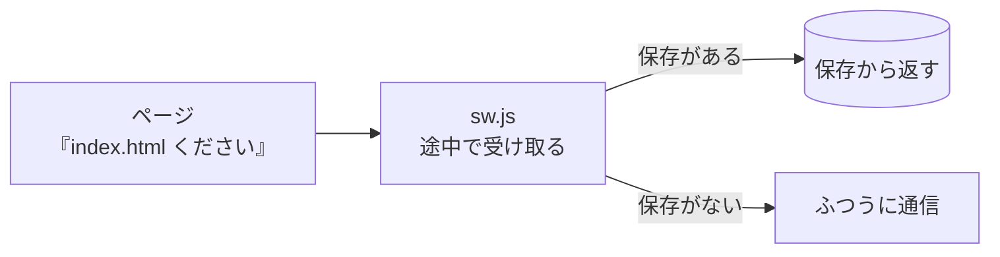

# 4-7 PWA：Webサイトをスマホアプリにする

所要 30分 ／ 種類：作る

## 今日のゴール
- 4-6 で公開したサイトに2つのファイルを足して、**スマホのホーム画面に置ける**ようにする
- 通信が無くても開ける仕組み（Service Worker のキャッシュ）が分かる
- 「PWA 対応」が、実際には何をすることなのか言える

## ステップ

### 1. なぜ PWA？

- **前提**：Web サイトは、開くたびに通信でファイルを取ってきます。スマホの中には何も残りません
- **困りごと**：電車のトンネルや圏外では真っ白になります。アプリのように、ホーム画面から1タップで開くこともできません
- **解決**：スマホの中に**控え（キャッシュ）**を残す係と、「アプリとしての名刺」を足します。これが **PWA**（**P**rogressive **W**eb **A**pp：だんだんアプリらしくなる Web サイト）です。作るのは2つだけです

| ファイル | 役目 |
|---|---|
| `manifest.json` | アプリの名前・色・アイコンの届け出（名刺） |
| `sw.js`（Service Worker） | ページのファイルをスマホに保存して、通信が無くても返す係 |

### 2. 部品をコピーして、アイコンを作る
**やってみよう**：先生がターミナルを用意します。タブ1（`norl-cs101` のフォルダ）で、1行ずつ打ってください。
```
cp lessons/04-infra/07-pwa/manifest.template.json playground/web/manifest.json
cp lessons/04-infra/07-pwa/sw.template.js playground/web/sw.js
python3 lessons/04-infra/07-pwa/make_icon.py playground/web
```
- 最初の2行は、ひな形を自分のサイトのフォルダ（`playground/web`）にコピーしています
- 3行目が、無地のアイコン `icon-192.png` と `icon-512.png` を作ります（**PNG**＝**P**ortable **N**etwork **G**raphics：画像の形式の1つ。数字は縦横の大きさ）

### 3. manifest.json：アプリの名刺を書く
- ホーム画面に置くとき、スマホは「このアプリの名前は？ アイコンは？ 開いたらどんな見た目？」を知りたがります
- それを書いておくのが `manifest.json`（manifest＝積み荷の目録、届け出）です

**やってみよう**：`vi playground/web/manifest.json` で開き、`TODO` を全部、自分の言葉に直して保存します。
- `name`：アプリの名前
- `short_name`：ホーム画面のアイコンの下に出る短い名前
- `theme_color`：好きな色（`#2563eb` のような形）
- `icons` の `src`：ステップ2で作った画像のファイル名
- `display` が `standalone` なのは「アドレスバーを出さず、アプリのように開く」の意味です

### 4. sw.js：保存係（Service Worker）

- **前提**：ふだん、ブラウザの「ください」は、まっすぐサーバーへ行きます
- **困りごと**：通信が無いと、頼む相手に届きません
- **解決**：ブラウザとサーバーの**途中で頼みを受け取る係**を置きます。保存があればそれを返し、無ければふつうに通信します。これが **Service Worker** です
- **注意**：この係は、ページの通信に割り込んで、返事を差し替えられる強い道具です。悪い人に差し替えられると困るので、盗み見や改ざんを防ぐ **HTTPS**（HTTP **S**ecure：暗号化つきの HTTP）か、自分の中だけで閉じた `localhost` でしか動きません

**やってみよう**：`vi playground/web/sw.js` で開き、`TODO` の `"TODO"` を、保存場所の名前（例 `"my-site-v1"`）に直します。その上のコメントの `TODO:` の文字も消して保存します（残っていると `/check` が「まだ途中」と判断します）。コメントを読んで、1) 2) 3) がそれぞれ何をしているか、ざっと眺めてください。

### 5. ページにつないで、Mac で確かめる
**やってみよう**：
1. `vi playground/web/index.html` で、次の2か所を足して保存します
   - `<head>` の中に：
     ```html
     <link rel="manifest" href="manifest.json">
     <meta name="theme-color" content="#好きな色">
     ```
   - `</body>` の直前に：
     ```html
     <script>
       if ("serviceWorker" in navigator) navigator.serviceWorker.register("sw.js");
     </script>
     ```
     （「このブラウザが Service Worker に対応していたら、`sw.js` を保存係として登録して」）
2. 先生がサーバー用のタブ（タブ2）を開きます。そちらで：`cd playground/web && python3 -m http.server 8000`
3. Chrome で `http://localhost:8000` を開き、DevTools（第3部）の **Application** タブ → **Manifest** と **Service workers** に、自分のものが出ていることを確かめます

**確かめ**：Service Worker が登録されたら、タブ2のサーバーを `Ctrl+C` で止めて再読み込みします。ページは？（答えたら試します） ボタン：`つながらない画面になる` / `そのまま表示される`
<!-- 先生用：表示される（意外なところ）。サーバーは止まっているが、Service Worker が保存しておいたファイルを返している。間違えたら「3-6 では止めたらつながらなかった。今は途中の保存係が控えを返している」と1行で対比する。DevTools の Network で「(ServiceWorker)」と出ていることも見せてよい -->

### 6. 公開して、ホーム画面に置く
**やってみよう**：
1. タブ1で、4-6 と同じように送ります：
   `cd playground/web && git add . && git commit -m "pwa" && git push`
2. 1〜2分後、スマホで公開 URL（`https://…github.io/…/`）を開きます
3. ホーム画面に追加します
   - iPhone：Safari の共有ボタン →「ホーム画面に追加」
   - Android：Chrome のメニュー →「アプリをインストール」または「ホーム画面に追加」
4. ホーム画面のアイコンから開きます。アドレスバーの無い「アプリの見た目」になっていれば成功です

**確かめ**：あとで `index.html` を直して push したのに、スマホでは古い画面のまま。なぜ？ ボタン：`Service Worker が前の保存を返しているから` / `push が GitHub に届いていないから`
<!-- 先生用：Service Worker が、前に保存したファイルを返し続けているから。「push」と答えたら「GitHub には新しいファイルがある。でもスマホの保存係が、途中で古い控えを返している」と1行で言い直す。直し方は、sw.js のキャッシュ名の末尾を -v2 に変えて push する（中身が変わったと気づいて、新しく保存し直す）。Mac なら DevTools の Application → Service workers → Unregister でも消せる -->

## チェック
`/check`：`manifest.json`・`sw.js`・アイコンがそろい、`TODO` が残らず、`index.html` から読み込まれていれば合格。ホーム画面に追加できたかは先生に見せてください。

## AIとの関係
「PWA 対応にしました」と Claude が言ったら、実際は今日の2ファイルと数行です。魔法ではないので、`manifest.json` の中身や、`sw.js` が何を保存しているかを自分で開いて確かめられます。特に「直したのに古い画面が消えない」トラブルは、Service Worker のキャッシュが原因のことが多いです。
