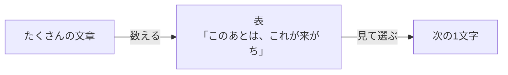
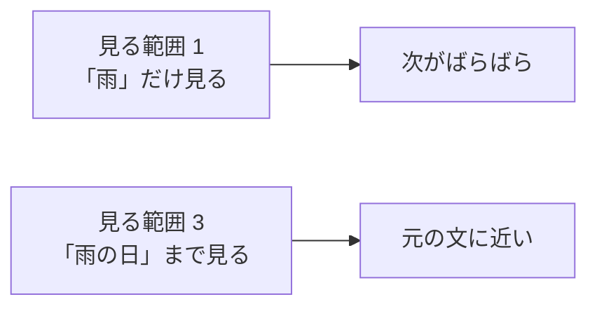
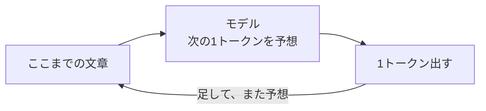

# 5-1 モデルとは

所要 25分 ／ 種類：作る

## 今日のゴール
- 「AIは次の言葉を予想している」の意味を、小さな手作りモデルで体感する
- **モデル**と**トークン**を、自分の言葉で説明できる
- モデルが「何文字前まで見るか」で、出てくる文章が変わるのを見る（5-4b の「コンテキストウィンドウ」の入口です）

## ステップ

### 1. なぜ「予想」で作るのか

- **前提**：コンピュータは意味を理解しません。できるのは、数を数えて計算することだけです
- **困りごと**：「こう聞かれたらこう返す」というルールを、人間が全部手で書くことはできません。言い方は無限にあるからです
- **解決**：大量の文章から「この並びのあとには、何が来がちか」を**数えて**おく。あとは、数えた表を見て次の1つを選ぶだけ
- たとえ：スマホの予測変換。「ありが」のあとは「とう」が来がち、を覚えているだけです

### 2. 言葉を2つ：トークンとモデル
- **トークン**：AIが文章を読むときの、いちばん小さな単位です。本物では「単語のかけら」くらい。今日は分かりやすく **1文字 = 1トークン** にします
- **モデル**：ステップ1の「このあとは、これが来がち」を覚えた、数字のかたまり（今日は表）です

**やってみよう**：先生がターミナルを開きます。そこで次を打ってください。

`python3 lessons/05-ai/01-what-is-a-model/model.py`

出てくるもの：

| 出力 | 意味 |
|---|---|
| `文章の長さ` と `覚えた並び` | 学習に使った文章のトークン数と、表の行数 |
| `「雨」のあと → [...]` | 表の中身。「雨」のあとに実際に来た文字のリスト |
| `1:` `2:` `3:` | モデルが作った文章 |

**確かめ**：もう一度同じコマンドを打ってください。同じ表から作ったのに、文章が毎回ちがうのはなぜ？ ボタン：`次の文字を、候補からサイコロで選んでいるから` / `打つたびに、表を作り直しているから`
<!-- 先生用：サイコロ（`random.choice`）で選んでいるから。間違えたら「表は同じ。「雨」のあとに「の」も「で」もあれば、どちらを出すかを毎回くじ引きしている」と言い直す。Claude の返事が毎回少しずつ違うのも同じ理由 -->

### 3. 自分の文章で学習させる
- 「学習」と聞くと難しそうですが、このモデルの学習は**数えるだけ**です。文章を変えれば、表が変わり、出てくる文章も変わります

**やってみよう**：
1. `cp lessons/05-ai/01-what-is-a-model/corpus.txt playground/corpus.txt`（`cp`＝**c**o**p**y）でお手本をコピーします
2. `vi playground/corpus.txt` で開き、中身を**あなたの文章**に書き換えます。100文字以上。日記、好きな食べ物、自己紹介など何でも
3. 保存したら、学習させて動かします：
   `python3 lessons/05-ai/01-what-is-a-model/model.py playground/corpus.txt`

### 4. 何文字前まで見るか（見る範囲）

- いまのモデルは、**直前の1文字だけ**を見て次を決めています
- 最後の数字を変えると、何文字前まで見るかを変えられます

**やってみよう**：数字を 1 → 2 → 3 と変えて、文章がどう変わるか比べてください。
`python3 lessons/05-ai/01-what-is-a-model/model.py playground/corpus.txt 2`

**確かめ**：見る範囲を 3 にすると、元の文章をほぼそのまま写すようになります。なぜ？ ボタン：`3文字の並びは1回しか出てこず、候補が1つしかないから` / `長く見ると、文の意味が分かるようになるから`
<!-- 先生用：候補が1つしかないから（覚えすぎ）。間違えたら「意味は分かっていない。「雨の日」のあとに来た文字が1つだけなら、それしか選べない」と言い直す。この「見る範囲」が、5-4b のコンテキストウィンドウの小さい版 -->

### 5. 本物の Claude との違い

- 本物も、やっていることは同じです：**次の1トークンを予想して、足して、繰り返す**
- 違いは2つ
  - 見る範囲が、何十万トークン（本なら何冊分も）あること
  - 表の代わりに、巨大な**ニューラルネット**（次のレッスン）で予想すること

## チェック
`/check`：`playground/corpus.txt` が自作の文章（100文字以上）で、モデルが動けば合格。

## AIとの関係
Claude の返事は、1トークンずつ「次はこれ」を選んで作られています。だから、もっともらしいのに間違うことがあります。意味を理解して答えているのではなく、「ありそうな続き」を出しているからです（5-7 でもう一度出てきます）。
