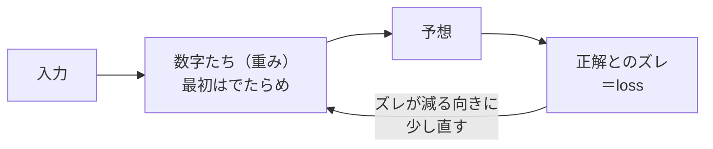

# 5-2 小さなニューラルネット

所要 25分 ／ 種類：作る

## 今日のゴール
- 「AIが学習する」とは、**数字を少しずつ直して、間違いを減らすこと**だと目で見て分かる
- **loss**（正解とのズレ）が下がっていくのを、自分の画面で見る
- 「部品が足りないと、いくら直しても覚えられない」ことがある、と知る

## ステップ

### 1. なぜ「数字を直す」のか

- **前提**：コンピュータが得意なのは、数の掛け算と足し算だけです
- **困りごと**：「この写真は猫？」「この文章の次は？」のようなあいまいな問題は、人間がルールを書き出せません
- **解決**：答えを出す式の数字（**重み**）を最初はでたらめにしておき、**正解とのズレが小さくなるように少しずつ直す**。ルールは書かず、数字に覚えさせます
- たとえ：料理の味見。薄ければ塩を少し足し、濃ければ減らす。これを何度も繰り返して、ちょうどいい味にします

言葉を3つ：
- **ニューラルネット**：数字を掛けて足して次へ渡す、を何段か重ねたもの
- **loss（ロス）**：正解とのズレの大きさ。小さいほど良い
- **学習**：loss が小さくなるように、数字を直すこと

### 2. 今日の問題と、最初の学習
今日は、2つの入力（0 か 1）を見て答える問題を解かせます。

| 問題 | 答えが 1 になるとき |
|---|---|
| `AND` | 両方が 1 |
| `OR` | どちらかが 1 |
| `XOR` | **どちらか片方だけ**が 1 |

**やってみよう**：先生がターミナルを開きます。次を順に打ってください。
1. `cp lessons/05-ai/02-tiny-neural-net/nn.py playground/nn.py`
2. `python3 playground/nn.py`

出てくるもの：
- `0回目 loss = ...` から `3000回目` まで：直すたびのズレ
- `答え合わせ`：入力ごとの予想（0〜1の数）と正解
- `数字の総数`：このモデルの中身の数字の数

### 3. 問題を変えてみる
**やってみよう**：
1. `vi playground/nn.py` で開き、`TASK = "AND"` を `TASK = "OR"` に変えて保存、実行
2. 次に `TASK = "XOR"` にして保存、実行

`答え合わせ` の数字が、正解（0 か 1）に近づいているかを見てください。

**確かめ**：モデルが XOR を正解できたのは、プログラムに何があったから？ ボタン：`「片方だけ 1 なら 1」というルールの行` / `正解の例の表と、ズレを見て直す仕組み`
<!-- 先生用：正解の例とズレを直す仕組み。ルールはどこにも書いていない。間違えたら「味見と同じ。レシピ（ルール）は無く、例とのズレを見て直しただけ」と言い直す -->

### 4. 部品を減らすと？
- `HIDDEN` は、まんなかの部品（数字を掛けて足す係）の数です。いまは 4 個

**やってみよう**：`TASK = "XOR"` のまま、`HIDDEN = 4` を `HIDDEN = 1` に変えて実行してください。

**確かめ**：部品が1個だと、何回直しても XOR が解けません。何が足りない？ ボタン：`直す回数` / `部品（数字）の数`
<!-- 先生用：部品（数字）の数。間違えたら「XOR は「片方だけ」という2つの条件の組み合わせで、1個の部品では表せない。何回直しても、道具が小さすぎる」と言い直す。本物の Claude が巨大なのは、難しいことを表すには数字がたくさん要るから -->

### 5. 戻して完成。本物との関係
- `HIDDEN` を 2、4 と戻して XOR を実行してください。うまくいく最小の数を探してみましょう
- 最後は `TASK = "XOR"`、`HIDDEN = 4` にして、最終 loss が小さい状態で終わります
- **これが「モデル」の正体です。** 賢さは、この十数個の数字に入っています
- 本物の Claude も同じ仕組みで、数字が**数千億個**あり、直した回数が桁違いに多いだけです。直しているのは「次のトークンの予想（5-1）」のズレです

## チェック
`/check`：`playground/nn.py` が XOR を、小さな最終 loss で解けていれば合格。

## AIとの関係
「モデルが学習した」「モデルを更新した」と聞いたら、それは数字が直された、という意味です。直す作業は、前もって大きなコンピュータで行われます。**あなたと話している最中に、数字が直されているわけではありません。** それなら、Claude はどうやって会話を覚えているように見えるのか。それを 5-4 で確かめます。
