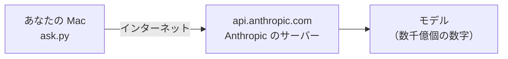
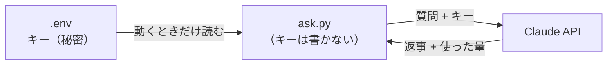

# 5-3 Claude API を Python から呼ぶ

所要 30分 ／ 種類：作る（**任意・有料**）

## 今日のゴール
- Claude の本体が**どこにあって**、どうやって頼んでいるのかが分かる
- 自分の Python プログラムから Claude を呼び、返事と**使ったトークン数**を画面に出す
- API キーを、コードに書かずに使える

> **お金について**：このレッスンは API を使うので、**使った分だけお金がかかります**（Claude Console でキーを作り、利用額を入金する仕組み。claude.ai や Claude Code のプランとは別の課金です）。使うのは一番安い Haiku で、質問も短いので、数回動かすくらいなら少額です。
> 気になる方は、**キーなしで「読むだけ」で進めて大丈夫**です（チェックも通ります）。5-4・5-4b・5-5 の有料の部分も同じで、飛ばしても第6部や卒業制作には影響しません。

## ステップ

### 1. Claude の本体はどこにある？

- **前提**：Claude の中身は、5-2 で見た「数字」が数千億個あるモデルです。Anthropic の大きなコンピュータの中にあり、あなたの Mac では動かせません
- **困りごと**：使うには、ネット越しに「これに答えて」と頼むしかありません
- **解決**：Anthropic は、プログラムから頼むための入口（**API**、3-3 で `curl` で叩いたのと同じもの）を、`api.anthropic.com` という名前で用意しています

**やってみよう**：先生がターミナルを開きます。0-3 でやった電話帳引きを、Claude の入口でやってみてください。

`nslookup api.anthropic.com`

`Address:` に出る番号が、Claude の入口のサーバーです。`127.0.0.1`（自分自身）ではありません。

**確かめ**：0-1 のページはスマホから見られませんでした。でも Claude は、スマホからでも会社のパソコンからでも使えます。なぜ？ ボタン：`Claude は、ネット上に名前と番号を持つサーバーにあるから` / `どの機械にも Claude のモデルが入っているから`
<!-- 先生用：ネット上のサーバーにあるから。間違えたら「0-1 のサーバーは localhost（自分の Mac の中だけ）。Claude の本体は Anthropic のコンピュータに1か所あり、みんなそこへ頼みに行く」と言い直す -->

### 2. キーは「会員カード」

- **前提**：入口はインターネットに開いているので、誰でも頼みに来られます
- **困りごと**：誰が頼んだか分からないと、料金の請求も、乱用を止めることもできません
- **解決**：頼むときに、本人の証明として**API キー**（長い合言葉の文字列）を見せます。会員カード付きの注文窓口のようなもので、使った分だけ請求されます
- キーは**パスワードと同じ**です。4-2 で習ったとおり、コードには書かず、`.env` に置いて**環境変数**として渡します

**確かめ**：キーを `playground/ai/.env` に入れて、`ask.py` だけを GitHub で公開しました。大丈夫？ ボタン：`大丈夫` / `危ない`
<!-- 先生用：大丈夫。ask.py にはキーが書いていない（環境変数から読むだけ）。.env は playground/ の中で git の管理外。間違えたら図の矢印を指して「キーは ask.py の中ではなく、.env にある。.env を公開したら危ない」と言い直す -->

### 3. 準備する（キーを使う人だけ）
**やってみよう**（あなたが、ブラウザとターミナルで）：
1. Claude Console（`console.anthropic.com`）で API キーを作ります。**キーはチャットにも、コードにも貼りません**
2. 作業フォルダを作ります（2-1 の uv です）：
   `mkdir -p playground/ai && cd playground/ai && uv init`
3. 部品を足します：`uv add anthropic python-dotenv`
   - `anthropic`：Claude を呼ぶための公式の部品
   - `python-dotenv`：`.env` を読む部品
4. `vi .env` で、1行だけ書いて保存します：`ANTHROPIC_API_KEY=ここにキー`

キーを使わない人は、2 と 3 だけやって次へ進んでください。
<!-- 先生用：先生はキーを見ない・聞かない。受講者が vi で .env を書いているあいだは、ターミナルパネルを読まない。.env の中身を cat させない。確かめるときは、先生が `grep -c "^ANTHROPIC_API_KEY=" playground/ai/.env` で「行があるか（1 と出るか）」だけを見る -->

### 4. ask.py を読む
**やってみよう**：先生のプログラムをコピーして、中身を見てください（いまは `playground/ai` にいます）。

`cp ../../lessons/05-ai/03-claude-api/ask.py ask.py` → `cat ask.py`

読むところは4つだけです。

| 行 | 意味 |
|---|---|
| `model="claude-haiku-5-5"` | どのモデルに頼むか。一番安くて速いもの |
| `max_tokens=300` | 返事の長さの上限（トークン） |
| `messages=[{"role": "user", "content": QUESTION}]` | 渡す文章。`user`（あなた）の発言が1つ |
| `message.usage` | 使ったトークン数。料金はこれで決まる |

裏では、第3部と同じく **HTTP で JSON を送っている**だけです。相手が天気のサーバーではなく Claude なだけです。

### 5. 動かして、トークンを見る（キーを使う人だけ）
**やってみよう**：
1. `uv run python ask.py` を打つ。返事と、入力・出力のトークン数が出ます
2. `vi ask.py` で `QUESTION` を好きな質問に変えて、もう一度
3. `max_tokens=300` を `max_tokens=20` に変えて、もう一度
4. 終わったら `cd ../..` でリポジトリの一番上に戻ります

- **トークン**は、5-1 では「1文字」にしましたが、本物はもう少し賢く切っています。日本語はだいたい1文字＝1トークン前後、英語は1単語＝1〜2トークンくらいが目安です

## チェック
`/check`：`playground/ai/ask.py` があり、キーがコードに直書きされておらず、使用量を表示していれば合格。
キー（`ANTHROPIC_API_KEY`）が使える状態なら、実際に動かして確かめます。無ければその部分だけスキップします。

## AIとの関係
Claude Code も、中では今日と同じ「文章を送って、返事をもらう」を何十回も繰り返しています。使用量の上限や料金の話が出たら、「トークンの数のことだ」と思い出してください。では、その「送る文章」には何が入っているのか。次の 5-4 で覗きます。
