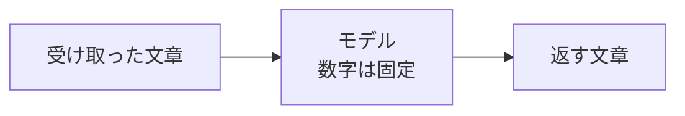
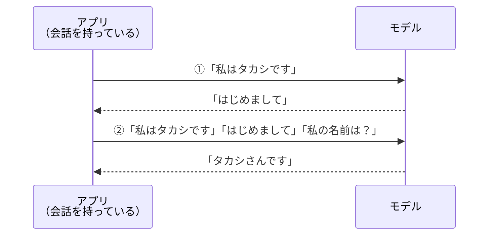

# 5-4 プロンプトとコンテキスト：AIは覚えていない

所要 30分 ／ 種類：作る（キー不要。最後のステップだけ任意・有料、5-3 と同じ条件）

## 今日のゴール
- モデルは**会話を覚えていない**こと、それでも覚えて見えるのは**アプリが毎回、会話を全部送り直している**からだと分かる
- **コンテキスト**（モデルに渡す文章の全部）という言葉を、自分の言葉で説明できる
- 渡す文章を変えると答えが変わるのを、プロンプトの練習で確かめる

## ステップ

### 1. モデルは「文章を受け取って、文章を返す」だけ

- **前提**：モデルの中身は数字のかたまりで、その数字は**会話のあいだ変わりません**（5-2）。学習は、前もって済ませてあります
- モデルは「文章を受け取ると、続きの文章を返す」関数です。メモ帳も、記憶する場所も持っていません
- **困りごと**：では、前に言ったことは、どこにも残らないはずです

### 2. 新しいチャットで確かめる（無料）
**やってみよう**（あなたが、ブラウザで）：claude.ai（または Claude アプリの「チャット」）を開いてください。
1. 新しいチャットで「私の好きな果物はマンゴーです。覚えておいてね」と送る
2. **もう1つ新しいチャット**を始めて、「私の好きな果物は何でしたか？」と聞く

- 2つ目のチャットの Claude は、たぶん知りません
- 設定で「メモリ」（過去の会話を参考にする機能）がオンだと、答えられることがあります。それも実は、アプリが過去のメモを探して**文章として一緒に渡している**のです。仕組みは次のステップで分かります

### 3. 覚えて見える仕組み：アプリが毎回、全部送り直す

- **解決**：会話を覚えているのは、モデルではなく**アプリ**（claude.ai や Claude Code）です
- アプリは、あなたが何か送るたびに、**これまでの会話を全部つなげて**、毎回はじめからモデルに渡しています
- このとき渡す文章の全部を**コンテキスト**（文脈）と呼びます。質問、これまでの会話、読ませた資料、ルール。全部です
- いまこの先生（Claude）も同じです。あなたが1つ送るたびに、アプリが、この会話の全部と、このレッスンの README と、`CLAUDE.md` を、まとめて渡しています

**確かめ**：会話が10往復目になったとき、アプリがモデルに渡す文章に、1往復目のあなたの発言は入っている？ ボタン：`入っている` / `古いので入っていない`
<!-- 先生用：入っている。毎回、全部送り直すから。間違えたら図の②を指して「①の内容がまた入っている。10往復目も、1往復目から全部」と言い直す。だから会話が長いほど送る量（トークン）が増える。この「増える」と「上限」は 5-4b で体験する -->

### 4. おもちゃのチャットで覗く
- 本物のアプリの中は見えません。そこで、中身が見える**おもちゃのチャット**を用意しました。お金はかかりません
- おもちゃのモデルは、受け取った文章だけを見て、決まった返事をする小さな関数です。本物ほど賢くありませんが、「**渡された文章しか見ない**」ところは本物と同じです

**やってみよう**：先生がターミナルを開きます。次を打ってください。
1. `cp lessons/05-ai/04-prompt-and-context/toychat.py playground/toychat.py`
2. `python3 playground/toychat.py`
3. `あなた>` のあとに `私の名前はタカシです`（名前はあなたの名前で）と打って Enter
4. 次に `私の名前は何ですか？` と打って Enter
5. `exit` で終わります

`┌─ モデルに送った文章` の枠が、**アプリが実際にモデルに渡した文章**です。

### 5. アプリを直す：会話を全部送る
**やってみよう**：
1. `vi playground/toychat.py` で開き、`def make_context` を探します（ファイルのまんなかより少し下、「アプリ（ハーネス）」の見出しのすぐ下です）
2. `return history[-1]` が「最後の発言だけ」を送っている行です。これまでの会話を全部、改行でつないで送るように直してください（コメントにヒントがあります）
3. 保存して、もう一度 `python3 playground/toychat.py`。ステップ4と同じ順で話しかけます

枠の中の文章が、1回ごとに**長くなっていく**のを見てください。右上の文字数も増えていきます。

**確かめ**：名前を答えられるようになったのは、どちらを直したから？ ボタン：`アプリ（渡す文章の作り方）` / `モデル（返事を作る部分）`
<!-- 先生用：アプリ（make_context）。モデル（toy_model）は1文字も変えていない。間違えたら「toy_model の行には触っていない。名前を言った発言が文章に入ったから答えられた」と言い直す。これが「覚えて見える」の正体 -->

### 6. プロンプトの練習：渡す文章で、答えが変わる（無料）
- **プロンプト**：モデルに渡す文章のうち、あなたが書いたお願いの部分
- **system プロンプト**：会話の前に置く「あなたは〇〇として答えて」のようなルール。アプリが毎回いちばん前に付けて渡します
- モデルが知っているのは、渡された文章だけ。だから、**必要なことを書いて渡すほど**、あなたに合った答えになります

**やってみよう**（あなたが、claude.ai の新しいチャットで）：次の3つを、それぞれ**別の新しいチャット**で送って、答えを比べてください。
1. `今日の夕食、何にしよう？ 1つだけ答えて。`
2. `冷蔵庫には卵とキャベツとベーコンしかありません。15分で作りたいです。今日の夕食、何にしよう？ 1つだけ答えて。`
3. `次の文を「ポジ」か「ネガ」で分類して。例：楽しかった → ポジ　例：最悪だった → ネガ　分類：電車が遅れて疲れた →`

### 7. （任意・有料）本物の Claude API で確かめる
5-3 で API キーを用意した人だけ。呼び出しは7回、どれも短い文章です（1回あたり数十〜百トークンほど）。

**やってみよう**：
1. `cd playground/ai && cp ../../lessons/05-ai/04-prompt-and-context/context.py context.py`
2. `cat context.py` で中身を読み、`uv run python context.py` で動かす
3. **実験5**を見る：「名前はタカシ」と「名前は何？」を**別々の呼び出し**にすると、答えられません。ステップ4のおもちゃと同じです
4. **実験6を完成させる**：`vi context.py` で `history = []` に、自己紹介 → Claude の返事 → 名前の質問、の順に入れて実行。名前を答えられたら成功です（形はコメントに書いてあります）
5. 実験5と実験6の「入力トークン」を比べる。終わったら `cd ../..` で戻ります

## チェック
`/check`：`playground/toychat.py` が会話を全部送るように直してあり、名前を答えられれば合格。
`playground/ai/context.py` があれば、実験6の履歴の形も確かめます（キーがあれば実際に動かします）。

## AIとの関係
Claude Code が賢く見えるのは、あなたの質問に加えて、`CLAUDE.md`（`.md` は Markdown：簡単な記号で書く文章の形式）、読んだファイル、これまでの会話を**毎回まとめて渡している**からです。うまくいかないときは「必要な情報は、コンテキストに入っているか？」と考える癖をつけましょう。では、会話がどんどん長くなったらどうなるのか。次の 5-4b で、わざと溢れさせてみます。
