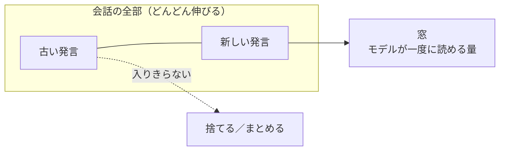
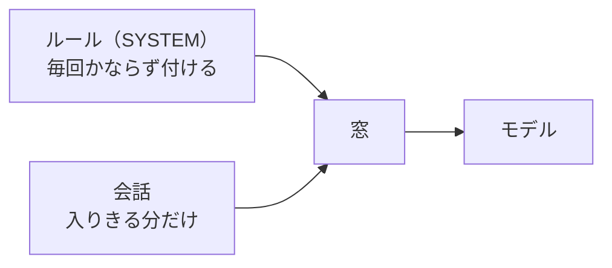

# 5-4b コンテキストを溢れさせる

所要 35分 ／ 種類：作る（キー不要。ステップ6だけ任意・有料、5-3 と同じ条件）

## 今日のゴール
- モデルが一度に読める量には**上限（コンテキストウィンドウ）**があり、溢れた分は**最初から無かったのと同じ**になると体感する
- わざと溢れさせて、AI に**名前を忘れさせ、最初のルールを破らせる**
- 上限の内側でも、長すぎると**大事なことが埋もれる**と知り、対処のしかたを言える

## ステップ

### 1. 前提：一度に読める量には上限がある

- **前提**：モデルは、受け取った文章を全部まとめて計算します。長いほど計算もメモリも増えるので、**一度に読める量（トークン数）に上限**があります。これを**コンテキストウィンドウ**と呼びます
- **困りごと**：5-4 のとおり、アプリは毎回、会話を全部送り直します。会話は伸び続けるので、いつか窓に入りきらなくなります
- **解決**：本物の API は、上限を超えた文章を「長すぎる」と断ります。だから**アプリ**が、古い部分を捨てるか、要約して縮めてから送ります
- 実は 5-1 のモデルにも窓がありました。最後の数字（何文字前まで見るか）です。窓が1文字だと、前の流れを忘れて、話がすぐ別の方向へ行きました

**やってみよう**：先生がターミナルを開きます。5-1 のモデルを、窓 1 と 3 でもう一度動かして比べてください。
`python3 lessons/05-ai/01-what-is-a-model/model.py playground/corpus.txt 1`
`python3 lessons/05-ai/01-what-is-a-model/model.py playground/corpus.txt 3`
（`playground/corpus.txt` が無ければ、`lessons/05-ai/01-what-is-a-model/corpus.txt` で試せます）

### 2. 溢れさせて、名前を忘れさせる
- 5-4 で直した `playground/toychat.py` を使います。いちばん上の `WINDOW` が窓の大きさ（文字数）です。いまは `0`（上限なし）
- おもちゃなので 1文字 = 1トークンと数えます

**やってみよう**：
1. `vi playground/toychat.py` で `WINDOW = 0` を `WINDOW = 100` に変えて保存
2. `python3 playground/toychat.py` で起動し、順に打ちます
   - `私の名前は〇〇です`（あなたの名前）
   - `/long`（長い会議メモを貼ったことになります）
   - `私の名前は何ですか？`
3. `exit` で終わります

（`playground/toychat.py` が無い人は、先に 5-4 のステップ4と5をやってください）
<!-- 先生用：5-4 の make_context が直っていないと、そもそも覚えられない。先に bash lessons/05-ai/04-prompt-and-context/check.sh で確かめてよい -->

`✂` の行が、アプリが**古いほうから捨てた**しるしです。枠の中に、名前を言った発言は残っていますか？

### 3. 最初に決めたルールも、溢れると消える
- 名前だけではありません。会話の**最初に**決めたルールも、古いほうから捨てられます

**やってみよう**：もう一度 `python3 playground/toychat.py` で起動して、順に打ちます。
1. `これから語尾に「ニャ」をつけて話して`
2. `今日は晴れ`（返事に「ニャ」が付くのを見る）
3. `/long`
4. `明日も晴れ`
5. `exit`

**確かめ**：4 の返事から「ニャ」が消えました。なぜ？ ボタン：`ルールを決めた発言が、窓から捨てられたから` / `長い話のあいだに、モデルがルールを破ったから`
<!-- 先生用：窓から捨てられたから。間違えたら「モデルは破ったのではなく、もう受け取っていない。枠の中にルールの行が無いのを見て」と言い直す。本物でも、長い会話の最初に頼んだ「〜の形で答えて」が、だんだん守られなくなることがある -->

### 4. 大事なことは、毎回いちばん前に付ける

- **解決**：大事なルールは、会話の中に混ぜずに、アプリが**毎回いちばん前に必ず付ける**。これが 5-4 で出てきた **system プロンプト**の使い方です
- ただし、ルールも窓の一部を使います。ルールが長いほど、会話に使える場所は減ります

**やってみよう**：
1. `vi playground/toychat.py` で `SYSTEM = ""` を `SYSTEM = "語尾に「ニャ」をつけて話す"` に変えて保存（語尾は好きな言葉でかまいません）
2. 起動して、`私の名前は〇〇です` → `/long` → `/long` → `私の名前は何ですか？` と打つ
3. 枠のいちばん上に、毎回 `ルール：` の行があることを確かめて、`exit`

**確かめ**：今度は「ニャ」は最後まで残りましたが、名前はやっぱり忘れました。名前も忘れないようにするには、どこに書く？ ボタン：`SYSTEM（毎回いちばん前に付く場所）` / `会話のいちばん最初の発言`
<!-- 先生用：SYSTEM（例：SYSTEM = "語尾に「ニャ」をつけて話す。私の名前は〇〇です"）。おもちゃは「ルール：」の行からも名前を探すので、試してもらってよい。間違えたら「最初の発言は、いちばん古いので真っ先に捨てられる。毎回付く場所なら捨てられない」と言い直す。これが Claude Code の CLAUDE.md と同じ考え方（6-4） -->

### 5. 本物は、上限の内側でも埋もれる（無料）
- 本物の Claude の窓はとても大きく、簡単には溢れません。でも**長くなるほど、大事な一文が埋もれて**、見落としや数え間違いが増えていきます
- 特に、長い文章の**まんなか**にあることは見落とされやすい、と知られています

**やってみよう**：
1. 長い文章を作ります（先生のプログラムが、文章を作ってファイルに書くだけです）：
   `python3 lessons/05-ai/04b-context-overflow/make_long.py 300 > playground/long.txt`
2. 中身を見ます：`head playground/long.txt`（`head`＝先頭だけ表示）。最初にルール、まんなかに合言葉、最後に質問があります
3. クリップボードにコピーします：`pbcopy < playground/long.txt`（`pbcopy`＝**p**aste**b**oard **copy**：貼り付け用にコピー）
4. claude.ai の**新しいチャット**に貼って送ります
5. 本当の答えを、自分で数えます：`grep -c "：在庫 0個" playground/long.txt`（`grep -c` は 1-6 の「数える」）
6. 余裕があれば、`300` を `1000` にして、もう一度（新しいチャットで）

- 目安：1行 ≈ 10トークン。300行で約3千、1000行で約1万トークンです

### 6. （任意・有料）API で、送る前に数えてから試す
5-3 で API キーを用意した人だけ。ステップ5と同じ文章を、Haiku に**1回だけ**送ります。

**やってみよう**：
1. `cd playground/ai && cp ../../lessons/05-ai/04b-context-overflow/overflow.py overflow.py`
2. `uv run python overflow.py 100`
3. 送る前に、**送ると何トークンになるか**が出ます（数えるだけならお金はかかりません）。`y` を押したときだけ送ります
4. 答え合わせ（本当の数、合言葉、ルール）と、使ったトークンが出ます
5. 行数を `300`、`1000` と増やして比べる（上限は 2000 行・約2万トークンにしてあります）。終わったら `cd ../..`

- Haiku の窓は約100万トークンなので、この程度では溢れません。わざと溢れさせると、送る量のぶん料金がかかるので、それはおもちゃでやりました

### 7. 対処のしかたをまとめる
| 困ったこと | 対処 |
|---|---|
| 話題が変わった | **新しい会話**を始める。前の話は要らないので、まっさらのほうが軽くて正確 |
| 続けたいが、長くなった | **要約して縮める**（Claude Code の `/compact`、または「ここまでを10行にまとめて」と頼んで、新しい会話に貼る） |
| 毎回守ってほしいルール | 会話ではなく、**毎回付く場所**に書く（system プロンプト、`CLAUDE.md`） |
| 大きな資料 | 全部渡さず、**必要な部分だけ**渡す |

## チェック
`/check`：`playground/toychat.py` で、`WINDOW` が小さくて溢れるようになっていて、`SYSTEM` の「語尾に「〇〇」」が、溢れたあとも守られていれば合格。

## AIとの関係
Claude が長い会話の途中で前の話を忘れたり、最初の指示を守らなくなったりしたら、それは「アホになった」のではなく、**大事なことが窓から押し出されたか、埋もれた**のです。新しい会話・要約・`CLAUDE.md` は、そのための道具です（6-4、6-8 で実際に使います）。
