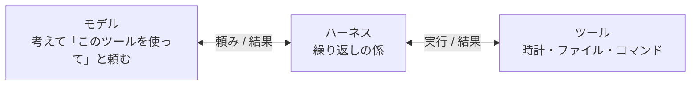
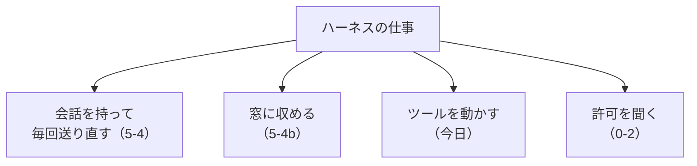
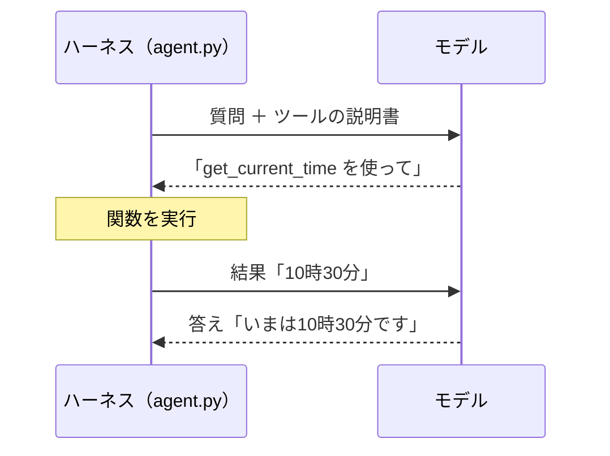

# 5-5 ハーネスとは

所要 30分 ／ 種類：作る（ステップ4・5の実行は**任意・有料**、5-3 と同じ条件。読む・書くだけならキー不要）

## 今日のゴール
- 「AIエージェント」の正体が、**モデル ＋ ハーネス ＋ ツール**だと分かる
- 30行ほどのハーネス（`agent.py`）を読み、ツールを1つ足す
- Claude Code が「コマンドを実行した」とき、本当は誰が実行しているのかを説明できる

## ステップ

### 1. モデルには、手も時計もない

- **前提**：モデルは、**文章を受け取って文章を返すだけ**です（5-4）。しかも Anthropic のサーバーの中にいます（5-3）
- **困りごと**：「いま何時？」と聞かれても、時計がありません。「ファイルを直して」と頼まれても、あなたの Mac に手が届きません
- **解決**：あなたの Mac の上に、手足の役をするプログラムを置きます。モデルは「時計を見て」と**文章で頼み**、プログラムが実際に見て、結果を**文章で返す**。この係を**ハーネス**（馬具：馬の力を車に伝える道具）と呼びます
- たとえ：目の見えない名シェフと、指示どおりに動く助手。シェフが考え、助手が手を動かします
- **モデル ＋ ハーネス ＋ ツール ＝ エージェント**。Claude Code は、これのとても大きなものです

### 2. ハーネスは、もう作ったことがあります

- 5-4 で直した `make_context`（会話を全部送る）も、5-4b の `WINDOW` と `SYSTEM`（窓に収める、ルールを毎回付ける）も、**モデルではなくアプリ側の仕事**でした。あれがハーネスです
- 今日は、そこに「**ツールを動かす**」を足します

**確かめ**：同じ Claude のモデルを使っていても、claude.ai と Claude Code では、できることが違います（Claude Code はファイルを触れる）。なぜ？ ボタン：`ハーネス（ツールと許可の聞き方）が違うから` / `中で動いているモデルが違うから`
<!-- 先生用：ハーネスが違うから。間違えたら「どちらでも同じモデルを選べる。違うのは、手足（ツール）を持っているかどうか。シェフは同じで、助手が違う」と言い直す -->

### 3. agent.py を読む

**やってみよう**：先生のプログラムをコピーして、読んでください。キーが無い人も、ここまではできます。

`mkdir -p playground/ai && cp lessons/05-ai/05-harness/agent.py playground/ai/agent.py && cat playground/ai/agent.py`

読むところは3つだけです。

| 場所 | 役目 |
|---|---|
| `TOOLS` | モデルに見せる**説明書**（ツールの名前と、何ができるか） |
| `FUNCS` | 説明書の名前に対応する、**本物の関数** |
| `while True:` | ハーネスの心臓。**ツールを頼まれなくなるまで**繰り返す |

### 4. 動かして、ツールを頼む回数を見る（キーを使う人だけ）
**やってみよう**：
1. `cd playground/ai`
2. `uv run python agent.py "いま何時？ playground に何がある？"`
3. `[ツール実行]` の行を数えます。**あなたのプログラムが、Claude に頼まれて関数を動かした**しるしです
4. 次に `uv run python agent.py "1+1は？"` を打ちます

- 1回の質問で、裏では Claude を2〜3回呼んでいます。ツールの結果を返すたびに、また呼ぶからです。それでも1回あたり数百〜千トークンほどです

### 5. ツールを1つ足す
**やってみよう**：`vi playground/ai/agent.py` で、`TODO` の場所に3つ目のツールを足します。例：サイコロを振る `roll_dice`、今日の曜日を返す、など。
1. 関数を書く（`def roll_dice():` のように）
2. `FUNCS` に、名前と関数を登録する
3. `TOOLS` に説明書を書く

- **説明書の文章が大事です。** モデルはそれだけを読んで、使うかどうかを決めます
- ファイルを消すなど、危ないツールは作らないでください
- キーを使う人は、足したツールを使わせる質問をして（例：`uv run python agent.py "サイコロを振って"`）、`[ツール実行]` に出るのを確かめます

### 6. 実行しているのは誰？
- Claude は、返事の `stop_reason` を `tool_use` にして「この名前のツールを、この引数で動かして」と**頼むだけ**です
- **実行する・しないを決めるのは、ハーネス**です。`agent.py` は頼まれたら必ず実行しますが、Claude Code は実行の前に「許可しますか？」と聞きます。これが 0-2 で見た**権限ダイアログ**です
- ツール・許可・会話の管理・窓に収めること（5-4b）・`CLAUDE.md` を読むこと。全部ハーネスの仕事です

**確かめ**：Claude Code の権限ダイアログで「許可しない」を押したら、どうなる？ ボタン：`ハーネスが実行せず、「許可されなかった」とモデルに返す` / `モデルが、自分で別の道具を使って実行する`
<!-- 先生用：ハーネスが実行しない。間違えたら「モデルはサーバーの中にいて、Mac に手が届かない。手足はハーネスだけなので、ハーネスが止めれば止まる」と言い直す。モデルは結果を受けて、別の方法を考える（か、あなたに聞く） -->

## チェック
`/check`：`playground/ai/agent.py` に3つ以上のツールがあり、それぞれ関数が用意されていれば合格。キーがあれば実際に動かして、ツールが呼ばれるか確かめます。

## AIとの関係
「Claude が勝手にコマンドを実行した」ように見えても、実際に実行しているのは**ハーネス**です。許可ダイアログは、その間に立つ関所。だから「何を許可するのか」を一言で説明できる人は、強いのです。
