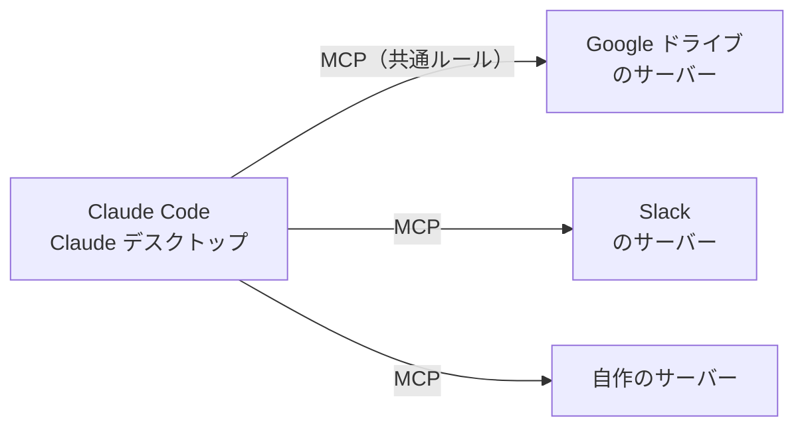
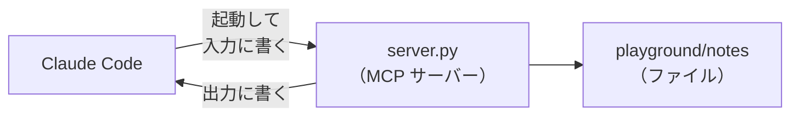

# 5-6 MCP は AI 向けの API

所要 30分 ／ 種類：覗く ＋ 作る（作る部分は任意・お金はかかりません）

## 今日のゴール
- **MCP** が何のための仕組みかを、5-5 のツールとつなげて説明できる
- 自分の Claude アプリで、MCP がつながっているところと、そのツールの説明書を見つける
- （任意）小さな MCP サーバーにツールを足して、Claude Code につなぐ

## ステップ

### 1. サービスごとにツールを作るのは大変

- **前提**：AI にサービスを使わせるには、5-5 のように、ツールの説明書（`TOOLS`）と関数を用意して、ハーネスに組み込む必要があります
- **困りごと**：Google ドライブ、Slack、カレンダー……。サービスの数 × AI アプリの数だけ、組み込みを作ることになります
- **解決**：「ツールの説明書の渡し方と、呼び方」を**共通のルール**にした。それが **MCP**（**M**odel **C**ontext **P**rotocol：モデルのコンテキストに、外の道具や情報を渡すための決まり）です
- たとえ：家電のコンセントの規格。形が決まっているから、どの機器もどの壁にも挿せます。決まりに従った **MCP サーバー**が1つあれば、Claude Code からもデスクトップアプリからも使えます
- 3-8 で作った FastAPI は「人間やプログラム向けの窓口」。MCP は「AI 向けの窓口」で、**窓口に張る説明書**が特に大事、という違いです

**確かめ**：Slack の会社が MCP サーバーを1つ作りました。どの AI アプリから使える？ ボタン：`MCP を話せる、どの AI アプリからでも` / `作るときに選んだ、1つの AI アプリだけ`
<!-- 先生用：MCP を話せるどの AI からでも。間違えたら「コンセントと同じ。規格に合わせて1つ作れば、どの壁にも挿せる。MCP が無ければ、AI ごとに別々の組み込みが要った」と言い直す -->

### 2. 自分のアプリで覗く
**やってみよう**（あなたが、アプリで）：
1. Claude のデスクトップアプリ（または claude.ai）の設定で、**コネクタ**の画面を開きます。何がつながっていて、何ができると書いてありますか？
2. Claude Code のチャットで `/mcp` と打ちます。つながっている MCP サーバーの一覧が出ます（無ければ「無い」と出るだけです）
3. 一覧の1つを選んで、**どんなツールを持っているか**を見ます

ツールの名前と説明文が、5-5 で見た `TOOLS` の説明書と同じ形をしていることを確かめてください。

### 3. 小さなサーバーを読む

**やってみよう**：先生がターミナルを開きます。`cat lessons/05-ai/06-mcp/server.py` で読んでください。

| 場所 | 役目 |
|---|---|
| `@mcp.tool()` | この印が付いた関数が、そのまま Claude のツールになる |
| `""" ... """` | 関数の下の説明文。これが Claude への説明書になる |
| `mcp.run()` | サーバーとして動き始める |

- `mcp.run()` は、**stdio**（**st**andar**d** **i**nput/**o**utput：キーボード入力と画面出力の仕組み）を、そのまま会話に使います
- 0-1 や 3-6 のサーバーは、ポートを開いて「誰か来ないかな」と待っていました。このサーバーは**ポートを開きません**。Claude Code がこのプログラムを自分で起動して、入力に書き込み、出力を読みます

### 4. （任意）ツールを足す
**やってみよう**：
1. 部品を入れます（5-3 で作った `playground/ai` を使います。無ければ 5-3 のステップ3の 2 と 3 だけやってください）：
   `cd playground/ai && uv add mcp`
2. コピー：`cp ../../lessons/05-ai/06-mcp/server.py server.py`
3. `vi server.py` で、TODO の **`add_note` ツール**を書き足します。上の2つのお手本（`list_notes`、`read_note`）を真似すれば書けます。説明文（`""" """`）も忘れずに
4. メモを1つ作っておきます：`mkdir -p ../notes && echo "牛乳を買う" > ../notes/todo.txt`
5. `cd ../..` でリポジトリの一番上に戻ります

### 5. （任意）Claude Code につないで使う
**やってみよう**：
1. リポジトリの一番上で、次を打ちます：
   `claude mcp add mini-notes -- uv run --project playground/ai python playground/ai/server.py`
   （「mini-notes という名前で、このコマンドで起動するサーバーを登録して」という意味です）
2. **新しい会話を始めてから** `/mcp` で `mini-notes` を確かめます
3. 「手帳に何がある？」「『明日の予定』というメモに、歯医者と書いておいて」と頼みます
4. 許可を求められたら、**何の許可か**を言葉にしてから押します

- つないだサーバーのツールの説明書は、会話のたびに**コンテキストに入ります**（5-4）。つなぐサーバーが多いほど、窓（5-4b）の場所を使います

**確かめ**：手順2で「新しい会話を始めてから」としたのは、なぜ？ ボタン：`会話の初めに、ツールの説明書を集めてコンテキストに入れるから` / `古い会話のままだと、ファイルを書く許可が切れているから`
<!-- 先生用：会話の初めに説明書を集めるから。間違えたら「前からの会話には、mini-notes の説明書が入っていない。モデルは渡された説明書しか知らない（5-4）」と言い直す -->

## チェック
`/check`：`playground/ai/server.py` に3つ以上のツールがあり、読み込めれば合格（`mcp` を入れていない場合は、形の確認だけ）。

## AIとの関係
コネクタをつなぐとき、あなたは「**この外部サービスの窓口を、Claude に渡す**」ことをしています。つなぐ前に、そのサーバーが「読む」だけか、「書く・消す・送る」までできるかを見る。ツールの一覧を読めるあなたなら、それができます。
