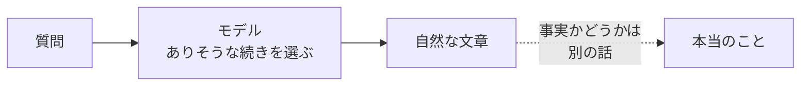
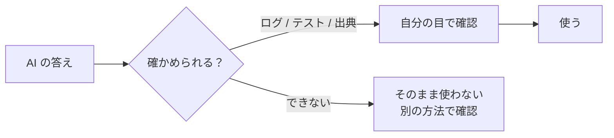

# 5-7 AIの限界と確かめ方

所要 25分 ／ 種類：作る（キー不要）

## 今日のゴール
- AI が間違える理由を、5-1 と 5-4b の言葉で説明できる
- AI が書いた「ログの要約」を、`grep` で自分で裏取りする
- 「任せる」と「信じる」を分けて考えられる。第5部のまとめです

## ステップ

### 1. なぜ AI は、自信満々に間違えるのか

- **前提**：AI は、5-1 のとおり「ありそうな続き」を1トークンずつ選んでいます。事実の辞書を引いているわけではありません
- **困りごと**：知らないことでも止まらず、それらしい続きを出してしまいます。文章が自然なので、間違いに気づきにくい
- これを**ハルシネーション**（幻覚）と呼びます。「知らない」と言うより、それらしく続けるほうが得意だからです

**やってみよう**（あなたが、claude.ai の新しいチャットで）：次を聞いてみてください。**どう答えるか予想してから**送ります。

> Python の `list.shuffle_all()` の使い方を教えて。

（そんなメソッドは存在しません）

### 2. 限界は3つ
| 限界 | 何が起きる | どこで見た |
|---|---|---|
| ハルシネーション | ありそうだけど事実でないことを、自然な文章で出す | 5-1、ステップ1 |
| コンテキストの限界 | 渡されていないことは知らない。長いと埋もれる・溢れる | 5-4、5-4b |
| コスト | 長い会話や大きな資料ほど、トークンが増え、時間もお金も増える | 5-3、5-4b |

- **解決**：答えを**自分の目で裏取りする**。裏取りの材料（ログ、テスト、出典）は、人間の手元にあります

### 3. AI の「要約」を裏取りする
先生が2つのファイルを用意しました。

| ファイル | 中身 |
|---|---|
| `lessons/05-ai/07-limits/server.log` | サーバーのログ（本物の記録） |
| `lessons/05-ai/07-limits/ai_summary.txt` | AI が書いた、そのログの要約 |

**やってみよう**：先生がターミナルを開きます。`cat` で両方を読んでください。要約は一見、もっともらしいです。

そのあと、要約の1〜5を、ログで確かめます。使うのは 1-6 で覚えた `grep` です。

- エラーの数：`grep -c ERROR lessons/05-ai/07-limits/server.log`
- 最初のエラー：`grep -n ERROR lessons/05-ai/07-limits/server.log | head -1`
- 原因は全部、天気API？：`grep ERROR lessons/05-ai/07-limits/server.log`
- ログインの回数：`grep -c "ログインに成功" lessons/05-ai/07-limits/server.log`
- 警告：`grep WARN lessons/05-ai/07-limits/server.log`

- `-c` は **c**ount（数える）、`-n` は行の**n**umber（番号）を付けて表示、`head -1` は先頭の1行だけ、です

**確かめ**：要約の1〜5をログで確かめた結果は？ ボタン：`ほぼ全部まちがっていた` / `正しいものに、まちがいが混ざっていた`
<!-- 先生用：混ざっていた。間違いは3つ（1：本当は5件、2：本当は 09:11:00、3：データベースと画面の描画のエラーもある）。4（ログイン10回）と5（WARN 1件）は合っている。間違えたら「4 と 5 は合っていた。全部が嘘ではなく、正しいことに混ざって間違いがあるのが一番こわい」と言い直す。check.sh が見るのは件数と最初の時刻。数がずれていたら、どの番号をどのコマンドで確かめたかを1つずつ一緒に見る -->

### 4. 結果を書く
**やってみよう**：`vi playground/verify.md` で、次を自分の言葉で書いてください（形は自由です）。
- ログの本当の**エラー件数**
- **最初のエラーの時刻**
- 要約の1〜5のうち、**間違っていた番号**

書けたら `/check` で確かめます。

### 5. 確かめ方の道具箱

| 何を確かめる？ | 道具 |
|---|---|
| 「サーバーを起動しました」 | ログを見る（`tail -f`、`docker logs`）、ブラウザで開く |
| 「直しました」 | テストを動かす、同じ操作をもう一度やる |
| 「事実です」 | 出典を出させて、そのページを自分で開く |
| 数・件数 | `grep -c`、`wc -l`（**w**ord **c**ount の **l**ine：行を数える）、自分で数える |
| 「安全です」 | 何をしたかの履歴（チャット）と `git diff` を見る |

- AI は**確かめる作業**も得意です。「どうやって確かめられる？」と聞けば、手順を出してくれます。ただし、**結果は自分の目で見る**、がルールです

**確かめ**：Claude Code が「テストを直して、全部通りました」と言いました。どう確かめる？ ボタン：`テストをもう一度動かして、出力を自分で見る` / `Claude に「本当に全部通った？」と聞き直す`
<!-- 先生用：テストを動かして出力を見る（チャットに残っている実行結果を読む、でも正解）。間違えたら「聞き直しても、返ってくるのはまた『ありそうな続き』。確かめの材料は、テストの出力という本物の記録」と言い直す -->

## チェック
`/check`：`playground/verify.md` に正しいエラー件数と最初のエラー時刻、間違っていた番号が書けていれば合格。

## AIとの関係
AI に任せるのは良いことです。ただし**「任せる」と「信じる」は別**です。ログ、テスト、出典で裏を取る習慣があれば、AI は頼もしい相棒になります。これが、このコースの目標そのものです。
