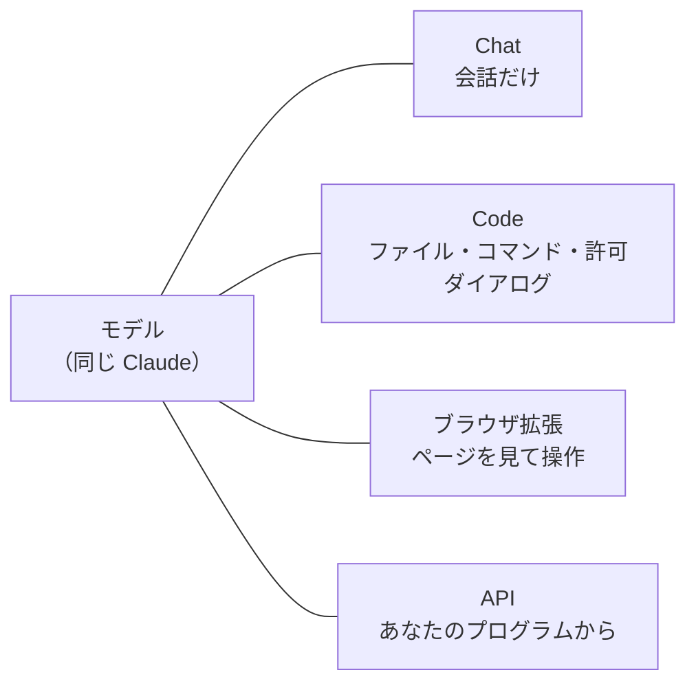
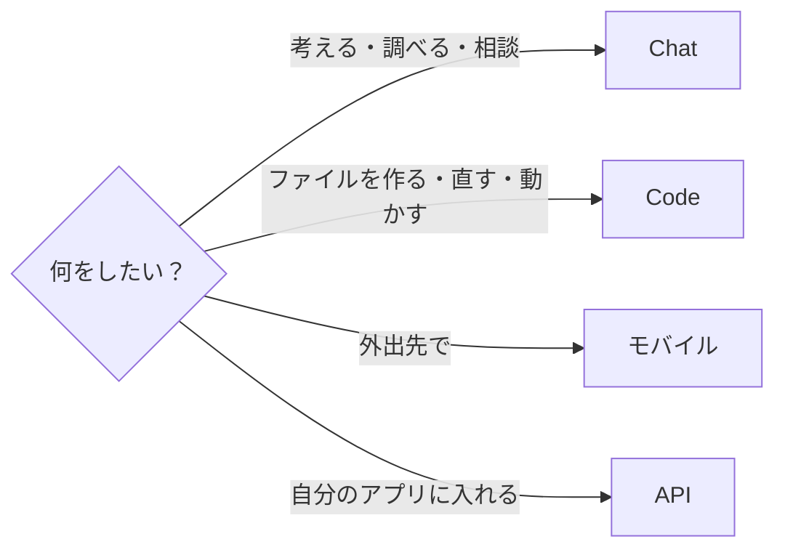

# 6-1 Claude の製品たち

所要 20分 ／ 種類：覗く

## 今日のゴール
- Claude にはいろいろな「入り口」があるけれど、**中にいるのは同じ Claude** だと分かる
- 入り口ごとに「できること」が違う理由を、ハーネス（5-5）で説明できる
- 場面ごとに、どの入り口を使うか選べる

## ステップ

### 1. 同じ料理人、違う厨房

- **前提**：モデルは、文字を受け取って文字を返すだけです（5-5）。ファイルやブラウザに触れるかどうかは、外側の**ハーネス**（手足の役のプログラム）が決めます
- **困りごと**：会話だけの窓口では、「ファイルを作って」という仕事は頼めません。逆に、何でも触れる窓口は、雑談に使うには危なすぎます
- **解決**：同じモデルに、**用途ごとに違う道具と許可を付けた入り口**をいくつも用意しました
- たとえ：同じ料理人が、屋台でも、レストランでも、出前でも働いている。違うのは、厨房にある道具です

**確かめ**：スマホのアプリで「Mac の中のファイルを直して」と頼んだら、どうなりそう？ ボタン：`直してくれる（中は同じ Claude だから）` / `できないと言われる（Mac のファイルに触る道具が無いから）`
<!-- 先生用：できない。スマホのアプリのハーネスには、Mac のファイルに触る道具が付いていない。間違えたら「料理人は同じ。でも屋台の厨房に、その包丁が無い」と言い直す -->

### 2. Chat と Code で同じことを頼む
**やってみよう**：あなたがアプリで、2か所に同じ文を送ります。
1. アプリの **Chat** タブを開き、新しい会話でこう送る
   > このフォルダの中のファイル一覧を見せて
2. この **Code** タブ（先生のいる場所）に戻って、同じ文を送る
3. 終わったら、ここで `やった` を押してください

### 3. 入り口の一覧
いま見た差は、ほぼ「付いている道具の違い」です。主な入り口はこれだけあります。

| 入り口 | ひとことで | 向いている場面 |
|---|---|---|
| claude.ai（Web） | ブラウザで使うチャット | 質問、文章、相談。ファイルは触らない |
| デスクトップアプリ（Chat タブ） | チャットのアプリ版 | 普段の相談、資料の読み込み |
| デスクトップアプリ（Code タブ） | **このコースで使っている場所** | パソコンのファイルを読み書きして作業してもらう |
| Claude Code（ターミナル／エディタ） | Code タブと同じ仕組みを別の窓口から | 慣れたら。ターミナルや VS Code で使いたい人向け |
| モバイルアプリ | スマホで使う | 外出先の相談、写真を見せて質問 |
| ブラウザ拡張 | ブラウザの中で動く Claude | Web ページを開いて操作してもらう作業 |
| API | プログラムから Claude を呼ぶ | 自分のアプリに組み込む（5-3 でやりました） |

- Code タブは「ファイルを変えられる」ぶん、許可ダイアログがあるのでした（0-2）。**道具が増えるほど、気をつけることも増えます**
- 提供状況や名前は変わることがあります。迷ったら公式サイトの最新情報を見ましょう

**確かめ**：「毎朝、売上のファイルを読んで、グラフのページを作り直してほしい」。どちらに頼む？ ボタン：`Chat` / `Code`
<!-- 先生用：Code。ファイルを読み、ページ（ファイル）を作るには、ファイルを触る道具が要るから。間違えたら「ステップ2で、Chat はファイル一覧すら見られなかった」と思い出してもらう -->

### 4. 選び方の目安

- 長い作業を任せたいときは Code（パソコンを開いておく）
- **「Claude ができない」と感じたら、まず入り口を疑う**。モデルではなく、道具が付いていないだけかもしれません

## チェック
`/check`：ステップ2を試して、「Chat と Code の違い」を、道具（ハーネス）という言葉を使って自分の言葉で説明できたら合格。

## AIとの関係
「Claude ができない」と感じたとき、原因はモデルではなく**入り口（道具が付いていない）**かもしれません。できないと決めつける前に、入り口を変えてみましょう。
