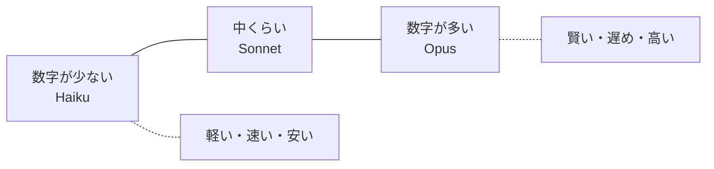
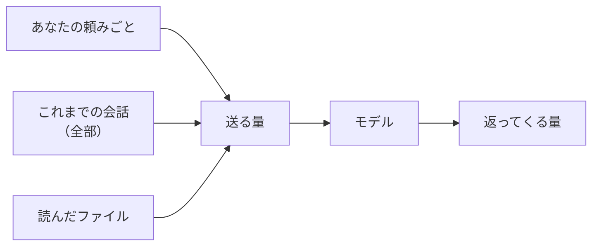
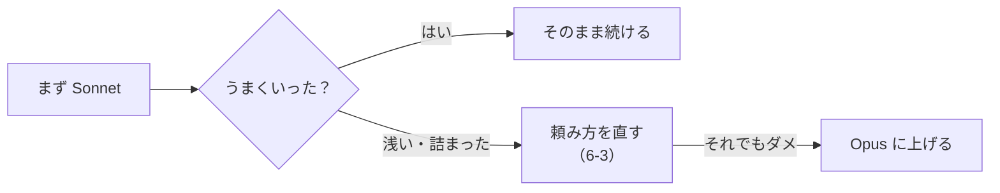

# 6-2 モデルの使い分けと料金

所要 25分 ／ 種類：作る

## 今日のゴール
- Claude のモデル（Opus・Sonnet・Haiku）の違いを、同じ頼みごとで**自分の目で比べる**
- 使用量が「トークン」で決まり、会話が長いほど増える理由が分かる
- 「まず Sonnet、詰まったら頼み方を直す、それでもダメなら上げる」という習慣をつける

## ステップ

### 1. なぜモデルに大小があるのか

- **前提**：モデルの正体は大量の数字で、1トークン出すたびに、その数字を全部使って計算します（5-1、5-2）
- **困りごと**：数字が多いほど賢くなりやすい。でも、そのぶん計算が重く、遅く、高くなります。簡単な仕事には無駄です
- **解決**：数字の量が違う**モデルを何種類か用意**して、仕事に合わせて選べるようにしました
- たとえ：電卓で足りる計算に、スーパーコンピュータは要りません

| | 賢さ・長い作業 | 速さ | 使用量の減り方 |
|---|---|---|---|
| Opus | 高い | 遅め | 大きい |
| Sonnet | 中〜高 | ふつう | 中 |
| Haiku | 軽い作業向き | 速い | 小さい |

現在のモデルには Opus 5.5・Sonnet 5.5・Haiku 5.5 のほか Fable 5.1 などがあります。名前と位置づけは変わるので、アプリのモデル選択の説明を読むのがいちばん確実です。金額や上限は、変わるのでここには書きません。

**確かめ**：1000通のメールを「急ぎ／急ぎじゃない」に分ける仕事。どちらに向いている？ ボタン：`大きいモデル（Opus）` / `小さいモデル（Haiku）`
<!-- 先生用：小さいモデル。1通ずつは簡単な判断で、数が多いので、速くて安いほうが得。間違えたら「電卓で足りる計算を1000回、スーパーコンピュータでやる？」と言い直す。迷うなら、数通だけ両方で試して比べればいい -->

### 2. 使用量は「トークン」で測る

- **前提**：文章は「トークン」という細かい単位に分けて数えます（5-1）。モデルは会話を覚えていないので、アプリは**毎回これまでの会話を全部つけて送り直しています**（5-4）
- **困りごと**：あなたが打ったのが一言でも、送る量はその一言だけではありません
- **解決**：使用量は「送った量＋返ってきた量」で数えます。賢いモデルほど、同じトークン数でも使用量を多く使います

**確かめ**：同じ「ありがとう」の一言でも、会話の1通目と50通目では使用量が違います。多いのは？ ボタン：`1通目` / `50通目`
<!-- 先生用：50通目。図の「これまでの会話（全部）」が一緒に送られるから。間違えたら図の左の箱を指して「50通目は、真ん中の箱が49通ぶん」と言い直す。くわしくは 6-8 で実際に見る -->

### 3. Sonnet で頼む（作るのは Claude）
**やってみよう**：あなたがアプリで操作します。
1. プロンプト欄の近くにあるモデル選択で **Sonnet** を選ぶ（分からなければ「モデルの選び方は？」と聞いてください）
2. この会話で、次の文を送る
   > playground/model-test/ に、1から100までの数を足すスクリプトを作って。なぜその答えになるかも3行で説明して。
3. 答えが返ってくるまでの**速さ**と、説明の**分かりやすさ**を覚えておく

<!-- 先生用：ここは README の「作るのは Claude」の箇所なので、頼まれたら作ってよい。作ったら、何をどこに作ったかを一言だけ添える -->

### 4. Haiku で同じことを頼む（作るのは Claude）
**やってみよう**：
1. モデル選択で **Haiku** に切り替える
2. 同じ文を、ファイルの場所だけ変えて送る（上書きを避けるため）
   > playground/model-test2/ に、1から100までの数を足すスクリプトを作って。なぜその答えになるかも3行で説明して。
3. 比べる：速さ、説明の丁寧さ、間違いの有無
4. 余裕があれば Opus でも試す。差が出やすいのは**難しい課題のとき**です
5. 試し終わったら、モデルを最初のもの（Sonnet など）に戻す

### 5. 使い分けの習慣

- 単純で大量の作業なら、Haiku を検討します
- 「モデルを上げる」より先に「頼み方を直す」ほうが、安くて効くことが多いです

## チェック
`/check`：`playground/model-test/` と `playground/model-test2/` があり、2つのモデルの違いを自分の言葉で話せたら合格。

## AIとの関係
いつも最高のモデルを選ぶのは、近所の買い物に大型トラックで行くようなものです。仕事に合う大きさを選べる人が、AIを長く気楽に使えます。使用量を実際に見る方法は 6-8 でやります。
