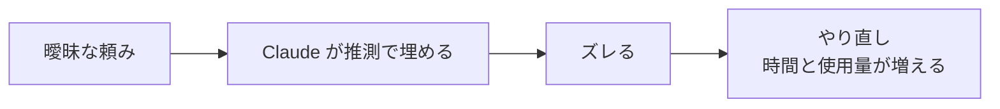

# 6-3 上手な頼み方

所要 25分 ／ 種類：作る

## 今日のゴール
- 曖昧な頼みと具体的な頼みで、Claude の動きがどう変わるかを見る
- 具体的な頼みの「4点セット」を使える
- 書ききれないときに「先に質問して」「先に計画を出して」と頼める

## ステップ

### 1. Claude は、足りないところを黙って埋める

- **前提**：Claude が知っているのは、渡された文章だけです（5-4）。あなたの頭の中は見えません
- **困りごと**：足りない部分は、Claude が**黙って推測で埋めます**。推測が外れると作り直しになり、時間も使用量も増えます（6-2）
- **解決**：決めてほしいことを、先に文章にして渡す。書ききれなければ「先に質問して」「先に計画を出して」と頼む
- たとえ：「おいしいものを買ってきて」より、「駅前のパン屋で、塩パンを2つ」のほうが一度で済みます

**確かめ**：「ToDoアプリを作って」とだけ頼んだとき、Claude が自分で決めないといけないことは？ ボタン：`ほとんど無い（ToDoアプリの形は決まっている）` / `置き場所・見た目・保存のしかたなど、たくさん`
<!-- 先生用：たくさん（どこに作るか、ファイル名、言語、見た目、消せるか、ページを閉じたら消えるか、スマホ向けか）。間違えたら「あなたがアプリ屋さんなら、作る前に何を聞きたい？」と言い直し、2〜3個並べて見せる -->

### 2. 曖昧に頼んでみる（作るのは Claude）
**やってみよう**：あなたがこの会話に、次の2つを順に送ります。
1. まず曖昧な頼み
   > ToDoアプリを作って
2. できたら、続けてこう聞く
   > いま作るときに、あなたが勝手に決めたことを全部、箇条書きで教えて。

<!-- 先生用：ここは「作るのは Claude」の箇所。曖昧なまま作ってよいが、置き場所だけは playground/ の中にする（CLAUDE.md のルール）。2つ目の質問には、場所・ファイル名・機能・見た目など、推測で決めたことを正直に並べる -->

### 3. 具体的な頼みの4点セット
| 要素 | 例 |
|---|---|
| 場所・ファイル名 | `playground/ask2/` の `todo.html` に |
| 期待する結果 | ボタンを押すとタスクが1行増える |
| 制約 | 外部ライブラリは使わない。ファイルは1つだけ |
| 例 | 「買い物」と入力 → 一覧に「買い物」が出る |

**やってみよう**：4点セットを入れて、頼み直します（作るのは Claude）。
> playground/ask2/todo.html に、ToDoアプリを作って。外部ライブラリなし、ファイル1つだけ。テキストを入力してボタンを押すと一覧に追加される。例：「買い物」と入力→一覧に「買い物」。

できたら、ステップ2と同じく「勝手に決めたことを全部教えて」と聞いて、1回目と比べてください。

**確かめ**：4点セットの「例」は、何のために書く？ ボタン：`完成のイメージを、具体的に1つ見せるため` / `頼みを長くして、丁寧に見せるため`
<!-- 先生用：完成のイメージを見せるため。Claude も、その例どおりに動くかで自分の出来を確かめられる。間違えたら「『塩パン』を見せずに『しょっぱいパン』と言うと、何が届きそう？」と言い直す -->

### 4. 先に質問させる（作るのは Claude）
- 全部を自分で書ききるのは大変です。**足りない部分を Claude に聞いてもらう**と、自分でも考えていなかったことに気づけます

**やってみよう**：この会話で送ります。
> playground/pomodoro/ にポモドーロタイマー（25分作業・5分休憩をくり返すタイマー）を作りたい。作る前に、必要なことを3つだけ質問して。

質問に答えてから、作ってもらってください。

### 5. 先に計画を出させる（作るのは Claude）
- 作り始めてから直すより、**作る前の計画で直すほうが安い**です。くわしい仕組み（プランモード）は 6-6 でやります

**やってみよう**：この会話で送ります。
> playground/ask3/ に、天気の絵文字を表示するページを作りたい。まずやる手順だけ書いて。私がOKと言うまでファイルは作らないで。

計画を読んで、**直したいところを1つ**伝えてから、OK を出してください。

## チェック
`/check`：`playground/ask2/todo.html` があり、ステップ4か5のどちらかを実際に試せていたら合格。

## AIとの関係
Claude は「頼まれたこと」を実行します。頼みが曖昧だと、**黙って推測で埋めます**。「何を決めたか教えて」と聞く癖をつけると、裏側が見えます。全部を完璧に書く必要はありません。**「先に質問して」と頼むのが、いちばん簡単な近道**です。
