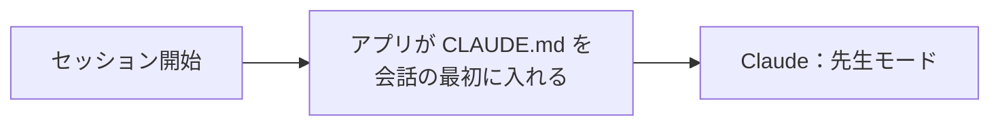
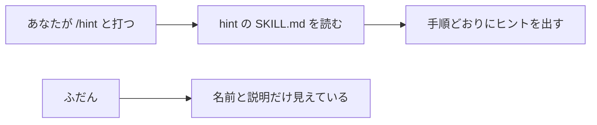

# 6-4 CLAUDE.md とスキル

所要 30分 ／ 種類：作る

## 今日のゴール
- あなたの「先生」が先生らしく振る舞う理由を、**設定ファイルを読んで**確かめる
- 毎回読まれる `CLAUDE.md` と、呼んだときだけ読まれるスキルの違いが分かる
- 自分用の小さなスキルを作って使う

## ステップ

### 1. 毎回読ませる取扱説明書：CLAUDE.md

- **前提**：Claude は、新しい会話（セッション）のたびに、何も覚えていない状態で始まります（5-4）
- **困りごと**：「答えを書かないで」「日本語で」のような決まりを、毎回自分で頼み直すことになります
- **解決**：決まりを**ファイルに書いておき、会話の最初にアプリが自動で読ませる**。それが `CLAUDE.md` です（`.md` は Markdown：簡単な記号で書く文章の形式）
- たとえ：新人に毎朝口頭で説明する代わりに、机に置いておく取扱説明書

**確かめ**：「いつも日本語で、短く答えて」を、会話の中で1回だけ頼みました。明日、新しい会話を始めたら？ ボタン：`ずっと効いている` / `もう効いていない`
<!-- 先生用：もう効いていない。会話で頼んだことは、その会話の中だけ。CLAUDE.md なら毎回最初に読まれるので、どの会話でも効く。間違えたら「明日の新人にも、今日の口頭説明は届く？」と言い直す -->

### 2. 先生の正体を読む
**やってみよう**：この会話で、次の文を送ってください。読んで表にするのは Claude の仕事です。
> このリポジトリの CLAUDE.md と .claude/skills/hint/SKILL.md を読んで、先生の振る舞いがどの行から来ているか、対応を表にして。

表ができたら、次の3つを表の中で探してください。
- 「課題の答えを書かない」はどこ？
- 毎回、最後にボタンが出るのはどこ？
- `/hint` が3回目で「ほぼ答え」を出すのはどこ？

**これが、先生がそう振る舞う理由です。** 先生は特別なAIではなく、Claude に説明書を読ませているだけです。

### 3. 必要なときだけ読む手順書：スキル

- **前提**：`CLAUDE.md` は、毎回**全部**、会話の最初に入ります
- **困りごと**：めったに使わない長い手順まで書くと、毎回場所を取ります。会話に入る量には上限があり、長いほど大事な指示も埋もれます（5-4、くわしくは 6-8）
- **解決**：手順は別のファイル（**スキル**、`SKILL.md`）に分ける。ふだんは**名前と説明だけ**を見せておき、`/名前` で呼ばれたとき（や Claude が必要と判断したとき）に全文を読む
- たとえ：机の上の取扱説明書（CLAUDE.md）と、棚にしまってある作業マニュアル（スキル）。背表紙だけ見えていて、要るときに取り出します

| | 何？ | いつ読まれる？ |
|---|---|---|
| `CLAUDE.md` | プロジェクトの取扱説明書 | セッションの最初に、毎回 |
| スキル（`SKILL.md`） | 手順書。`/名前` で呼べる | 呼んだとき（や Claude が必要と判断したとき）だけ |

**確かめ**：月に1回しか使わない「請求書の作り方」の長い手順。どこに書く？ ボタン：`CLAUDE.md` / `スキル`
<!-- 先生用：スキル。CLAUDE.md に書くと、使わない日も毎回読まれて、場所（コンテキスト）と使用量を食い、大事な決まりが埋もれる。間違えたら「机の上に、月1回のマニュアルを毎日全部広げておく？」と言い直す -->

### 4. 自分のスキルを作る（作るのは Claude）
お題：「今日の学びを3行にまとめて」と呼べるスキル。

**やってみよう**：この会話で、次の文を送ってください。
> playground/my-skill/SKILL.md に、「/learned」というスキルを作って。会話を振り返って、今日学んだことを3行の箇条書きにして、最後に次に試すことを1つ書く。名前と説明のヘッダー（frontmatter）も付けて。

できたら、`playground/my-skill/SKILL.md` を開いて読んでください。
- 先頭の `---` で囲まれた部分が **frontmatter**（front＝前、matter＝中身。ファイルの頭に付ける情報）です
- `name` と `description` があるか確認します。`description` は「いつ使うか」を書く場所です

### 5. 使ってみる、置き場所を知る
**やってみよう**：この会話で、次の文を送ってください。
> playground/my-skill/SKILL.md の手順どおりにやって

3行にまとまれば成功です。

`/learned` と打つだけで呼べるようにするには、決まった場所に置きます。

| 置き場所 | 効く範囲 |
|---|---|
| `プロジェクト/.claude/skills/名前/SKILL.md` | そのプロジェクトだけ（チームで共有もできる） |
| `~/.claude/skills/名前/SKILL.md` | 自分の全プロジェクト（`~` はホームフォルダ） |

- `CLAUDE.md` も同じで、プロジェクト用と、自分用（全体用）があります
- **コースの先生の設定（`.claude/`）は書き換えず、置くなら個人用（`~/.claude/skills/`）に**。置いたあと、新しいセッションで使えるようになることが多いです
- 個人用フォルダへの書き込みは許可ダイアログが出ます。何を書くのかを確認してから許可してください

## チェック
`/check`：`playground/my-skill/SKILL.md` があり、`name` と `description` が書かれていて、ステップ2の表を説明できたら合格。

## AIとの関係
Claude の「性格」や「やり方」の多くは、読ませている文章で決まります。説明書を読めれば、AIの振る舞いを**直せる側**に回れます。
