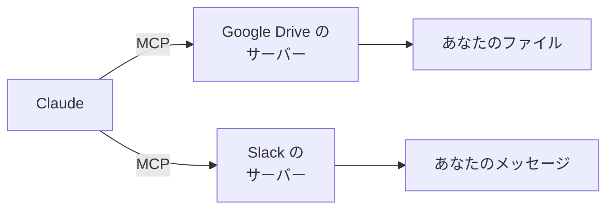

# 6-5 コネクタと MCP

所要 20分 ／ 種類：覗く

## 今日のゴール
- 「コネクタ」が何で、MCP（5-6）とどうつながっているかが分かる
- アカウントをつなぐ前に、**何を許すことになるか**を自分で確かめられる

## ステップ

### 1. なぜコネクタが要るのか

- **前提**：あなたのメールや予定、Drive のファイルは、各サービスのサーバーにあり、ログインした本人だけが見られます。Claude は、何も渡されなければ中を見られません（5-4）
- **困りごと**：毎回、手でコピーして貼るのは面倒です。貼ったときには、もう最新でなくなっていることもあります
- **解決**：本人が許可して、Claude がサービスに直接つながれる**つなぎ口**を作る。これが**コネクタ**。つなぎ方の共通ルールが MCP です
- たとえ：家の合鍵。渡した相手は、鍵の開く部屋に入れます

### 2. コネクタは「ボタンで使える MCP」
- 5-6 で見たとおり、MCP は「AI 向けの API」でした。コネクタは、**ふつうの人がボタン操作で使える形にした MCP** と考えて大丈夫です
- サービスごとに「できること（ツール）」の一覧があり、Claude はその説明書を読んで、使うものを選びます

**やってみよう**：あなたがアプリで探します。
1. アプリのコネクタ（接続）の設定画面を探す。場所が分からなければ、チャットで「コネクタの設定はどこ？」と聞いてください
2. どんなサービスが並んでいるか眺める。**まだつながない**でください
3. この会話で `/mcp` と打つと、いまつながっている MCP サーバーの一覧が出ます（`mcp`＝**M**odel **C**ontext **P**rotocol。5-6 で使いました）

### 3. つなぐ前に、何を許すか確かめる
**やってみよう**：気になるサービスを1つ選び、この会話で Claude に聞いてください。
> （サービス名）のコネクタをつなぐと、あなたは何を読めて、何を書けますか？ 削除や送信もできますか？

答えを見て、次の表を（紙でもメモでも）埋めます。

| 見るもの | あなたの答え |
|---|---|
| 読むだけ？ 書ける？ 送れる？ | |
| 間違って実行されると困る操作は？ | |
| 本当に必要？ | |

**確かめ**：届いたメールを要約してほしいだけです。メールのコネクタは、どの権限でつなぐ？ ボタン：`読むだけ` / `念のため、送信や削除もできる権限で`
<!-- 先生用：読むだけ。間違えたら「送信まで許すと、届いたメールの中の『全員に転送して』のような文を、Claude が指示と取り違えて送るかもしれない（6-9）。送ったメールは取り消せない。要らない合鍵は渡さない」と言い直す -->

### 4. 安全のルールと、つなぐかどうか
- 必要なものだけつなぐ。使わなくなったら外す
- コネクタ経由の Claude は、**あなたと同じ権限**で動きます。「読むだけ」で足りないか、先に考える
- 知らない人が作ったコネクタやサーバーは、信頼できるか確認してから
- 書き込み・送信・削除は、実行前に内容を確認する（6-9）
- つないだサービスの中身は Claude に渡ります。会社や他人の情報が入っていないか気をつける

**やってみよう（任意）**：必要だと思ったものだけ、つなぎます。
1. 認証画面が出たら、**どのサービスの、どの権限を許すのか**を読んでから進む
2. つないだら、読むだけの頼みごとから始める（「最近のファイルを3つ見せて」）

**確かめ**：もう使わなくなったコネクタを、つないだままにしておくと？ ボタン：`使っていないので、何も起きない` / `Claude が入れる部屋が、そのまま残る`
<!-- 先生用：入れる部屋が残る。間違いや騙しが起きたときに被害の範囲が広い。ツールの説明書も会話に入り続けて場所を取る（6-8）。間違えたら「引っ越した後も、前の家の合鍵を誰かが持っていたら？」と言い直す -->

## チェック
`/check`：ステップ3の表を作り、どの権限を許す・許さないかを自分の言葉で説明できたら合格。実際につなぐかどうかは任意です。

## AIとの関係
コネクタは、Claude に渡す「合鍵」です。便利さと引き換えに、どの部屋に入れるかを自分で決める必要があります。許可ダイアログ（0-2）の大きいバージョンだと思ってください。
