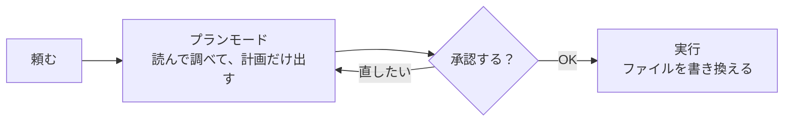
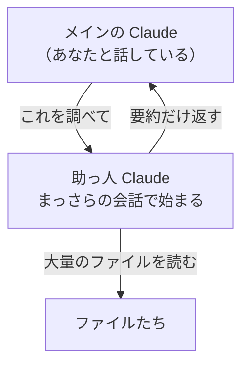

# 6-6 プランモードとサブエージェント

所要 25分 ／ 種類：作る

## 今日のゴール
- 「実行する前に計画を見て、承認する」流れを体験する
- Claude が「助っ人 Claude」に仕事を分ける仕組み（サブエージェント）が分かる
- 助っ人にもコストがかかるので、いつ使うかは判断だと分かる

## ステップ

### 1. プランモード：作る前に設計図を見る

- **前提**：Claude は、ハーネスの道具で、実際にファイルを書き換えます（5-5）
- **困りごと**：方向が違うまま作り始めると、作ったものが全部無駄になります。6-3 で「計画を先に出して」と頼んだのは、これを防ぐためでした
- **解決**：毎回頼まなくても、**書き換えずに計画だけ出す**モードに切り替えられます。これが**プランモード**。あなたが承認して、初めて実行に進みます
- たとえ：家を建てる前の設計図。壁を立てる前なら、直すのは紙の上だけで済みます

**確かめ**：ボタンの色を1か所だけ変えたいとき、プランモードは要る？ ボタン：`要る（いつも計画を先に見る）` / `要らない（やり直しても安い）`
<!-- 先生用：要らない。1行直すだけなので、計画を挟むほうが手間。プランモードが効くのは、やり直しが高くつく大きな作業。間違えたら「1行の修正にも設計図を描く？」と言い直す -->

### 2. プランモードで作る（作るのは Claude）
**やってみよう**：あなたがアプリで操作します。
1. プロンプト欄の近くにある**許可のモード**の選択を探し、「プラン」を選ぶ（分からなければ「プランモードにするには？」と聞いてください）
2. この会話で送る
   > playground/plan/ に、自分の読んだ本を記録する小さなWebページを作りたい。計画を立てて。
3. 出てきた計画を読み、**直したいところを1つ**伝える（例：「評価を星5つで入れたい」）
4. 計画に納得したら承認する。Claude が作ったら、ページを開いて見る
5. 終わったら、許可のモードを元に戻す

### 3. サブエージェント：調べものは助っ人に

- **前提**：Claude が読んだものは、すべて会話（コンテキスト）に残ります。会話に入る量には上限があります（5-4）
- **困りごと**：大量のファイルを調べさせると、会話が調べものの中身で埋まり、あなたの大事な指示が埋もれます
- **解決**：調べものを**別の Claude（助っ人）に任せ、要約だけ受け取る**。これが**サブエージェント**（sub＝下の、agent＝代わりに動く者）です。Claude が自分の判断で呼びます
- たとえ：資料室に調べに行く部下。分厚い資料は持ち帰らず、メモだけ渡してくれます

**確かめ**：助っ人は**まっさらな会話**で始まり、あなたとメインの Claude の会話は見えません。そのせいで起きやすいことは？ ボタン：`事情を知らず、ズレた調べものをする` / `メインの会話を読み直して、遅くなる`
<!-- 先生用：ズレた調べもの。だからメインの Claude が「何を、なぜ、どこまで調べるか」を指示にきちんと書いて渡す。6-3 の「頼み方」が、Claude どうしの間でも大事になる。間違えたら「助っ人には会話が見えない。今日入ったばかりの部下に、会議に出ていない話を頼むのと同じ」と言い直す -->

### 4. 助っ人に調べてもらう
**やってみよう**：この会話で送ってください。
> このリポジトリの lessons フォルダ全体から、「git」について書かれているレッスンを探して、場所を一覧にして。調べる部分は助っ人（サブエージェント）に任せて。

画面に、助っ人が調べている表示が出るか見てください。

### 5. 助っ人にもコストがかかる
- 助っ人も Claude なので、**助っ人ごとに使用量がかかります**。しかも、メインの会話と同じ枠から引かれます
- 助っ人は毎回、事情の説明（指示）を読むところから始めます
- だから、いつも呼べばよいわけではありません

| 助っ人が向いている | 向いていない |
|---|---|
| たくさんのファイルを調べて、結果だけ欲しい | ファイルを1つ読むだけ |
| 別々の調べものを同時に進めたい | 会話の流れを知らないとできない仕事 |

## チェック
`/check`：`playground/plan/` にページがあり、計画に1つ直しを入れたことと、サブエージェントのメリット・デメリットを説明できたら合格。

## AIとの関係
「いきなり作る」は速いけれど、方向が違うと全部やり直しです。計画を見て承認する習慣は、**AIに任せる側の仕事**です。助っ人を呼ぶかどうかも、同じく判断の対象です。
