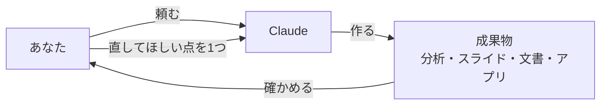
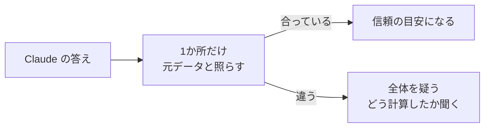

# 6-7 作ってみる

所要 30分 ／ 種類：作る

## 今日のゴール
- Claude に**データ分析・スライド・文書・小さなアプリ**を作らせる
- できたものを**1か所だけ自分で確かめて**、1つ直しを頼む
- 「作る人」ではなく「確かめて直す人」になる練習をする

## ステップ

### 1. 準備：材料のデータを用意する（Claude がやる）

- 作るのは Claude、**確かめて直させるのはあなた**。この往復が、今日の中身です

**やってみよう**：この会話で、次の文を送ってください。
> playground/make/ を作って、lessons/06-claude/07-make-things/sales.csv をコピーして。

できたら `playground/make/sales.csv` を開いて、中を見てください。カフェ2店舗の、4月第1週の売上データです（日付・店・商品・数量・価格）。CSV（**C**omma-**S**eparated **V**alues：カンマで区切った表）は 2-5 で見ました。

### 2. Claude の「できました」を、どう確かめる？

- **前提**：Claude は「ありそうな答え」を出しています（5-1）。計算を実行して確かめたとは限りません
- **困りごと**：見た目が整っていても、数字が違う、言い過ぎている、動かない、があり得ます。しかも自信満々です（5-7）
- **解決**：全部ではなく、**1か所だけ自分で元データと照らす**。1か所合っていれば、残りへの信頼の目安になります

| 作ったもの | 確かめ方 |
|---|---|
| 分析 | 1行だけ手計算する。「どう計算した？」と聞く |
| スライド・文書 | 数字を1つ、元データと照らす。言い過ぎていないか読む |
| アプリ | 実際に開いて操作する。「できました」を信じない（1-6） |

**確かめ**：1か所だけ照らしたら、合っていました。それで「全部正しい」と言える？ ボタン：`言える` / `言えない`
<!-- 先生用：言えない。でも、間違いが無い可能性はぐっと上がる。大事な数字（人に出す合計など）は、もう1か所照らす。違っていたら、その時点で全体を疑う。間違えたら「テストで1問だけ採点して丸だったら、満点？」と言い直す -->

### 3. 分析を作って、1か所検算する（全員、作るのは Claude）
**やってみよう**：この会話で、次の文を送ってください。
> sales.csv を分析して。店ごと・商品ごとの売上合計（数量×価格）と、いちばん売れた日を出して。結果を playground/make/analysis.md にまとめて。

できたら、あなたの番です。
1. **1か所だけ検算する**：`sales.csv` で「4/5 渋谷のコーヒー」の行を探し、数量×価格を電卓で計算する
2. Claude に「その数字は、どう計算した？」と聞く
3. 直しを1つ頼む（例：「紅茶だけ別に集計して」）

### 4. もう1つ選んで作る（作るのは Claude）
どれも**「作ってもらう → 確かめる → 1つ直しを頼む」**です。1つ選んで、この会話で送ってください。

**A. スライド**
> sales.csv を元に、4月第1週の売上を報告する3枚のスライドを playground/make/ に作って。見た目はシンプルに。
- 確かめ：数字は CSV と合っている？ 1枚に文字を詰め込みすぎていない？
- 直し：「3枚目をグラフ中心にして」など、1つだけ

**B. 文書**
> sales.csv を見て、店長向けに1ページの週報を playground/make/report.md に書いて。
- 確かめ：書いてあることは、本当にデータから言える？（言い過ぎていない？）
- 直し：「もっと短く」「箇条書きを減らして」など

**C. 小さなアプリ**
> sales.csv を読んで、店ごとの売上を棒グラフで表示するページを playground/make/chart.html に作って。ブラウザで見られるようにして。
- 確かめ：ブラウザで開く。棒の高さは、ステップ3の分析と合っている？
- 直し：「色を店ごとに変えて」など

## チェック
`/check`：`playground/make/` に、`sales.csv` 以外のファイルが2つ以上あり、それぞれ1つ直しを頼んでいたら合格。

## AIとの関係
作る作業は Claude がやります。**正しいかを見るのは人間の仕事**です。数字を1つ検算するだけで、AIの出力を信頼できるかの感覚が育ちます。確かめは「全部」でなく「1か所」から、で十分です。
