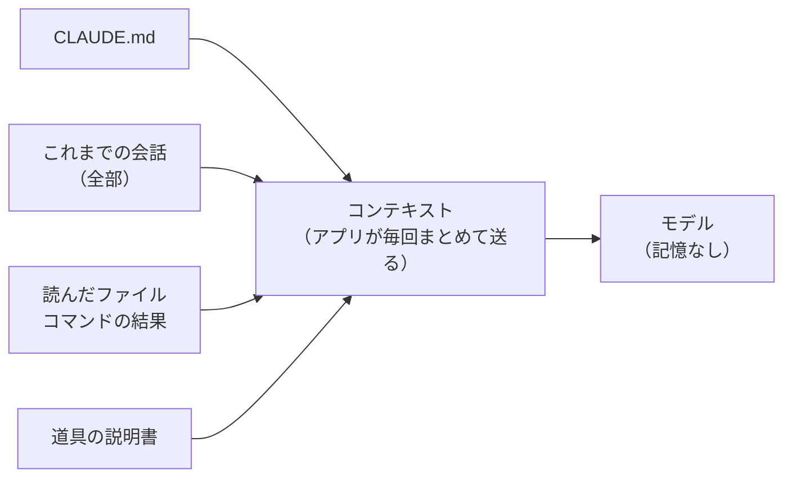
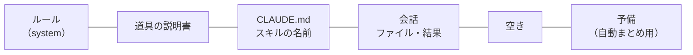
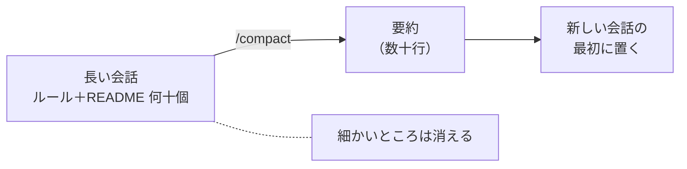
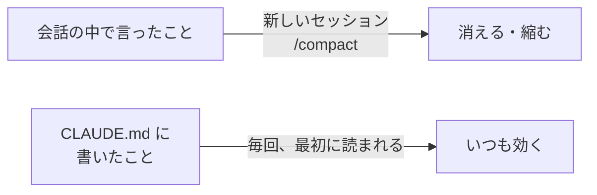

# 6-8 コンテキストと使用量

所要 20分 ／ 種類：覗く

## 今日のゴール
- Claude Code の中で、**記憶が無いこと**と、**コンテキストが埋まっていく様子**を自分の目で見る
- 会話を詰め込みすぎると、なぜ細かいことを忘れたり、間違えたりするのかが分かる
- 新しいセッション・`/compact`・`CLAUDE.md` を、場面に合わせて使い分けられる

第5部（5-4・5-4b）では「モデルは覚えていない」「毎回、会話を全部送り直している」「入れ物には上限があり、溢れると忘れる」を確かめました。今日は、同じことを **Claude Code の中で**確かめます。

## ステップ

### 1. おさらい：毎回、全部を送り直している

- **前提**：モデルは会話を覚えていません。呼ばれるたびに、まっさらです（5-4）
- **困りごと**：それでは「さっきの話」が通じません
- **解決**：アプリ（ハーネス、5-5）が、毎回**これまでの全部**をまとめて送り直しています。この送る中身全体が**コンテキスト**、入れ物の上限が**コンテキストウィンドウ**です
- Claude Code では、会話だけでなく、読んだファイルやコマンドの結果も、全部コンテキストに積もっていきます

### 2. 記憶が無いのを確かめる
新しいセッション（別の会話）を1つ作って、実験に使います。**先生のいるこのセッションは、きれいなまま残しておきます。**

**やってみよう**：あなたがアプリで操作します。
1. この会話（先生のセッション）に、次の文を送る
   > 合言葉は「みかん」です。メモやファイルには書かず、この会話の中だけで覚えておいて。
2. アプリのサイドバーで**新しいセッション**を作る。フォルダは、このコースと同じフォルダを選ぶ（やり方が分からなければ、ここで聞いてください）
3. 新しいセッション（これからは**実験セッション**と呼びます）で、こう聞く
   > 私が決めた合言葉は何？ それと、私はいま何のレッスンをやっている？
4. 答えを見たら、サイドバーでこのセッションに戻って、`やった` を押す

<!-- 先生用：合言葉を progress.md やメモに書かないこと（実験が壊れる）。実験セッションの答えは、受講者に教えてもらう（先生からは見えない） -->

**確かめ**：実験セッションは、合言葉は知らないのに、レッスンの場所は答えられました。なぜ？ ボタン：`レッスンの場所は、ファイル（progress.md）に書いてあるから` / `Claude が、あなたのことを前から覚えているから`
<!-- 先生用：ファイルにあるから。合言葉は先生のセッションの会話の中にしか無く、新しいセッションには送られない。レッスンの場所は progress.md、先生らしさは CLAUDE.md から、新しいセッションでも読めた。間違えたら「覚えているなら、合言葉も知っているはず。覚えて見えるものは、全部どこかのファイルから読んでいる」と言い直す。結果が違ったとき（合言葉を知っていた等）は聞かずに、自動メモ（記憶のファイル）に書かれていないか一緒に調べる。それもやはり「ファイルから読んだ」例 -->

### 3. コンテキストの中身を見る：`/context`

- 図は、コンテキストウィンドウ（入れ物）の中の場所取りです。左から埋まっていきます

**やってみよう**：この会話（先生のセッション）で `/context` と打ってください（`context`＝文脈。いま Claude に渡している中身）。入れ物のどこが何で埋まっているかが出ます。

| 表示（英語） | 意味 |
|---|---|
| System prompt | アプリが最初に渡すルール |
| System tools / MCP tools | 道具の説明書（MCP は 5-6、6-5） |
| Memory files | `CLAUDE.md` など |
| Skills | スキルの名前と説明（6-4） |
| Messages | 会話。読んだファイルやコマンドの結果も、ここに入る |
| Free space | 空き |
| Autocompact buffer | 自動で会話をまとめるための予備 |

<!-- 先生用：デスクトップアプリの版によっては /context が使えないことがある。その場合は、プロンプト欄の近くにある使用量の表示（円や％）を探す。どちらも無ければ、図だけで説明して進む -->

### 4. 実験セッションに詰め込む
実験セッションで、会話を一気に大きくしてみます。**この実験は、ふだんの会話の数十回ぶんの使用量を使います。** 気になる人は、手順2の「全部」を「第5部と第6部の README だけ」にしてください。

**やってみよう**：実験セッションで、順に送ります。
1. ルールを決める
   > この会話のルール：返事の最後に必ず「ござる」を付けて。合言葉は「りんご」。
2. `/context` と打って、**Messages の数字を覚えておく**
3. 詰め込む
   > lessons フォルダの README.md を全部、あなた自身で1つずつ読んで（助っ人は使わないで。lessons/06-claude/08-context-and-usage だけは読まないで）。要約は要らない。読み終わったら、読んだ数だけ言って。
4. もう一度 `/context`。Messages はどれくらい増えた？
5. 確かめの質問をする
   > ファイルを読み直さずに答えて：合言葉は？ それと、6-7 のレッスンで検算に使う行は、何日の、どの店の、何の行？
6. 答えと、最後に「ござる」が付いていたかを覚えて、このセッションに戻って `やった` を押す

<!-- 先生用：期待：Messages が大きく増える（数万トークン）。手順5は、まだ全部コンテキストに入っているので、ほぼ正しく答えられる（合言葉は「りんご」、4/5 渋谷のコーヒー）。ただ「ござる」が抜け始めることがある。抜けていたら「大量の文章の中に、最初のルールが埋もれた」例としてほめる。実験セッションも CLAUDE.md と progress.md を読むので、先生のように振る舞ったり、6-8 の実験だと気づいたりすることがあるが、そのまま進めてよい -->

### 5. 溢れるとどうなる？：`/compact`

- **前提**：コンテキストウィンドウには上限があります（5-4b）
- **困りごと**：上限まで埋まると、それ以上は送れません。上限の手前でも、大量の文章に大事な指示が埋もれて、精度が落ちます
- **解決**：Claude Code は、空きが少なくなると、**それまでの会話を要約して、要約だけを持って続けます**。これが **compact**（ぎゅっと小さくまとめる）。`/compact` と打てば、自分でも起こせます
- ただし要約は「縮めた写し」です。**細かいところは消えます**

**やってみよう**：実験セッションで、順に送ります。いま、溢れたときと同じことを、自分で起こします。
1. `/compact` と打つ（少し時間がかかります）
2. `/context`。Messages はどうなった？
3. ステップ4の手順5と、まったく同じ質問を送る
4. 答えと「ござる」を覚えて、このセッションに戻って `やった` を押す

**もっとやりたい人へ（任意・使用量をかなり使います）**：実験セッションで「Python で playground/big.txt に、1行に『行番号と、ぶどう・もも・なしの短い文』を3万行書いて。それを最初から最後まで、助っ人を使わずに全部読んで」と頼むと、入れ物が本当に溢れて、Claude Code が**自動で**まとめる様子が見られます。

<!-- 先生用：期待：Messages が小さくなる。合言葉やルールは要約に残ることが多い（Claude Code の要約は、あなたの指示を残そうとする）。6-7 の細かい行は消えやすい。「分かりません、読み直します」と正直に言う場合と、それらしく間違える場合がある。間違えたら、それが「溢れてアホになった」瞬間。5-7 の「自信満々に間違える」とつなげる。うまく忘れなかった場合は、「今回は要約に残った。でも何が残るかは選べない」と伝える -->

**確かめ**：`/compact` のあと、6-7 の細かい行のような答えが消えたり怪しくなったりしやすいのは、なぜ？ ボタン：`要約に入りきらず、捨てられたから` / `時間がたって、モデルが忘れたから`
<!-- 先生用：要約に入りきらず捨てられたから。間違えたら「モデルはもともと何も覚えていない（ステップ1）。要約に無いことは、もう知りようがない」と言い直す。残ったものがあれば、それは「要約に選ばれた」から -->

### 6. 消えない記憶は、ファイルに書く：CLAUDE.md

- **前提**：会話で言ったことは、新しいセッションで消え、`/compact` で縮みます（ステップ2、5）
- **困りごと**：毎回守ってほしいルールまで、消えたり縮んだりします
- **解決**：ずっと守ってほしいことは、`CLAUDE.md` に書く（6-4）。セッションの最初にも、`/compact` のあとにも、**ファイルから読み直されます**
- 先生がずっと先生でいられるのも、ステップ2の実験セッションがレッスンの場所を知っていたのも、これです

**やってみよう**：
1. 先生のセッションで、次の文を送る（作るのは Claude）
   > playground/memory-test/CLAUDE.md に、「返事の最後に必ず『ござる』を付ける」と1行だけ書いて。
2. サイドバーで新しいセッションを作り、フォルダに `playground/memory-test` を選ぶ
3. 「こんにちは」と送る。次に `/compact`。もう一度「こんにちは」
4. このセッションに戻って `やった` を押す

<!-- 先生用：期待：どちらの返事にも「ござる」が付く。そのフォルダの上にあるコースの CLAUDE.md も読まれるので、先生っぽい返事になるのは正常（CLAUDE.md は、いるフォルダから上へたどって読まれる）。フォルダの選び方が分からなければ、Finder で選ぶ画面になる、と案内する -->

### 7. 日頃の使い分けと、使用量の確認
**やってみよう**：先生のセッションで `/usage` と打ってください（`usage`＝使用量）。いまどれくらい使ったか、上限まであとどれくらいかが出ます。ステップ4の実験で、増えたのが分かるかもしれません。

| やりたいこと | 方法 |
|---|---|
| 関係ない話に切り替える | 新しいセッション（`/clear`＝片付ける、でも同じ） |
| 続けたいが長くなった | `/compact`。大事な決定は先に書き出しておく |
| 何が場所を取っているか知りたい | `/context` |
| 使用量を見たい | `/usage` |
| ずっと守ってほしいルール | `CLAUDE.md` に書く |

- 1つのセッションは1つの目的
- 巨大なファイルは丸ごと読ませず、必要な部分だけ頼む。調べものは助っ人に（6-6）
- モデルを上げる前に、会話をきれいにする（6-2）
- **先生のセッションで `/clear` は打たないでください。** 今日の会話が消えます（`progress.md` があるので、レッスンの続きからは再開できます）

<!-- 先生用：/usage が出ない版なら、アプリの設定の使用量の画面を探してもらう。数字そのものは覚えなくてよい -->

## チェック
`/check`：実験セッションで `/context` の数字が増えるのを見て、`/compact` の前後で答えがどう変わったかを話せ、`playground/memory-test/CLAUDE.md` があれば合格。最後に「長い会話の問題を2つ」と「対処法を1つ」を自分の言葉で言えたら完了。

## AIとの関係
Claude は「覚えている」のではなく、**毎回、コンテキストの全部を読み直している**だけです。入れ物には上限があり、溢れれば要約され、細部は消えます。だから、会話を切る・まとめる・大事なことはファイルに書く。これが、AIを長く賢く働かせる人の習慣です。
