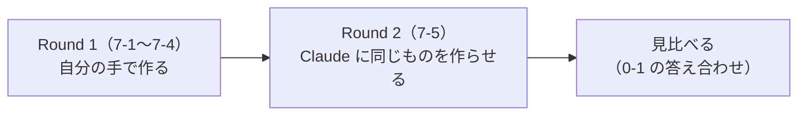
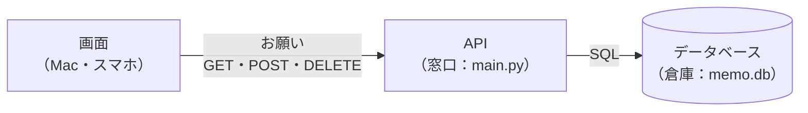
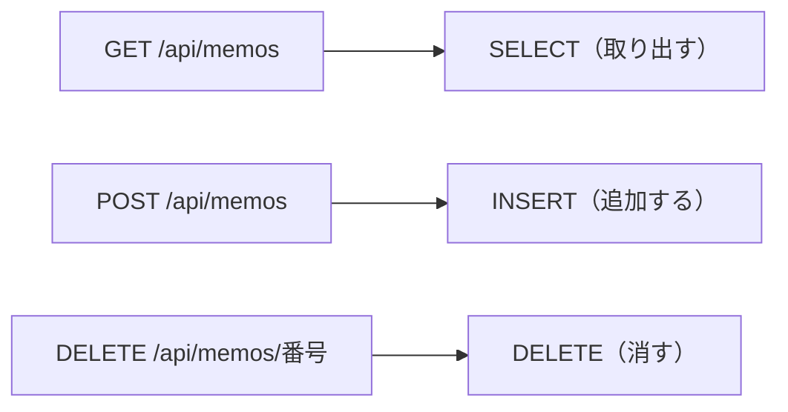

# 7-1 メモAPIを作る FastAPI＋SQLite

所要 40分 ／ 種類：作る

## 今日のゴール
- メモを「追加・一覧・削除」できる API を、自分の手で完成させる
- アプリを「画面・API・データベース」の3つに分ける理由を、自分の言葉で言える
- 同じメモを、`curl`・サーバーのログ・`sqlite3` の3か所から確かめる

## ステップ

### 1. 卒業制作でやること

- 0-1 では、Claude が5分で Webページを作るのを**眺めるだけ**でした
- 卒業制作では、同じような「メモアプリ」を、まず**自分の手で**作ります（Round 1）
- そのあと Claude に同じものを作らせて、見比べます（Round 2）
- 自分で作ったものなら、Claude が出すコードもコマンドも、全部読めるはずです

新しいことはほとんど出ません。ターミナル・Python・uv・FastAPI・SQLite の**復習のつもり**で大丈夫です。詰まったら `/hint` をどうぞ。

### 2. なぜ「画面・API・データベース」に分けるのか

- **前提**：プログラムが止まると、メモリの中のデータは全部消えます。そして画面（ブラウザ）は、使う人の手元で1台ずつ別々に動いています
- **困りごと**：メモを画面の中に持たせると、閉じたら消えます。Mac で書いたメモも、スマホの画面には出ません
- **解決**：役割で3つに分けます
  - **データベース**（SQLite）：ファイルに書く倉庫。プログラムが止まっても残る
  - **API**（FastAPI）：倉庫の窓口。「追加・一覧・削除」だけを、決まった言葉（URL＋動詞）で受け付ける
  - **画面**：窓口にお願いするだけ。Mac でもスマホでも、同じ窓口に頼めば同じメモが見える
- 今日は API とデータベースを作ります。画面は 7-2 です

**確かめ**：もし API を通さずに、画面が倉庫（`memo.db`）を直接さわれたら？ ボタン：`窓口が1つ減って、速くて便利になるだけ` / `誰でも全部消せるし、スマホの画面からは届かない`
<!-- 先生用：困る（誰でも勝手に消せる・壊せる、スマホから Mac のファイルに届かない）。間違えたら「お店の倉庫に、お客さんが直接入れたら？ 窓口は『決まったお願いだけ』受け付けるから安全で、どこからでも同じ方法で頼める」と言い直す -->

### 3. 作業場所を用意して、ライブラリを入れる
`playground/capstone/` が、今日から卒業制作の家です。

**やってみよう**：先生がターミナルを開きます。そこで順番に打ってください。

```bash
mkdir -p playground/capstone
cp -R lessons/07-capstone/01-api/starter/. playground/capstone/
cd playground/capstone
uv add fastapi uvicorn
cat pyproject.toml
```

| 部分 | 意味 |
|---|---|
| `mkdir -p` | `-p`＝parents。途中のフォルダもまとめて作る |
| `cp -R` | `-R`＝recursive（再帰的に）。フォルダの中身ごとコピー |
| `fastapi` | API を作る道具（3-8） |
| `uvicorn` | 作った API を、サーバーとして動かす道具 |

- `pyproject.toml` の `dependencies` に、2つ増えていれば成功です
- `uv.lock` というファイルもできます。入れたライブラリの**正確なバージョンの控え**です（7-3 の Docker で使います）

### 4. 埋める前に動かして、エラーを読む
`main.py` には `TODO 1`〜`TODO 3` という穴があります。埋める前に、わざと動かしてみます。

**やってみよう**：
1. 先生がサーバー用のタブを開いて、`uv run uvicorn main:app --port 8000 --reload` を動かします
   - `main:app`＝「`main.py` の中の `app`」を動かす
   - `--reload`＝ファイルを保存したら、自動で起動し直す
2. あなたのタブで `curl -s localhost:8000/api/memos` を打ちます
3. サーバーのタブに、赤いエラーが出ます。**最後の行**を読んでみましょう

- `'NoneType' object is not iterable`＝「中身が無いもの（None）を、1つずつ取り出そうとした」という意味です

### 5. TODO を埋める：お願いを SQL に訳す

- **前提**：API の仕事は、届いたお願い（URL＋動詞）を、倉庫の言葉（SQL、4-4）に**訳す**ことです
- **困りごと**：メモの文字を SQL の文に直接つなげると、メモに SQL の命令に見える文字を書かれたとき、それが**命令として実行されて**しまいます（4-8）
- **解決**：値は SQL の文に混ぜず、`?` の場所に**別に渡します**。データベースは `?` に入ったものを「ただの文字」として扱います

**やってみよう**：`vi main.py`（または好きな方法）で開いて、`TODO 1`〜`TODO 3` を埋めて保存します。
- `TODO 1`：全部のメモを、id の小さい順に取り出す
- `TODO 2`：メモを追加して、できた行の id を返す
- `TODO 3`：指定された id のメモを消す

保存すると、`--reload` のおかげでサーバーが自動で起動し直します。

### 6. curl で叩いて、ログを見る
**やってみよう**：あなたのタブで、1行ずつ打ちます。

```bash
curl -s -X POST localhost:8000/api/memos -H 'Content-Type: application/json' -d '{"text":"牛乳を買う"}'
curl -s localhost:8000/api/memos
curl -s -X DELETE localhost:8000/api/memos/1
curl -s localhost:8000/api/memos
```

| 部分 | 元の英語 | 意味 |
|---|---|---|
| `-s` | silent | 途中経過を出さない |
| `-X POST` | request（方式） | GET 以外の動詞で頼む |
| `-H` | header | 「中身は JSON です」という添え書き |
| `-d` | data | 送る中身 |

- 叩くたびに、サーバーのタブに `"POST /api/memos HTTP/1.1" 200 OK` のような行が増えます。これが**ログ**です
- 次に、ブラウザで `http://localhost:8000/docs` を開いてみましょう。FastAPI が自動で作った操作画面です

### 7. 倉庫を直接覗く
**やってみよう**：あなたのタブで次を打ちます。

```bash
ls
sqlite3 memo.db "select * from memos"
```

- `ls` で `memo.db` ができているのが見えます。これが倉庫のファイルです
- `sqlite3` で、API を通さずに中身を直接見られます（4-4）。消した1番は出てきません

**確かめ**：いま、1番のメモは消えています。ここでメモをもう1件追加すると、新しいメモの id は何番？ ボタン：`1番` / `2番`
<!-- 先生用：2番（1番は再利用されない。/docs で追加していたら「今までで一番大きい番号の次」）。CREATE TABLE の AUTOINCREMENT のため。答えのあと、ステップ6の1行目（文字は変えてOK）で実際に試してもらう。間違えたら「番号は、その1件の名札。使い回すと、古い『1番のメモ』へのリンクが別のメモを指してしまう」と言い直す -->

## チェック
`/check`：追加・一覧・削除が期待どおり動いたら合格。
（チェックは別のポートと別のデータベースで動くので、あなたのメモは消えません。サーバーは動かしたままで大丈夫です）

## AIとの関係
Claude が「API を作りました」と言うとき、中身はまさに今日のこれです。**URL・動詞（GET/POST/DELETE）・データベースへの SQL** の3つ。Claude が作ったコードを開いたら、この3つを探せば全体が読めます。
